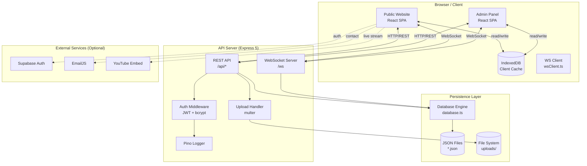
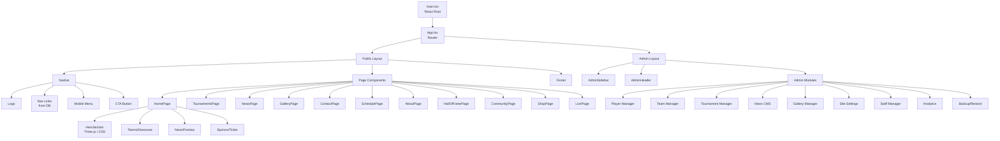
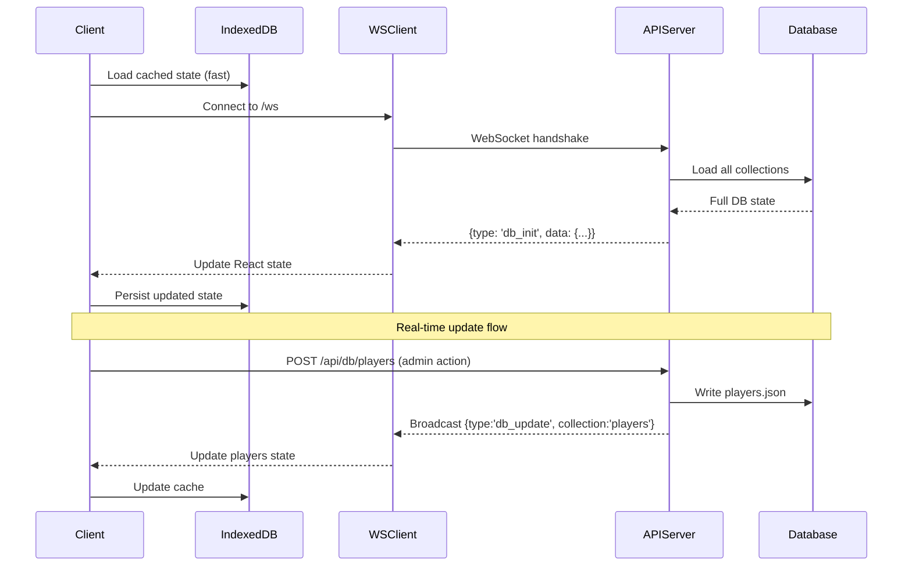
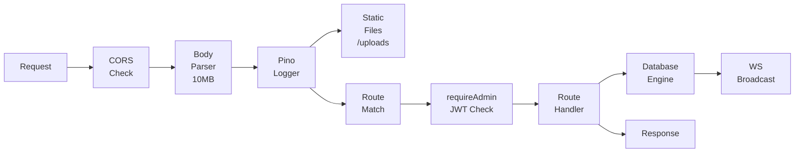
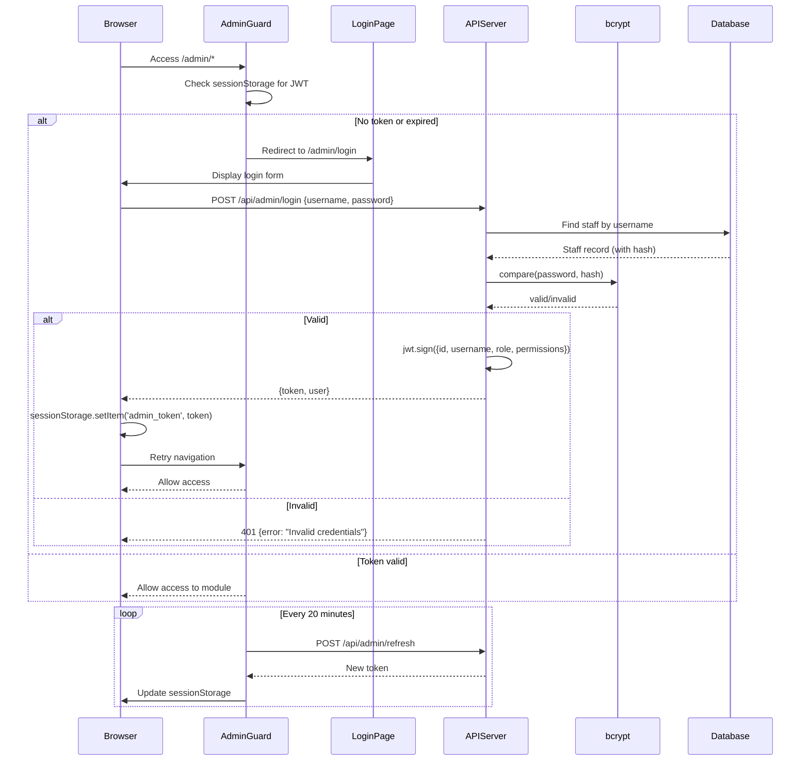
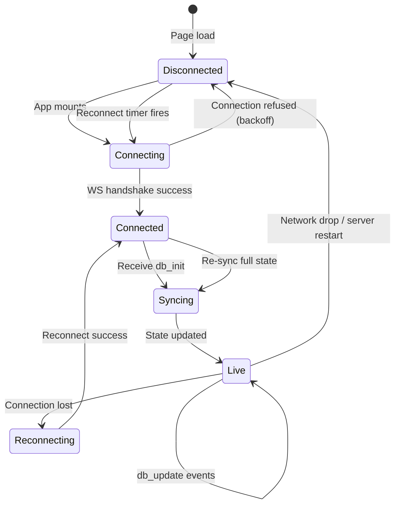
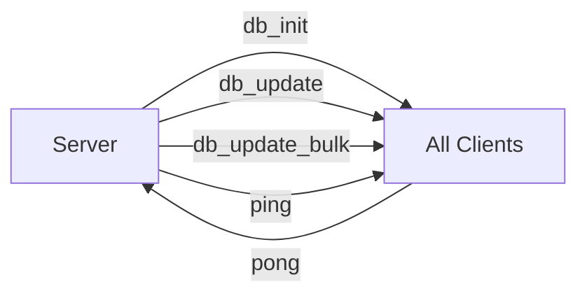
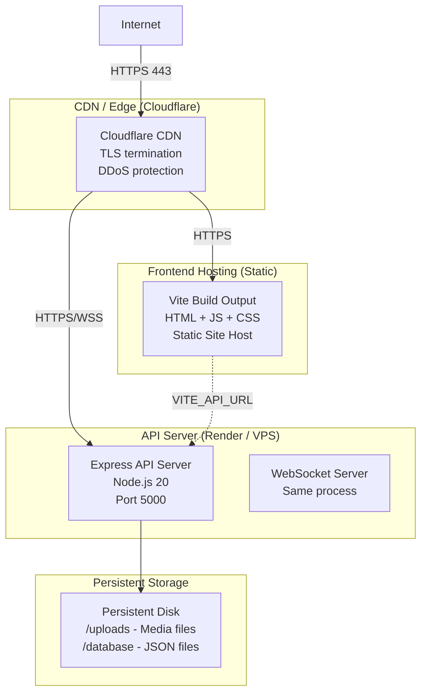
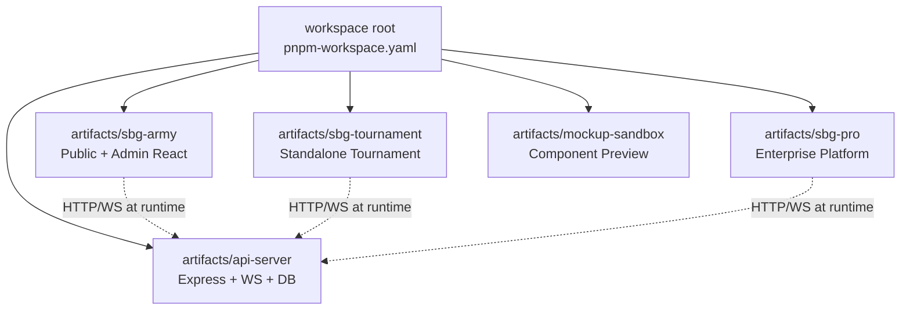

# System Architecture Document
## SBG ARMY Esports Platform

> **Version:** 3.0 | **Date:** July 2026

---

## 1. Architecture Overview

### 1.1 High-Level System Diagram



---

## 2. Frontend Architecture

### 2.1 Component Hierarchy



### 2.2 State Flow



### 2.3 Data Loading Strategy

```
Page Mount
    │
    ▼
Check IndexedDB cache
    │
  ┌─┴──┐
Hit   Miss
 │      │
 ▼      ▼
Render  Show
cached  skeleton
state   loader
 │      │
 └──┬───┘
    │
    ▼
Connect WebSocket
    │
    ▼
Receive db_init from server
    │
    ▼
Merge server state with local
(server is source of truth)
    │
    ▼
Re-render with fresh data
    │
    ▼
Persist to IndexedDB
    │
    ▼
Listen for db_update events
(incremental updates)
```

---

## 3. Backend Architecture

### 3.1 Express Middleware Pipeline



### 3.2 Database Engine Architecture

```mermaid
graph TB
    REQ[API Request] --> DBE[Database Engine]
    
    DBE --> CACHE[In-Memory Cache<br/>Map<string, Record[]>]
    
    CACHE --> READ{Read or Write?}
    
    READ -->|Read| RETURN[Return cached data]
    READ -->|Write| VALIDATE[Validate input]
    VALIDATE --> UPDATE[Update in-memory cache]
    UPDATE --> WRITE[Atomic file write<br/>*.json]
    WRITE --> BROADCAST[WS Broadcast<br/>db_update]
    BROADCAST --> CLIENTS[All WS Clients]
    
    subgraph Startup
        INIT[Server Start] --> LOAD[Load all JSON files<br/>into memory]
        LOAD --> CACHE
    end
```

---

## 4. Authentication Architecture

### 4.1 JWT Token Flow



---

## 5. WebSocket Architecture

### 5.1 Connection Lifecycle



### 5.2 Message Types



| Message Type | Direction | Payload | Description |
|-------------|-----------|---------|-------------|
| `db_init` | Server → Client | Full DB state | Sent on new connection |
| `db_update` | Server → Client | `{collection, data}` | Single collection updated |
| `db_update_bulk` | Server → Client | `{collections: {...}}` | Multiple collections updated |
| `ping` | Server → Client | `{}` | Keepalive |
| `pong` | Client → Server | `{}` | Keepalive response |

---

## 6. Data Flow Diagrams

### 6.1 Read Data Flow (Public Page)

```
User visits /tournaments
        │
        ▼
App.tsx loads TournamentsPage
        │
        ▼
useDatabase() hook
        │
    ┌───┴───┐
   IDB     WS
  Cache  Update
    │       │
    ▼       ▼
  Render  Re-render
 (fast)   (fresh)
        │
        ▼
Display tournaments list
with registration buttons
```

### 6.2 Write Data Flow (Admin Action)

```
Admin edits player in panel
        │
        ▼
Form submit
        │
        ▼
POST /api/db/players
{Authorization: Bearer <token>}
        │
        ▼
requireAdmin() middleware
verifies JWT
        │
        ▼
Handler validates payload
        │
        ▼
database.ts saves players.json
        │
        ▼
broadcast() sends db_update
to all WS connections
        │
    ┌───┴───────────┐
Admin tab        All other
updates          clients update
instantly        within 500ms
```

### 6.3 File Upload Data Flow

```
Admin uploads player image
        │
        ▼
POST /api/upload
multipart/form-data
{file, category: 'players'}
        │
        ▼
multer middleware
saves to /uploads/players/<uuid>.<ext>
        │
        ▼
Response: {url: '/uploads/players/<file>'}
        │
        ▼
Admin panel stores URL
in player record
        │
        ▼
POST /api/db/players
(update with image URL)
        │
        ▼
Public site renders
">
```

---

## 7. Deployment Architecture

### 7.1 Production Infrastructure



### 7.2 Request Routing

```
User Request: https://sbgarmy.gg/
    → CDN serves static React build
    → React router handles /*, /admin, etc.
    → SPA calls https://api.sbgarmy.gg/api/* for data
    → SPA connects WSS://api.sbgarmy.gg/ws for real-time
```

---

## 8. Security Architecture

### 8.1 Defense Layers

```
Internet Request
        │
        ▼
[Layer 1] TLS/HTTPS — Cloudflare/Load Balancer
        │
        ▼
[Layer 2] CORS — Only configured origins allowed
        │
        ▼
[Layer 3] Rate Limiting — Auth: 5/15min per IP
        │
        ▼
[Layer 4] JWT Verification — All /admin/* routes
        │
        ▼
[Layer 5] Role/Permission Check — Per module
        │
        ▼
[Layer 6] Input Validation — Zod schemas
        │
        ▼
[Layer 7] Output Sanitization — Strip passwords/tokens
        │
        ▼
Database Write / Response
```

---

## 9. Monorepo Structure

### 9.1 Workspace Graph



### 9.2 Shared Configuration

- TypeScript configuration: each workspace has its own `tsconfig.json`
- Tailwind: shared base config extended by each frontend workspace
- pnpm: version pinned via `.npmrc` + `packageManager` in root `package.json`

---

*Architecture Document v3.0 — SBG ARMY Esports Platform — July 2026*
