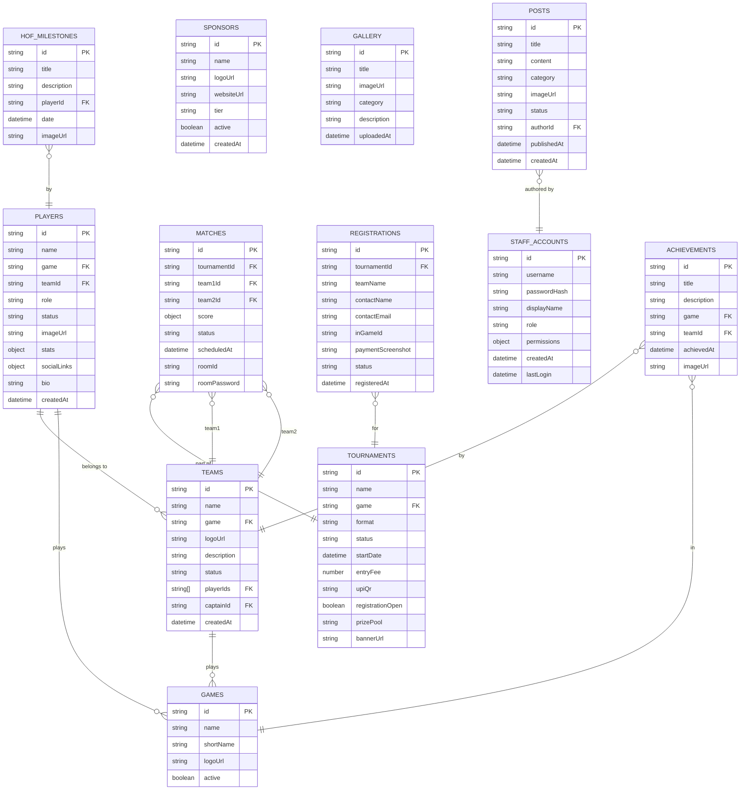

# Database Design Document
## SBG ARMY Esports Platform

> **Version:** 3.0 | **Date:** July 2026

---

## 1. Database Overview

### 1.1 Technology

The SBG ARMY platform uses a **custom JSON flat-file database** backed by Node.js filesystem operations. Each collection is stored as a separate JSON file in `artifacts/api-server/database/`.

| Attribute | Value |
|-----------|-------|
| Type | JSON flat-file (custom engine) |
| Location | `artifacts/api-server/database/*.json` |
| Engine | `database.ts` (custom) |
| In-memory cache | Yes (full DB loaded at startup) |
| Transactions | No (single writer, atomic file writes) |
| Indexing | None (in-memory array filter/find) |
| Client cache | IndexedDB (browser, via idb-keyval) |

### 1.2 Collection Registry

All collections must be registered in `ALL_COLLECTIONS` in `database.ts`:

```typescript
const ALL_COLLECTIONS = [
  // Core organization data
  'players', 'teams', 'matches', 'tournaments', 'registrations',
  // Content
  'posts', 'gallery', 'sponsors', 'games',
  // Community
  'contact_messages', 'fan_messages', 'giveaways', 'collab_requests',
  // People
  'creators', 'founders', 'staffAccounts', 'playerUsers',
  // Commerce
  'orders', 'shop',
  // Esports records
  'achievements', 'hofMilestones', 'trophies', 'teamRecords', 'teamSeasons', 'weeklyEvents',
  // System
  'settings', 'features', 'analytics', 'navigation', 'customCode',
  // Tournament (tnmt sub-system)
  'tnmt_tournaments', 'tnmt_registrations', 'tnmt_matches'
];
```

> ⚠️ **Critical:** Any collection NOT in this list will be silently skipped during bulk `saveDB()` operations, causing data loss.

---

## 2. Entity Relationship Diagram



---

## 3. Collection Schemas

### 3.1 `players`

Stores player profiles for the organization roster.

| Field | Type | Required | Description |
|-------|------|----------|-------------|
| `id` | string (UUID) | ✅ | Unique player identifier |
| `name` | string | ✅ | Display name / gamertag |
| `game` | string | ✅ | Game ID (references games collection) |
| `teamId` | string | ❌ | Team ID if assigned |
| `role` | string | ❌ | In-game role (e.g., "Fragger", "IGL", "Support") |
| `status` | enum | ✅ | `active`, `inactive`, `retired`, `tryout` |
| `imageUrl` | string | ❌ | Profile image URL |
| `bio` | string | ❌ | Player biography |
| `stats` | object | ❌ | Game-specific stats (kills, wins, KD, etc.) |
| `socialLinks` | object | ❌ | `{twitter, youtube, twitch, instagram}` |
| `country` | string | ❌ | Player's country (ISO code) |
| `joinDate` | datetime | ❌ | Date joined the organization |
| `createdAt` | datetime | ✅ | Record creation timestamp |
| `updatedAt` | datetime | ✅ | Last modification timestamp |

**Example Document:**
```json
{
  "id": "plr_abc123",
  "name": "ShadowX",
  "game": "game_bgmi",
  "teamId": "team_alpha",
  "role": "IGL",
  "status": "active",
  "imageUrl": "/uploads/players/shadowx.webp",
  "bio": "Top IGL in the BGMI circuit with 3 years experience.",
  "stats": {
    "kills": 1250,
    "winRate": 0.68,
    "kd": 3.2,
    "matchesPlayed": 180
  },
  "socialLinks": {
    "youtube": "https://youtube.com/@shadowx",
    "instagram": "https://instagram.com/shadowx_gaming"
  },
  "country": "IN",
  "joinDate": "2024-03-15",
  "createdAt": "2024-03-15T10:00:00Z",
  "updatedAt": "2026-07-01T08:30:00Z"
}
```

---

### 3.2 `teams`

Stores esports team information.

| Field | Type | Required | Description |
|-------|------|----------|-------------|
| `id` | string | ✅ | Unique team identifier |
| `name` | string | ✅ | Team name |
| `game` | string | ✅ | Game ID |
| `logoUrl` | string | ❌ | Team logo URL |
| `bannerUrl` | string | ❌ | Team banner/cover image |
| `description` | string | ❌ | Team description |
| `status` | enum | ✅ | `active`, `inactive`, `disbanded` |
| `playerIds` | string[] | ❌ | Array of player IDs |
| `captainId` | string | ❌ | Player ID of captain |
| `coachId` | string | ❌ | Player ID of coach |
| `founded` | string | ❌ | Year founded |
| `achievements` | string[] | ❌ | Array of achievement IDs |
| `createdAt` | datetime | ✅ | Record creation timestamp |

---

### 3.3 `matches`

Stores match records, schedules, and results.

| Field | Type | Required | Description |
|-------|------|----------|-------------|
| `id` | string | ✅ | Unique match identifier |
| `tournamentId` | string | ❌ | Associated tournament (if any) |
| `team1Id` | string | ✅ | First team ID |
| `team2Id` | string | ✅ | Second team ID |
| `team1Name` | string | ✅ | First team display name |
| `team2Name` | string | ✅ | Second team display name |
| `score` | object | ❌ | `{team1: number, team2: number}` |
| `status` | enum | ✅ | `scheduled`, `live`, `completed`, `cancelled` |
| `scheduledAt` | datetime | ✅ | When match is scheduled |
| `game` | string | ✅ | Game being played |
| `format` | string | ❌ | Match format (BO1, BO3, BO5) |
| `roomId` | string | ❌ | Custom room ID |
| `roomPassword` | string | ❌ | Room password |
| `streamUrl` | string | ❌ | Live stream URL |
| `result` | string | ❌ | Winner team ID |
| `notes` | string | ❌ | Admin notes |
| `createdAt` | datetime | ✅ | Record creation |

---

### 3.4 `tournaments`

Stores tournament configurations.

| Field | Type | Required | Description |
|-------|------|----------|-------------|
| `id` | string | ✅ | Unique tournament identifier |
| `name` | string | ✅ | Tournament display name |
| `game` | string | ✅ | Game ID |
| `format` | enum | ✅ | `single_elimination`, `double_elimination`, `round_robin`, `group_stage` |
| `status` | enum | ✅ | `upcoming`, `registration`, `active`, `completed`, `cancelled` |
| `startDate` | datetime | ✅ | Tournament start date |
| `endDate` | datetime | ❌ | Tournament end date |
| `registrationDeadline` | datetime | ❌ | Registration close time |
| `entryFee` | number | ❌ | Entry fee in INR (0 = free) |
| `prizePool` | string | ❌ | Prize pool description |
| `upiId` | string | ❌ | UPI ID for payment |
| `upiQrUrl` | string | ❌ | QR code image URL |
| `maxTeams` | number | ❌ | Maximum registered teams |
| `registrationOpen` | boolean | ✅ | Whether registration is active |
| `bannerUrl` | string | ❌ | Tournament banner image |
| `rules` | string | ❌ | Tournament rules (markdown) |
| `bracket` | object | ❌ | Generated bracket structure |
| `createdAt` | datetime | ✅ | Record creation |

---

### 3.5 `registrations`

Stores tournament registration submissions.

| Field | Type | Required | Description |
|-------|------|----------|-------------|
| `id` | string | ✅ | Unique registration identifier |
| `tournamentId` | string | ✅ | Associated tournament |
| `teamName` | string | ✅ | Registering team name |
| `contactName` | string | ✅ | Contact person name |
| `contactEmail` | string | ✅ | Contact email |
| `contactPhone` | string | ❌ | Contact phone number |
| `inGameId` | string | ✅ | Primary in-game ID/UID |
| `members` | object[] | ❌ | Team members `[{name, inGameId}]` |
| `paymentScreenshot` | string | ❌ | URL to payment proof image |
| `paymentStatus` | enum | ✅ | `pending`, `verified`, `rejected` |
| `registrationStatus` | enum | ✅ | `pending`, `approved`, `rejected`, `waitlisted` |
| `roomIdSent` | boolean | ❌ | Whether room ID has been shared |
| `adminNotes` | string | ❌ | Admin review notes |
| `registeredAt` | datetime | ✅ | Submission timestamp |
| `reviewedAt` | datetime | ❌ | When admin reviewed |
| `reviewedBy` | string | ❌ | Staff ID who reviewed |

---

### 3.6 `posts`

Stores news articles and announcements.

| Field | Type | Required | Description |
|-------|------|----------|-------------|
| `id` | string | ✅ | Unique post identifier |
| `title` | string | ✅ | Article headline |
| `slug` | string | ✅ | URL-safe slug (derived from title) |
| `content` | string | ✅ | Article body (HTML/Markdown) |
| `excerpt` | string | ❌ | Short summary for listing pages |
| `category` | string | ❌ | Category tag (News, Announcement, Update) |
| `imageUrl` | string | ❌ | Cover image URL |
| `status` | enum | ✅ | `draft`, `published` |
| `featured` | boolean | ❌ | Whether to feature on homepage |
| `authorId` | string | ❌ | Staff account ID |
| `authorName` | string | ❌ | Display name of author |
| `tags` | string[] | ❌ | Content tags |
| `views` | number | ❌ | View counter |
| `publishedAt` | datetime | ❌ | Publication timestamp |
| `createdAt` | datetime | ✅ | Record creation |
| `updatedAt` | datetime | ✅ | Last modification |

---

### 3.7 `sponsors`

Stores sponsor/partner information.

| Field | Type | Required | Description |
|-------|------|----------|-------------|
| `id` | string | ✅ | Unique sponsor identifier |
| `name` | string | ✅ | Sponsor/brand name |
| `logoUrl` | string | ✅ | Sponsor logo URL |
| `websiteUrl` | string | ❌ | Sponsor website |
| `tier` | enum | ❌ | `title`, `gold`, `silver`, `bronze`, `partner` |
| `description` | string | ❌ | Partnership description |
| `active` | boolean | ✅ | Whether to display on site |
| `displayOrder` | number | ❌ | Sort order for display |
| `startDate` | datetime | ❌ | Partnership start |
| `endDate` | datetime | ❌ | Partnership end (null = ongoing) |
| `createdAt` | datetime | ✅ | Record creation |

---

### 3.8 `gallery`

Stores gallery images.

| Field | Type | Required | Description |
|-------|------|----------|-------------|
| `id` | string | ✅ | Unique image identifier |
| `title` | string | ✅ | Image title/caption |
| `imageUrl` | string | ✅ | Image URL |
| `thumbnailUrl` | string | ❌ | Thumbnail URL (if processed) |
| `category` | string | ❌ | Gallery category |
| `description` | string | ❌ | Image description |
| `tags` | string[] | ❌ | Searchable tags |
| `featured` | boolean | ❌ | Featured/pinned image |
| `uploadedBy` | string | ❌ | Staff ID who uploaded |
| `uploadedAt` | datetime | ✅ | Upload timestamp |

---

### 3.9 `staffAccounts`

Stores admin and staff user accounts.

| Field | Type | Required | Description |
|-------|------|----------|-------------|
| `id` | string | ✅ | Unique account identifier |
| `username` | string | ✅ | Login username (unique) |
| `passwordHash` | string | ✅ | bcrypt hash (NEVER returned in API responses) |
| `displayName` | string | ✅ | Display name in panel |
| `role` | enum | ✅ | `super_admin`, `admin`, `staff` |
| `permissions` | object | ❌ | Module permissions (staff only) |
| `email` | string | ❌ | Staff email |
| `avatarUrl` | string | ❌ | Profile image |
| `active` | boolean | ✅ | Account active status |
| `lastLogin` | datetime | ❌ | Last successful login |
| `loginCount` | number | ❌ | Total login count |
| `createdAt` | datetime | ✅ | Account creation |
| `createdBy` | string | ❌ | ID of creating admin |

**Security rule:** `passwordHash` is stripped from all API responses by `mergeSensitive()`.

**Permissions object schema:**
```json
{
  "players": true,
  "teams": false,
  "tournaments": true,
  "news": true,
  "gallery": false,
  "sponsors": false,
  "shop": false,
  "recruitment": true,
  "analytics": false
}
```

---

### 3.10 `settings`

Global platform configuration (singleton — one document per key).

| Field | Type | Description |
|-------|------|-------------|
| `siteName` | string | Organization name |
| `tagline` | string | Organization tagline |
| `logoUrl` | string | Main logo URL |
| `faviconUrl` | string | Favicon URL |
| `primaryColor` | string | CSS hex color |
| `secondaryColor` | string | CSS hex color |
| `accentColor` | string | CSS hex color |
| `backgroundColor` | string | CSS hex color |
| `fontFamily` | string | Primary font family |
| `heroTitle` | string | Homepage hero heading |
| `heroSubtitle` | string | Homepage hero subheading |
| `heroCta1Text` | string | Primary CTA button text |
| `heroCta1Url` | string | Primary CTA button URL |
| `heroCta2Text` | string | Secondary CTA button text |
| `heroCta2Url` | string | Secondary CTA button URL |
| `socialLinks` | object | `{twitter, youtube, instagram, discord, twitch}` |
| `contactEmail` | string | Organization contact email |
| `footerText` | string | Footer copyright text |
| `maintenanceMode` | boolean | Show maintenance page |
| `cookieConsentEnabled` | boolean | Show cookie banner |
| `analyticsEnabled` | boolean | Track page visits |
| `liveStreamUrl` | string | Current live stream URL |
| `liveStreamActive` | boolean | Whether live indicator shows |

---

### 3.11 `features`

Feature flags for toggling platform sections.

| Field | Type | Description |
|-------|------|-------------|
| `id` | string | Feature identifier |
| `name` | string | Display name |
| `enabled` | boolean | Feature on/off |
| `description` | string | What the feature controls |

**Example features:**
```json
[
  {"id": "shop", "name": "Shop", "enabled": true},
  {"id": "live", "name": "Live Stream", "enabled": false},
  {"id": "giveaway", "name": "Giveaways", "enabled": true},
  {"id": "recruitment", "name": "Recruitment", "enabled": true},
  {"id": "hall_of_fame", "name": "Hall of Fame", "enabled": true}
]
```

---

### 3.12 `analytics`

Page visit tracking data.

| Field | Type | Description |
|-------|------|-------------|
| `id` | string | Entry identifier |
| `page` | string | URL path visited |
| `timestamp` | datetime | Visit time |
| `userAgent` | string | Browser user agent |
| `referrer` | string | Referring URL |
| `country` | string | Visitor country (if available) |
| `sessionId` | string | Anonymous session ID |

---

### 3.13 `navigation`

Configurable navigation menu items.

| Field | Type | Description |
|-------|------|-------------|
| `id` | string | Item identifier |
| `label` | string | Display label |
| `url` | string | Target URL or path |
| `order` | number | Display order |
| `visible` | boolean | Show/hide item |
| `target` | string | `_self` or `_blank` |
| `icon` | string | Optional icon name |
| `children` | object[] | Dropdown sub-items |

---

### 3.14 `achievements` & `hofMilestones`

Esports achievement records.

**achievements:**
| Field | Type | Description |
|-------|------|-------------|
| `id` | string | Achievement identifier |
| `title` | string | Achievement title |
| `description` | string | Achievement description |
| `game` | string | Game ID |
| `teamId` | string | Team that achieved |
| `place` | string | Position (1st, 2nd, etc.) |
| `tournament` | string | Tournament name |
| `achievedAt` | datetime | Date of achievement |
| `imageUrl` | string | Trophy/medal image |

**hofMilestones:**
| Field | Type | Description |
|-------|------|-------------|
| `id` | string | Milestone identifier |
| `title` | string | Milestone title |
| `description` | string | Detailed description |
| `playerId` | string | Associated player |
| `playerName` | string | Player display name |
| `date` | datetime | Milestone date |
| `imageUrl` | string | Milestone image |
| `category` | string | Milestone type |

---

### 3.15 `contact_messages` & `fan_messages`

Inbound community messages.

**contact_messages:**
| Field | Type | Description |
|-------|------|-------------|
| `id` | string | Message identifier |
| `name` | string | Sender name |
| `email` | string | Sender email |
| `subject` | string | Message subject |
| `message` | string | Message content |
| `status` | enum | `unread`, `read`, `replied` |
| `submittedAt` | datetime | Submission time |

**fan_messages:**
| Field | Type | Description |
|-------|------|-------------|
| `id` | string | Message identifier |
| `name` | string | Fan name |
| `message` | string | Fan message |
| `gameTag` | string | Fan's in-game tag |
| `approved` | boolean | Whether to display publicly |
| `submittedAt` | datetime | Submission time |

---

### 3.16 `games`

Supported esports titles.

| Field | Type | Description |
|-------|------|-------------|
| `id` | string | Game identifier (e.g., `game_bgmi`) |
| `name` | string | Full game name |
| `shortName` | string | Abbreviated name (BGMI, PUBG, etc.) |
| `logoUrl` | string | Game logo URL |
| `active` | boolean | Whether game is actively played |
| `platform` | string | `mobile`, `pc`, `console` |

---

### 3.17 `shop`

Shop product listings.

| Field | Type | Description |
|-------|------|-------------|
| `id` | string | Product identifier |
| `name` | string | Product name |
| `description` | string | Product description |
| `price` | number | Price in INR |
| `imageUrl` | string | Product image |
| `category` | string | Product category |
| `stock` | number | Available stock (-1 = unlimited) |
| `active` | boolean | Whether listed |
| `createdAt` | datetime | Listing creation |

---

### 3.18 `customCode`

Custom CSS/JS injection (singleton).

| Field | Type | Description |
|-------|------|-------------|
| `css` | string | Custom CSS to inject in `<head>` |
| `js` | string | Custom JavaScript to inject before `</body>` |
| `updatedAt` | datetime | Last modification |
| `updatedBy` | string | Staff ID who modified |

---

### 3.19 Tournament Sub-System (`tnmt_*`)

Used by the standalone `sbg-tournament` site.

**tnmt_tournaments:**
Same schema as `tournaments` but prefixed to avoid conflicts.

**tnmt_registrations:**
Same schema as `registrations`.

**tnmt_matches:**
Same schema as `matches` with additional bracket position fields:
| Field | Type | Description |
|-------|------|-------------|
| `round` | number | Bracket round number |
| `position` | number | Match position in round |
| `bracketSide` | string | `winner` or `loser` (double elim) |

---

## 4. Data Relationships

```
players ──────────────── teams (many-to-one: player belongs to team)
players ──────────────── games (many-to-one: player plays game)
teams ─────────────────── games (many-to-one: team plays game)
matches ────────────────── tournaments (many-to-one: match in tournament)
matches ────────────────── teams ×2 (many-to-one: match has two teams)
registrations ──────────── tournaments (many-to-one: registration for tournament)
achievements ───────────── teams (many-to-one: achievement by team)
achievements ───────────── games (many-to-one: achievement in game)
hofMilestones ─────────── players (many-to-one: milestone by player)
posts ──────────────────── staffAccounts (many-to-one: article by staff)
```

> **Note:** All relationships are maintained by storing IDs as string fields. There is no foreign key enforcement — referential integrity is maintained by application logic.

---

## 5. Data Validation Rules

| Collection | Validation Rules |
|------------|-----------------|
| players | `name` required, `status` must be valid enum |
| teams | `name` required, `game` must reference valid game |
| matches | `team1Id` ≠ `team2Id`, `status` must be valid enum |
| tournaments | `startDate` must be valid ISO date, `entryFee` ≥ 0 |
| registrations | `contactEmail` must be valid email format |
| posts | `title` required, `status` must be `draft` or `published` |
| staffAccounts | `username` unique, `role` must be valid enum |
| settings | Singleton pattern — update by key, not create |

---

## 6. Backup & Restore Format

```json
{
  "version": "3.0",
  "timestamp": "2026-07-21T12:00:00Z",
  "platform": "sbg-army",
  "collections": {
    "players": [...],
    "teams": [...],
    "matches": [...],
    "tournaments": [...],
    "registrations": [...],
    "posts": [...],
    "gallery": [...],
    "sponsors": [...],
    "games": [...],
    "settings": {...},
    "features": [...],
    "navigation": [...],
    "staffAccounts": [...],
    "analytics": [...],
    "achievements": [...],
    "hofMilestones": [...],
    "trophies": [...],
    "weeklyEvents": [...],
    "contact_messages": [...],
    "fan_messages": [...],
    "orders": [...],
    "shop": [...],
    "customCode": {...},
    "creators": [...],
    "founders": [...]
  }
}
```

---

## 7. Migration Path to PostgreSQL

When migrating from JSON flat-file to PostgreSQL, the following schema is recommended:

```sql
-- Core tables follow the same field structure as JSON collections
-- All IDs should use UUID type
-- timestamps use TIMESTAMPTZ
-- JSON/JSONB columns for flexible nested objects (stats, permissions, etc.)

CREATE TABLE players (
  id UUID PRIMARY KEY DEFAULT gen_random_uuid(),
  name VARCHAR(100) NOT NULL,
  game VARCHAR(50) REFERENCES games(id),
  team_id UUID REFERENCES teams(id),
  role VARCHAR(50),
  status VARCHAR(20) CHECK (status IN ('active','inactive','retired','tryout')),
  image_url TEXT,
  bio TEXT,
  stats JSONB DEFAULT '{}',
  social_links JSONB DEFAULT '{}',
  country CHAR(2),
  join_date DATE,
  created_at TIMESTAMPTZ DEFAULT NOW(),
  updated_at TIMESTAMPTZ DEFAULT NOW()
);

-- Similar tables for all other collections...
-- Indexes on frequently queried fields:
CREATE INDEX idx_players_game ON players(game);
CREATE INDEX idx_players_team ON players(team_id);
CREATE INDEX idx_players_status ON players(status);
CREATE INDEX idx_matches_tournament ON matches(tournament_id);
CREATE INDEX idx_matches_status ON matches(status);
CREATE INDEX idx_posts_status ON posts(status);
CREATE INDEX idx_posts_published ON posts(published_at);
```

---

*Database Design Document v3.0 — SBG ARMY Esports Platform — July 2026*
