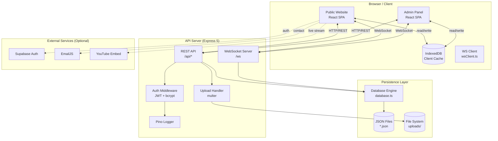
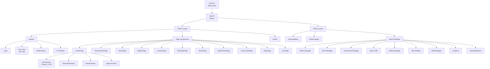
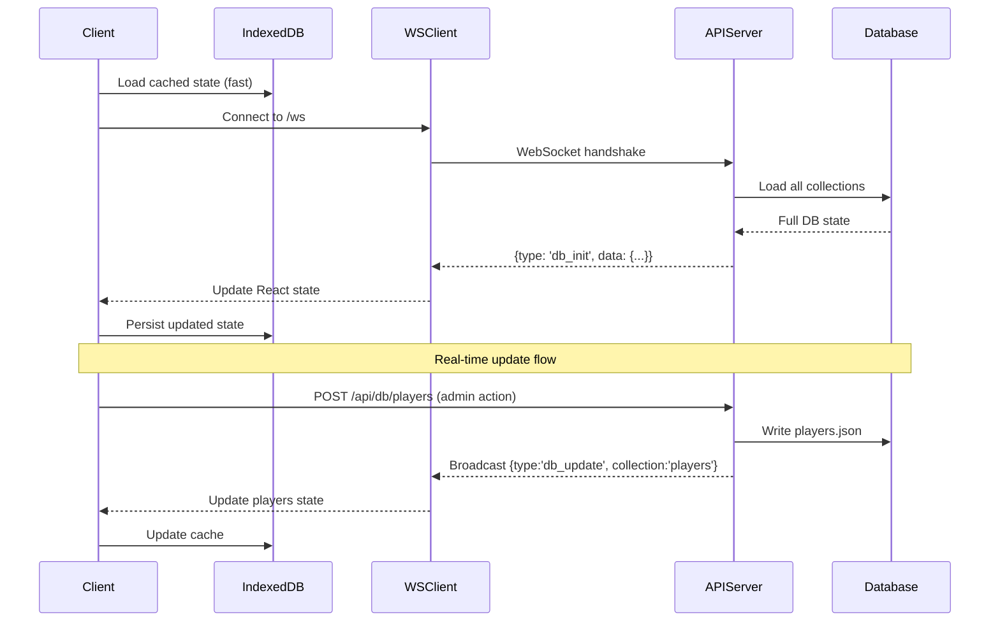
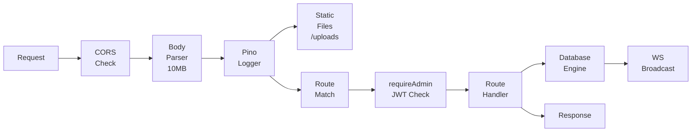
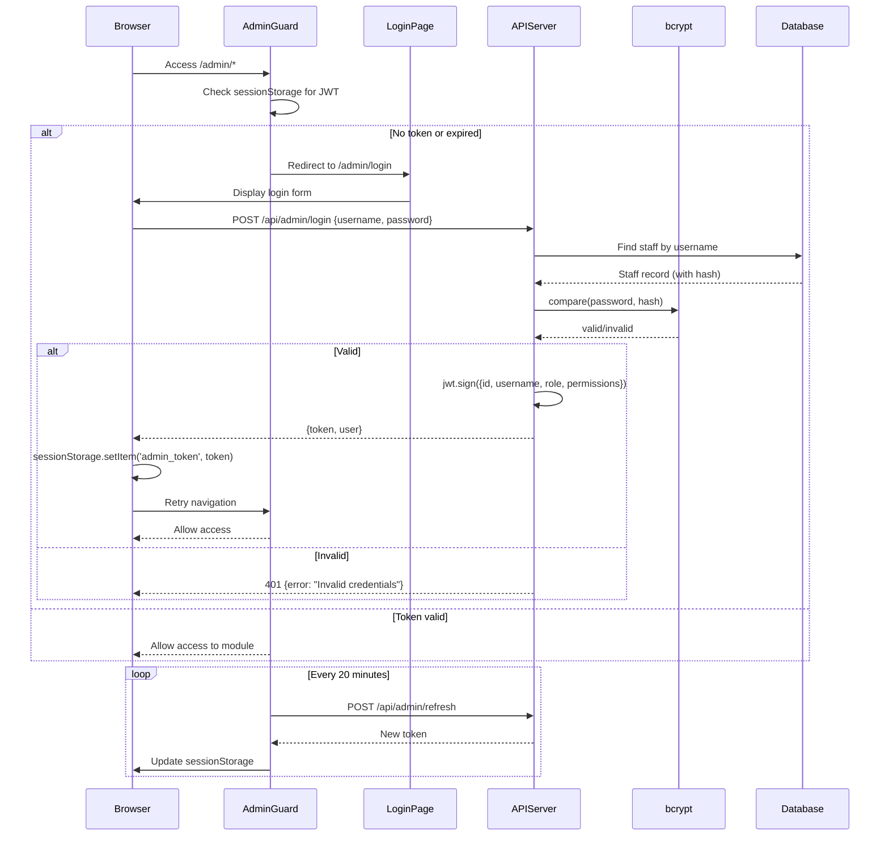
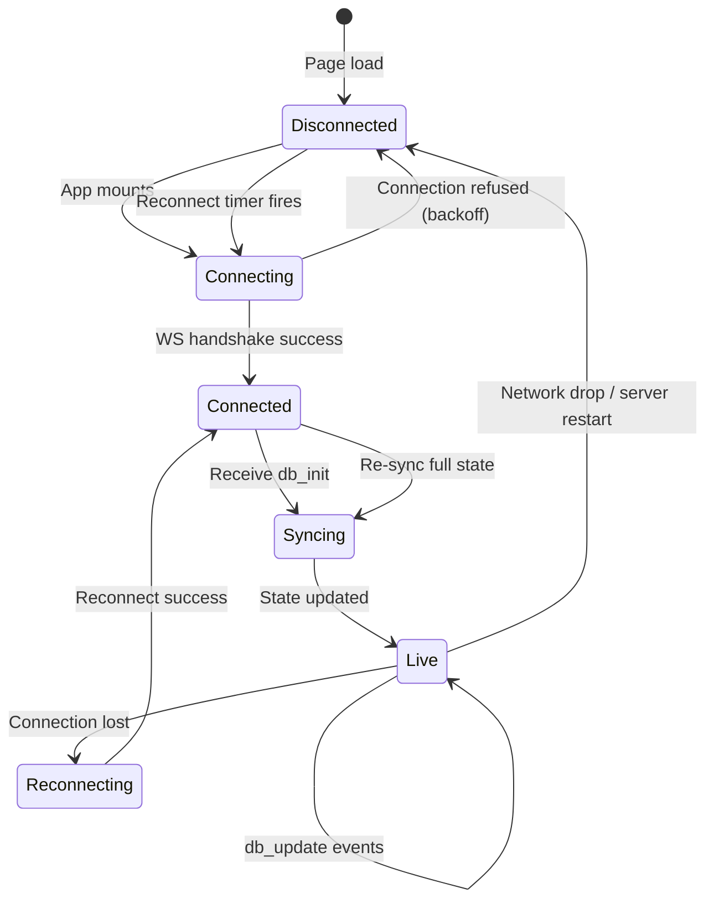
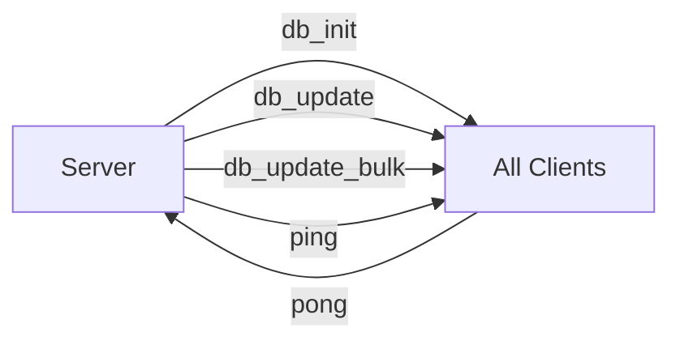
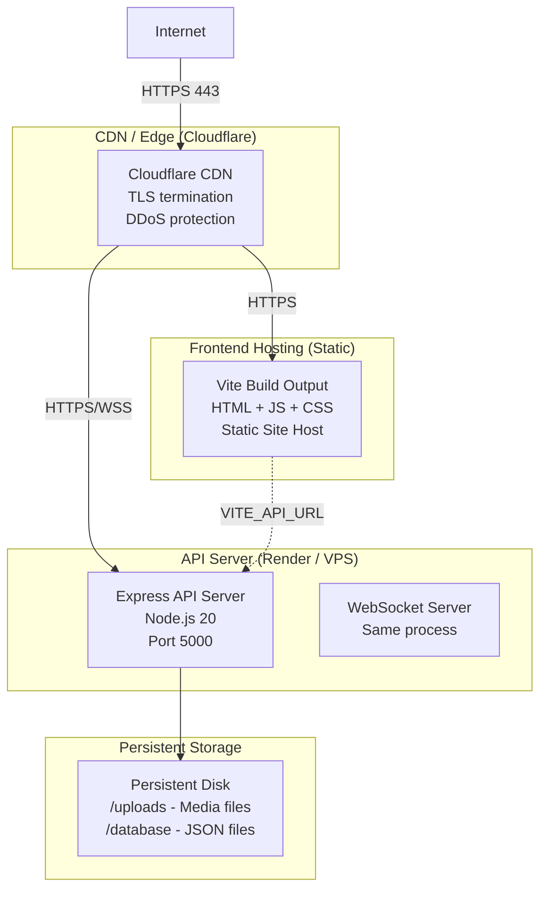
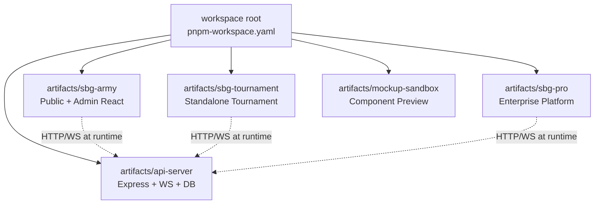
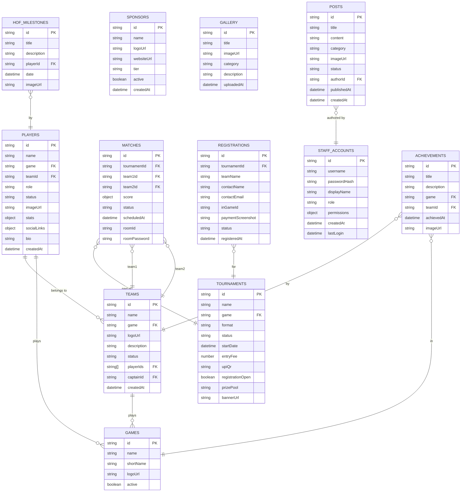

# SBG ARMY ESPORTS PLATFORM
# COMPLETE DOCUMENTATION SUITE
---
> **Version:** 3.0 | **Date:** July 2026 | **Classification:** Internal  
> **Total Documents:** 14 | **Format:** Single-file combined reference

---

## NAVIGATION

1. [MASTER INDEX](#master-index)
2. [PRODUCT REQUIREMENTS DOCUMENT](#product-requirements-document)
3. [TECHNICAL REQUIREMENTS DOCUMENT](#technical-requirements-document)
4. [SOFTWARE REQUIREMENTS SPECIFICATION](#software-requirements-specification)
5. [SYSTEM ARCHITECTURE](#system-architecture)
6. [DATABASE DESIGN](#database-design)
7. [API REFERENCE](#api-reference)
8. [UI/UX DESIGN SYSTEM](#uiux-design-system)
9. [ADMIN PANEL SPECIFICATION](#admin-panel-specification)
10. [DEPLOYMENT GUIDE](#deployment-guide)
11. [SECURITY DOCUMENTATION](#security-documentation)
12. [TESTING GUIDE](#testing-guide)
13. [MAINTENANCE GUIDE](#maintenance-guide)
14. [FEATURE ROADMAP & CHANGELOG](#feature-roadmap--changelog)
15. [BRAND GUIDELINES](#brand-guidelines)

---


====================================================================================================

<a name="master-index"></a>

# PART 1 — MASTER INDEX

---

# SBG ARMY Esports Platform — Master Documentation Index

> **Enterprise Documentation Suite** | Version 3.0 | Last Updated: July 2026

---

## Overview

SBG ARMY is a full-stack esports organization management platform featuring a public-facing website, an administrative control panel, real-time database synchronization, a tournament engine, player/team management, CMS, shop, analytics, and more.

---

## Documentation Map

| # | Document | Description | Est. Pages |
|---|----------|-------------|------------|
| 1 | [PRD — Product Requirements Document](PRD.md) | Vision, goals, personas, user stories, features, roadmap | ~90 |
| 2 | [TRD — Technical Requirements Document](TRD.md) | Architecture, stack, APIs, DB, auth, deployment, performance | ~120 |
| 3 | [SRS — Software Requirements Specification](SRS.md) | Functional & non-functional requirements, use cases, constraints | ~60 |
| 4 | [ARCHITECTURE — System Architecture](ARCHITECTURE.md) | Frontend, backend, data flow, Mermaid diagrams | ~40 |
| 5 | [DATABASE — Database Design](DATABASE.md) | All collections, fields, indexes, relationships, ER diagrams | ~35 |
| 6 | [API — API Reference](API.md) | Every endpoint, request/response, auth, error codes | ~60 |
| 7 | [UI-UX — Design System](UI-UX.md) | Colors, typography, components, animations, breakpoints | ~40 |
| 8 | [ADMIN-PANEL — Admin Specification](ADMIN-PANEL.md) | Every admin module, CRUD, roles, permissions | ~50 |
| 9 | [DEPLOYMENT — Deployment Guide](DEPLOYMENT.md) | Hosting, CI/CD, env vars, SSL, domain, rollback | ~30 |
| 10 | [SECURITY — Security Document](SECURITY.md) | Auth, rules, rate limiting, XSS/CSRF, validation | ~35 |
| 11 | [TESTING — Testing Guide](TESTING.md) | Unit, integration, UI, security, performance tests | ~30 |
| 12 | [MAINTENANCE — Maintenance Guide](MAINTENANCE.md) | Monitoring, logging, backup, restore, troubleshooting | ~25 |
| 13 | [ROADMAP — Feature Roadmap & Changelog](ROADMAP.md) | V1–V5 history, upcoming features, priorities | ~20 |
| 14 | [BRAND — Brand Guidelines](BRAND.md) | Logo, colors, fonts, esports identity, sponsor placement | ~20 |

---

## Quick-Start for Developers

```bash
# Clone and install
git clone <repo-url>
cd sbg-army
pnpm install

# Environment setup
cp artifacts/api-server/.env.example artifacts/api-server/.env
cp artifacts/sbg-army/.env.example artifacts/sbg-army/.env

# Start all services
pnpm --filter @workspace/api-server run dev   # API on :5000
pnpm --filter @workspace/sbg-army run dev     # Frontend on :3000
```

> **Full setup instructions:** See [DEPLOYMENT.md](DEPLOYMENT.md)

---

## Platform Architecture Summary

```
┌─────────────────────────────────────────────────────┐
│              SBG ARMY ESPORTS PLATFORM              │
├──────────────────────┬──────────────────────────────┤
│   PUBLIC WEBSITE     │      ADMIN PANEL             │
│   React + Wouter     │   JWT-Protected SPA          │
│   Framer Motion      │   18+ Management Modules     │
│   Three.js Hero      │   Real-time DB Sync          │
├──────────────────────┴──────────────────────────────┤
│              API SERVER (Express 5)                 │
│   REST Endpoints + WebSocket (ws)                   │
│   JWT Auth (bcryptjs) + Role-Based Access           │
├─────────────────────────────────────────────────────┤
│         JSON FLAT-FILE DATABASE (Node.js)           │
│   IndexedDB Client Cache + WS Broadcast Sync        │
└─────────────────────────────────────────────────────┘
```

---

## Key Technologies

| Layer | Technology |
|-------|-----------|
| Frontend Framework | React 18 + Vite |
| Routing | Wouter |
| Styling | Tailwind CSS + shadcn/ui (Radix UI) |
| Animations | Framer Motion + Three.js |
| Charts | Recharts |
| Backend | Express 5 + Node.js |
| Real-time | WebSocket (ws library) |
| Auth | JWT + bcryptjs |
| Persistence | JSON flat-file + IndexedDB client cache |
| Logging | Pino |
| Package Manager | pnpm (workspace monorepo) |

---

## Repository Structure

```
/
├── artifacts/
│   ├── api-server/          # Express API + JSON database
│   ├── sbg-army/            # Main public + admin React app
│   ├── sbg-tournament/      # Standalone tournament site
│   └── sbg-pro/             # Enterprise platform
├── docs/                    # ← You are here
│   ├── README.md            # This file
│   ├── PRD.md
│   ├── TRD.md
│   └── ...
└── package.json             # Workspace root
```

---

*Documentation generated July 2026. For the most current state, re-run documentation generation against the latest codebase.*


====================================================================================================

<a name="product-requirements-document"></a>

# PART 2 — PRODUCT REQUIREMENTS DOCUMENT

---

# Product Requirements Document (PRD)
## SBG ARMY Esports Platform

> **Version:** 3.0 | **Status:** Production | **Date:** July 2026  
> **Owner:** SBG ARMY Organization | **Classification:** Internal

---

## Table of Contents

1. [Vision & Mission](#1-vision--mission)
2. [Goals & Objectives](#2-goals--objectives)
3. [User Personas](#3-user-personas)
4. [User Stories](#4-user-stories)
5. [Functional Requirements](#5-functional-requirements)
6. [Non-Functional Requirements](#6-non-functional-requirements)
7. [Complete Feature List](#7-complete-feature-list)
8. [Public Website Requirements](#8-public-website-requirements)
9. [Admin Panel Requirements](#9-admin-panel-requirements)
10. [Business Rules](#10-business-rules)
11. [User Flows](#11-user-flows)
12. [Wireframe Descriptions](#12-wireframe-descriptions)
13. [Success Metrics](#13-success-metrics)
14. [Product Roadmap](#14-product-roadmap)

---

## 1. Vision & Mission

### 1.1 Vision Statement

> *"To be the premier digital home for SBG ARMY esports — where fans, players, and partners converge in a seamlessly managed, professionally presented ecosystem."*

### 1.2 Mission Statement

SBG ARMY Esports Platform provides an all-in-one digital infrastructure for esports organization management. It empowers administrators to manage rosters, tournaments, content, and community engagement through a powerful control panel while simultaneously delivering an immersive, high-performance experience for fans and players through a stunning public website.

### 1.3 Problem Statement

Esports organizations typically rely on fragmented tools — Discord for communication, Google Sheets for rosters, Challonge for brackets, WordPress for news — creating operational silos, data inconsistency, and an unprofessional brand presence.

**SBG ARMY Platform solves this by:**
- Unifying all management functions into a single admin panel
- Providing a branded, animated public website that reflects professional esports identity
- Enabling real-time updates across all connected clients via WebSocket sync
- Eliminating third-party dependencies for core operations

---

## 2. Goals & Objectives

### 2.1 Business Goals

| Goal | KPI | Target |
|------|-----|--------|
| Establish brand presence | Monthly unique visitors | 10,000+ |
| Grow player roster | Registered players | 500+ |
| Tournament participation | Registrations per tournament | 100+ |
| Community engagement | Fan messages & contact submissions | 200+/month |
| Sponsor acquisition | Active sponsors displayed | 10+ |
| Operational efficiency | Admin tasks completed without external tools | 95% |

### 2.2 Product Objectives

1. **Operational Excellence** — All org data (players, teams, matches, tournaments) managed from a single admin panel
2. **Brand Authority** — Public website with high production value (Three.js animations, smooth transitions, mobile-first)
3. **Real-Time Transparency** — Live match scores, tournament brackets, and announcements update instantly
4. **Community Building** — Fan engagement through messages, recruitment, giveaways, and shop
5. **Scalability** — Architecture supports growing player base, more games, and expanding staff

---

## 3. User Personas

### 3.1 Persona A — The Esports Fan (Visitor)

| Attribute | Detail |
|-----------|--------|
| **Name** | Alex, 19 |
| **Role** | Public website visitor / fan |
| **Devices** | Primarily mobile (Android), secondary desktop |
| **Goals** | Follow the organization, track match results, view player profiles, buy merch |
| **Pain Points** | Outdated rosters on other platforms, no single source of truth, slow websites |
| **Tech Comfort** | High — daily social media, gaming platforms |

**Key needs:** Fast page loads, mobile-friendly design, live match updates, player/team info, news feed.

---

### 3.2 Persona B — The Competitive Player

| Attribute | Detail |
|-----------|--------|
| **Name** | Ravi, 22 |
| **Role** | Active player / potential recruit |
| **Devices** | Desktop (gaming PC), mobile |
| **Goals** | Track own stats, register for tournaments, apply for team membership |
| **Pain Points** | Complex registration flows, unclear team hierarchy, no stat tracking |
| **Tech Comfort** | Very high |

**Key needs:** Tournament registration, player profile visibility, match scheduling, recruitment application.

---

### 3.3 Persona C — The Team Manager / Coach

| Attribute | Detail |
|-----------|--------|
| **Name** | Sarah, 27 |
| **Role** | Team captain / coach |
| **Devices** | Desktop |
| **Goals** | Manage team roster, submit match results, view performance analytics |
| **Pain Points** | Manual roster updates, no centralized match log, communication gaps |
| **Tech Comfort** | High |

**Key needs:** Team management dashboard, match result submission, player stat access, notification system.

---

### 3.4 Persona D — The Super Administrator

| Attribute | Detail |
|-----------|--------|
| **Name** | Jordan, 30 |
| **Role** | Organization director / super admin |
| **Devices** | Desktop |
| **Goals** | Oversee entire org operations, manage staff, publish content, audit logs |
| **Pain Points** | No audit trail, multiple tools to manage, security concerns |
| **Tech Comfort** | High |

**Key needs:** Full admin panel access, activity logs, staff management, backup/restore, analytics.

---

### 3.5 Persona E — The Sponsor Partner

| Attribute | Detail |
|-----------|--------|
| **Name** | Corporate Marketing Manager |
| **Role** | Sponsor / brand partner |
| **Devices** | Desktop |
| **Goals** | Verify brand visibility, measure reach, professional partnership presentation |
| **Pain Points** | No visibility into platform metrics, unprofessional digital presence |
| **Tech Comfort** | Medium |

**Key needs:** Sponsor logo display, platform credibility, analytics access (read-only).

---

## 4. User Stories

### 4.1 Visitor Stories

| ID | As a... | I want to... | So that... | Priority |
|----|---------|--------------|------------|----------|
| VS-01 | Visitor | See the organization homepage | I can understand who SBG ARMY is | Must Have |
| VS-02 | Visitor | View active player roster | I can follow my favorite players | Must Have |
| VS-03 | Visitor | See upcoming and past tournaments | I can track competitive events | Must Have |
| VS-04 | Visitor | Read latest news and updates | I stay informed about the org | Must Have |
| VS-05 | Visitor | View match schedule and results | I know when games are happening | Must Have |
| VS-06 | Visitor | Browse the org gallery | I see behind-the-scenes content | Should Have |
| VS-07 | Visitor | Visit the shop | I can purchase branded merchandise | Should Have |
| VS-08 | Visitor | Submit a contact message | I can get in touch with the org | Must Have |
| VS-09 | Visitor | View Hall of Fame | I learn about historic achievements | Should Have |
| VS-10 | Visitor | Watch live streams embedded | I can follow live competitive play | Should Have |
| VS-11 | Visitor | Apply for recruitment | I can try out for the team | Must Have |
| VS-12 | Visitor | View sponsor partners | I know who supports the org | Should Have |

### 4.2 Admin Stories

| ID | As an... | I want to... | So that... | Priority |
|----|---------|--------------|------------|----------|
| AD-01 | Admin | Log in securely | I can access the control panel | Must Have |
| AD-02 | Admin | Add/edit/remove players | The roster stays current | Must Have |
| AD-03 | Admin | Create and manage tournaments | Competitive events are organized | Must Have |
| AD-04 | Admin | Publish news articles | Fans receive timely updates | Must Have |
| AD-05 | Admin | Upload images to gallery | Visual content is maintained | Must Have |
| AD-06 | Admin | Manage team rosters | Team compositions are accurate | Must Have |
| AD-07 | Admin | Configure site settings | Platform appearance is customizable | Must Have |
| AD-08 | Admin | View analytics dashboard | I understand platform performance | Should Have |
| AD-09 | Admin | Manage staff accounts | Access control is maintained | Must Have |
| AD-10 | Admin | Export/import database | Data can be backed up and restored | Must Have |
| AD-11 | Admin | Receive and manage recruitment apps | Talent pipeline is tracked | Should Have |
| AD-12 | Admin | Manage sponsor listings | Partners are properly featured | Must Have |
| AD-13 | Admin | View activity logs | Operations are auditable | Must Have |
| AD-14 | Admin | Manage match schedules | Schedule is always up to date | Must Have |
| AD-15 | Admin | Run giveaways | Community engagement is active | Could Have |
| AD-16 | Admin | Manage shop products | Merchandise is properly listed | Should Have |
| AD-17 | Admin | Configure navigation | Site menu structure is flexible | Must Have |

---

## 5. Functional Requirements

### 5.1 Authentication & Authorization

| Req ID | Requirement | Priority |
|--------|-------------|----------|
| AUTH-01 | System shall provide secure admin login with username/password | Must |
| AUTH-02 | Passwords shall be hashed using bcrypt with minimum 12 salt rounds | Must |
| AUTH-03 | Successful login shall return a signed JWT token (RS256 or HS256) | Must |
| AUTH-04 | JWT tokens shall expire after a configurable period (default: 24h) | Must |
| AUTH-05 | A token refresh endpoint shall extend valid sessions | Must |
| AUTH-06 | Admin panel shall be completely inaccessible without a valid token | Must |
| AUTH-07 | System shall support role hierarchy: super_admin > admin > staff | Must |
| AUTH-08 | Staff accounts shall have granular per-module permissions | Must |
| AUTH-09 | First-run setup shall allow creating the initial super_admin account | Must |
| AUTH-10 | All auth failures shall be logged with IP, timestamp, and reason | Must |

### 5.2 Player Management

| Req ID | Requirement | Priority |
|--------|-------------|----------|
| PLY-01 | Admin can create player profiles with name, game, role, stats | Must |
| PLY-02 | Player profiles shall support profile image upload | Must |
| PLY-03 | Players can be assigned to teams | Must |
| PLY-04 | Player status (active, inactive, retired) shall be trackable | Must |
| PLY-05 | Player social links (Twitter, YouTube, Twitch) shall be supported | Should |
| PLY-06 | Player win/loss statistics shall be displayed | Should |
| PLY-07 | Public player profile page shall be accessible without login | Must |

### 5.3 Team Management

| Req ID | Requirement | Priority |
|--------|-------------|----------|
| TM-01 | Admin can create teams with name, game, logo, description | Must |
| TM-02 | Teams can have multiple players assigned | Must |
| TM-03 | Team captain/coach designation shall be supported | Should |
| TM-04 | Team history and season records shall be maintained | Should |
| TM-05 | Teams can be active or archived | Must |

### 5.4 Tournament Management

| Req ID | Requirement | Priority |
|--------|-------------|----------|
| TRN-01 | Admin can create tournaments with name, game, date, format | Must |
| TRN-02 | Tournament registration shall be publicly accessible | Must |
| TRN-03 | Registration fee collection via UPI QR code screenshot submission | Must |
| TRN-04 | Admin can verify and approve payment screenshots | Must |
| TRN-05 | Tournament brackets shall be auto-generated from approved registrations | Must |
| TRN-06 | Match results shall be updatable in real-time | Must |
| TRN-07 | Room IDs and passwords shall be distributable to approved teams | Must |
| TRN-08 | Tournament public page shall display bracket, standings, schedule | Must |

### 5.5 Content Management

| Req ID | Requirement | Priority |
|--------|-------------|----------|
| CMS-01 | Admin can create, edit, publish, and delete news articles | Must |
| CMS-02 | Articles shall support rich text, images, and categories | Must |
| CMS-03 | Gallery images shall be uploadable and categorizable | Must |
| CMS-04 | About page content shall be CMS-driven | Must |
| CMS-05 | Legal pages (Privacy, Terms, Cookie Policy) shall be CMS-driven | Must |
| CMS-06 | Homepage hero content (text, CTA) shall be configurable | Must |
| CMS-07 | Navigation menu items shall be configurable | Must |

### 5.6 Community Features

| Req ID | Requirement | Priority |
|--------|-------------|----------|
| COM-01 | Public contact form shall send messages to admin inbox | Must |
| COM-02 | Recruitment application form shall collect player info | Must |
| COM-03 | Fan message board shall allow public submissions | Should |
| COM-04 | Giveaway system shall manage entries and winner selection | Could |
| COM-05 | Collaboration request form shall be available | Could |

### 5.7 Analytics

| Req ID | Requirement | Priority |
|--------|-------------|----------|
| ANL-01 | Platform shall track page visits, unique visitors | Must |
| ANL-02 | Admin dashboard shall display visit trends as charts | Must |
| ANL-03 | Public analytics summary shall be available via API | Should |
| ANL-04 | Analytics data shall be retained for 90+ days | Should |

### 5.8 Real-Time Sync

| Req ID | Requirement | Priority |
|--------|-------------|----------|
| RT-01 | All database changes shall be broadcast via WebSocket | Must |
| RT-02 | Admin panel clients shall reflect changes within 500ms | Must |
| RT-03 | Client shall reconnect automatically on WS disconnect | Must |
| RT-04 | Client shall re-sync full database state on reconnect | Must |
| RT-05 | Offline clients shall sync from IndexedDB cache | Should |

---

## 6. Non-Functional Requirements

### 6.1 Performance

| Req ID | Requirement | Target |
|--------|-------------|--------|
| PF-01 | Public homepage Time-to-Interactive | < 3 seconds on 4G |
| PF-02 | API endpoint response time (p95) | < 200ms |
| PF-03 | WebSocket message delivery latency | < 100ms |
| PF-04 | Image assets shall be compressed and optimized | < 200KB per image |
| PF-05 | Admin panel initial load | < 2 seconds |

### 6.2 Reliability

| Req ID | Requirement | Target |
|--------|-------------|--------|
| RL-01 | Platform uptime | 99.5% |
| RL-02 | Database backup frequency | Daily automatic |
| RL-03 | Recovery time objective (RTO) | < 4 hours |
| RL-04 | Recovery point objective (RPO) | < 24 hours |

### 6.3 Security

| Req ID | Requirement |
|--------|-------------|
| SC-01 | All admin routes must require valid JWT |
| SC-02 | All inputs must be sanitized to prevent XSS |
| SC-03 | Rate limiting must be applied to all auth endpoints |
| SC-04 | HTTPS must be enforced in production |
| SC-05 | Sensitive fields (passwords, tokens) must never be returned in API responses |
| SC-06 | CORS must be configured to allow only trusted origins |

### 6.4 Usability

| Req ID | Requirement |
|--------|-------------|
| UX-01 | Public website must be fully responsive (mobile-first) |
| UX-02 | Admin panel must function on 1280px+ screens |
| UX-03 | All interactive elements must have loading/error states |
| UX-04 | Forms must provide inline validation feedback |
| UX-05 | WebGL hero must gracefully degrade on unsupported devices |

### 6.5 Scalability

| Req ID | Requirement |
|--------|-------------|
| SCA-01 | Database layer must be replaceable with PostgreSQL without frontend changes |
| SCA-02 | API must be stateless (JWT-based) for horizontal scaling |
| SCA-03 | Frontend assets must be CDN-deployable |
| SCA-04 | System must support 500+ concurrent WebSocket connections |

### 6.6 Maintainability

| Req ID | Requirement |
|--------|-------------|
| MT-01 | Codebase must use TypeScript throughout |
| MT-02 | All components must be documented with JSDoc |
| MT-03 | Environment configuration must use .env files |
| MT-04 | Logging must capture all errors with stack traces |

---

## 7. Complete Feature List

### 7.1 Public Website Features

- ✅ Animated hero section (Three.js 3D / CSS particle fallback)
- ✅ Organization overview & mission statement
- ✅ Live player roster with profiles
- ✅ Team showcase with logos and game tags
- ✅ Tournament listings (upcoming, active, completed)
- ✅ Public tournament registration with payment
- ✅ Match schedule & live scoreboard
- ✅ News & announcements feed
- ✅ Photo & media gallery
- ✅ Hall of Fame with achievements and milestones
- ✅ Weekly events calendar
- ✅ Shop / merchandise browser
- ✅ Sponsor showcase
- ✅ Recruitment application form
- ✅ Fan message board
- ✅ Live stream embed (YouTube/Twitch)
- ✅ Community page
- ✅ Contact form
- ✅ About, Privacy, Terms, Cookie Policy pages (CMS-driven)
- ✅ PWA-ready (installable on mobile)
- ✅ SEO meta tags
- ✅ Cookie consent banner

### 7.2 Admin Panel Features

- ✅ Secure JWT login & session management
- ✅ Dashboard with analytics charts
- ✅ Player Manager (CRUD, images, stats, social links)
- ✅ Team Manager (CRUD, logos, rosters, history)
- ✅ Match Manager (schedule, results, live updates)
- ✅ Tournament Manager (create, brackets, registrations, payments)
- ✅ News CMS (create, publish, delete articles)
- ✅ Gallery Manager (upload, categorize, delete)
- ✅ Sponsor Manager (CRUD, logos, tiers)
- ✅ Recruitment Inbox (view, approve, reject applications)
- ✅ Contact Message Inbox
- ✅ Fan Messages Inbox
- ✅ Giveaway Manager
- ✅ Shop Manager (products, orders)
- ✅ Achievement & Trophy Manager
- ✅ Hall of Fame Editor
- ✅ Weekly Events Manager
- ✅ Game Manager (supported titles)
- ✅ Founders & Creators Sections
- ✅ Navigation Menu Builder
- ✅ Site Settings (theme, colors, branding, feature flags)
- ✅ Analytics Dashboard (charts, trends)
- ✅ Staff Account Manager (roles, permissions)
- ✅ Activity / Audit Log
- ✅ Database Backup & Restore
- ✅ Custom Code Injection (CSS/JS)
- ✅ CMS Pages (About, Legal, Gallery content)
- ✅ Collab Request Inbox

---

## 8. Public Website Requirements

### 8.1 Page Inventory

| Page | Route | Description |
|------|-------|-------------|
| Home | `/` | Hero, featured teams, latest news, upcoming tournaments |
| Tournaments | `/tournaments` | Tournament listings and registration |
| Schedule | `/schedule` | Match calendar and results |
| About | `/about` | Organization history, mission, founders |
| News | `/news` | Article feed, individual article view |
| Gallery | `/gallery` | Photo and media gallery |
| Hall of Fame | `/hall-of-fame` | Achievements, milestones, trophies |
| Community | `/community` | Fan messages, giveaways, events |
| Shop | `/shop` | Merchandise listings |
| Live | `/live` | Embedded live stream |
| Contact | `/contact` | Contact form |
| Privacy Policy | `/privacy` | CMS-driven legal page |
| Terms of Service | `/terms` | CMS-driven legal page |
| Cookie Policy | `/cookies` | CMS-driven legal page |

### 8.2 Navigation Requirements

- Persistent top navigation bar with org logo
- Mobile hamburger menu with slide-out drawer
- Active page indicator in nav
- CTA button (e.g., "Join Now" / "Register")
- Social media icon links
- Navigation items shall be configurable via admin panel

### 8.3 Homepage Sections

1. **Hero** — Full-screen animated 3D section, tagline, CTA buttons
2. **Featured Matches** — Upcoming/live matches with countdown
3. **Teams Showcase** — Grid of active teams with logos
4. **Latest News** — Three most recent articles
5. **Tournament Highlights** — Active/upcoming tournaments
6. **Sponsors Bar** — Scrolling sponsor logo strip
7. **Recruitment CTA** — Invitation to join the org
8. **Footer** — Links, social, legal

---

## 9. Admin Panel Requirements

### 9.1 Access Control Matrix

| Module | super_admin | admin | staff (with permission) |
|--------|-------------|-------|------------------------|
| Dashboard | ✅ | ✅ | ✅ |
| Player Manager | ✅ | ✅ | ⚙️ |
| Team Manager | ✅ | ✅ | ⚙️ |
| Tournament Manager | ✅ | ✅ | ⚙️ |
| News CMS | ✅ | ✅ | ⚙️ |
| Gallery | ✅ | ✅ | ⚙️ |
| Settings | ✅ | ✅ | ❌ |
| Staff Manager | ✅ | ❌ | ❌ |
| Backup/Restore | ✅ | ❌ | ❌ |
| Logs | ✅ | ✅ | ❌ |
| Shop | ✅ | ✅ | ⚙️ |

*⚙️ = access granted per-staff permissions*

### 9.2 Dashboard Requirements

- Total player count widget
- Active tournament count widget
- Recent contact messages
- Visit analytics chart (7-day, 30-day)
- Latest news articles
- Pending recruitment applications count
- Quick-action shortcuts

---

## 10. Business Rules

| Rule ID | Rule |
|---------|------|
| BR-01 | A player may only belong to one active team per game |
| BR-02 | Tournament registration is closed after admin manually closes it |
| BR-03 | Payment screenshots must be admin-verified before registration is approved |
| BR-04 | Room IDs are only revealed to teams with approved registrations |
| BR-05 | Staff accounts cannot modify other staff accounts |
| BR-06 | Only super_admin can create or delete admin/staff accounts |
| BR-07 | Backup files exported contain full database state |
| BR-08 | Restored backup overwrites current database state |
| BR-09 | Deleted gallery images are removed from both disk and database |
| BR-10 | News articles in draft status are not visible on public site |
| BR-11 | Feature flags in admin override default feature visibility |
| BR-12 | Custom code injection is restricted to super_admin |

---

## 11. User Flows

### 11.1 Tournament Registration Flow

```
Visitor lands on /tournaments
        │
        ▼
Selects active tournament
        │
        ▼
Clicks "Register" button
        │
        ▼
Fills registration form
(Team name, contact, game ID)
        │
        ▼
Views UPI QR code
        │
        ▼
Makes payment, takes screenshot
        │
        ▼
Uploads payment screenshot
        │
        ▼
Submits form → Pending status
        │
        ▼
Admin reviews in Tournament Manager
        │
     ┌──┴──┐
  Approve  Reject
     │        │
     ▼        ▼
Room ID    Notification
revealed   (optional)
```

### 11.2 Admin Login Flow

```
Admin navigates to /admin
        │
        ▼
Enters username + password
        │
        ▼
POST /api/admin/login
        │
     ┌──┴──┐
  Success  Failure
     │        │
     ▼        ▼
JWT stored  Error shown
sessionStorage rate-limited
     │
     ▼
Redirect to Admin Dashboard
     │
     ▼
Token auto-refreshed
every 20 minutes
```

### 11.3 Content Publish Flow

```
Admin opens News CMS
        │
        ▼
Clicks "New Article"
        │
        ▼
Fills title, content, image
        │
        ▼
Sets status: Draft / Published
        │
        ▼
Saves → POST /db/posts
        │
        ▼
WebSocket broadcasts update
        │
        ▼
All connected clients
update in real-time
```

---

## 12. Wireframe Descriptions

### 12.1 Homepage

```
┌─────────────────────────────────────────────┐
│ [LOGO]   Nav: Home Teams News Tournaments  [Join] │
├─────────────────────────────────────────────┤
│                                             │
│         THREE.JS 3D HERO SECTION           │
│      "SBG ARMY" animated particles          │
│       [Play Now]  [Watch Live]              │
│                                             │
├─────────────────────────────────────────────┤
│  FEATURED TEAMS (horizontal card scroll)   │
├─────────────────────────────────────────────┤
│  LATEST NEWS (3-column grid)               │
├─────────────────────────────────────────────┤
│  SPONSORS TICKER (auto-scroll logos)       │
└─────────────────────────────────────────────┘
```

### 12.2 Admin Panel

```
┌──────────┬──────────────────────────────────┐
│          │  Dashboard / Module Header       │
│  SIDE    ├──────────────────────────────────┤
│  NAV     │                                  │
│          │   Module Content Area            │
│ • Players│   (Tables, Forms, Charts)        │
│ • Teams  │                                  │
│ • Tourns │                                  │
│ • News   │                                  │
│ • ...    │                                  │
│          │                                  │
└──────────┴──────────────────────────────────┘
```

---

## 13. Success Metrics

### 13.1 Platform Health KPIs

| Metric | Measurement | Target |
|--------|-------------|--------|
| Monthly Active Users | Unique visitors/month | 10,000+ |
| Tournament Registrations | Per tournament | 50–200 |
| News Articles Published | Per month | 4+ |
| Admin Session Time | Avg. session | 15+ minutes |
| Page Load Time | Lighthouse score | 85+ |
| Uptime | Monthly | 99.5%+ |
| Mobile Traffic % | Of total visitors | 60%+ |
| Sponsor Renewals | Year-over-year | 80%+ |

### 13.2 Engagement Metrics

- Fan message submissions per month
- Recruitment applications per month  
- Gallery views per session
- Tournament page conversion rate (view → register)

---

## 14. Product Roadmap

### V1.0 — Foundation (Completed)
- Basic React frontend with static content
- Express API server with JSON persistence
- Admin login and player/team CRUD
- Public homepage with news feed

### V2.0 — Platform Expansion (Completed)
- Tournament management with bracket generation
- Payment verification flow (UPI QR)
- Gallery and sponsor management
- WebSocket real-time sync
- Three.js hero with WebGL detection

### V3.0 — CMS & Security Hardening (Current)
- Full CMS for About, Legal, Gallery pages
- JWT refresh + AdminGuard auto-refresh
- Custom code manager
- Backup/restore security (admin-only)
- Staff permissions system
- Activity logging
- POST /db auth protection

### V4.0 — Community & Monetization (Planned)
- Full shop with order management
- Giveaway system with automated selection
- Fan authentication (Supabase-based)
- Player profile claiming
- Push notifications (PWA)
- Advanced analytics with retention metrics

### V5.0 — Enterprise Scale (Future)
- PostgreSQL migration from JSON flat-file
- Microservices extraction (auth, media, notifications)
- CI/CD pipeline automation
- Multi-org support (white-label)
- Native mobile app (React Native)
- Streaming integration (direct Twitch/YouTube API)

---

*PRD v3.0 — SBG ARMY Esports Platform — July 2026*


====================================================================================================

<a name="technical-requirements-document"></a>

# PART 3 — TECHNICAL REQUIREMENTS DOCUMENT

---

# Technical Requirements Document (TRD)
## SBG ARMY Esports Platform

> **Version:** 3.0 | **Status:** Production | **Date:** July 2026

---

## Table of Contents

1. [Overall Architecture](#1-overall-architecture)
2. [Technology Stack](#2-technology-stack)
3. [Frontend Architecture](#3-frontend-architecture)
4. [Backend Architecture](#4-backend-architecture)
5. [Authentication Flow](#5-authentication-flow)
6. [Database Architecture](#6-database-architecture)
7. [WebSocket Architecture](#7-websocket-architecture)
8. [File Storage & Upload](#8-file-storage--upload)
9. [State Management](#9-state-management)
10. [API Architecture](#10-api-architecture)
11. [Security Architecture](#11-security-architecture)
12. [Error Handling & Logging](#12-error-handling--logging)
13. [Backup System](#13-backup-system)
14. [Deployment Architecture](#14-deployment-architecture)
15. [Performance Optimization](#15-performance-optimization)
16. [Scalability Plan](#16-scalability-plan)
17. [Folder Structure](#17-folder-structure)
18. [Environment Configuration](#18-environment-configuration)

---

## 1. Overall Architecture

### 1.1 System Overview

The SBG ARMY platform is a **monorepo workspace** (pnpm workspaces) containing multiple artifacts that function as a cohesive system:

```
┌──────────────────────────────────────────────────────────────────┐
│                        BROWSER / CLIENT                          │
│                                                                  │
│  ┌─────────────────────────┐   ┌──────────────────────────────┐  │
│  │   PUBLIC WEBSITE        │   │   ADMIN PANEL (SPA)          │  │
│  │   artifacts/sbg-army    │   │   artifacts/sbg-army/admin   │  │
│  │   React 18 + Wouter     │   │   JWT-gated React SPA        │  │
│  │   Framer Motion         │   │   18+ management modules     │  │
│  │   Three.js              │   │                              │  │
│  └────────────┬────────────┘   └──────────────┬───────────────┘  │
│               │                               │                  │
│               └───────────── HTTP / WS ───────┘                  │
└──────────────────────────────┬───────────────────────────────────┘
                               │
┌──────────────────────────────▼───────────────────────────────────┐
│                    API SERVER (Express 5)                        │
│                    artifacts/api-server                          │
│                                                                  │
│   ┌─────────────────┐  ┌──────────────┐  ┌─────────────────┐   │
│   │  REST Endpoints  │  │  WebSocket   │  │  Middleware      │   │
│   │  /api/*          │  │  /ws         │  │  JWT, CORS,      │   │
│   │                  │  │  broadcast   │  │  Rate limit,     │   │
│   │                  │  │  sync        │  │  Pino logger     │   │
│   └────────┬─────────┘  └──────┬───────┘  └─────────────────┘   │
│            │                   │                                  │
│   ┌────────▼───────────────────▼──────────────────────────────┐  │
│   │              DATABASE LAYER (database.ts)                  │  │
│   │   JSON flat-files per collection (./database/*.json)       │  │
│   │   In-memory cache + atomic write + WS broadcast            │  │
│   └───────────────────────────────────────────────────────────┘  │
└──────────────────────────────────────────────────────────────────┘

CLIENT-SIDE CACHE
┌──────────────────────────────────────────────────────────────────┐
│  IndexedDB (idb-keyval)    wsClient.ts                          │
│  Persists db state         Manages WS connection lifecycle       │
│  Serves as offline cache   Reconnect + re-sync on disconnect     │
└──────────────────────────────────────────────────────────────────┘
```

### 1.2 Architectural Decisions

| Decision | Choice | Rationale |
|----------|--------|-----------|
| Database | JSON flat-file | Low operational overhead, zero dependencies, easy backup/restore |
| Auth | JWT + bcrypt | Stateless, portable, standard |
| Real-time | WebSocket (ws) | Lower overhead than Socket.IO for this use case |
| Client cache | IndexedDB | Offline support, fast re-render on reconnect |
| Routing | Wouter | Lightweight React router (vs. React Router's heavier bundle) |
| Styling | Tailwind + Radix UI | Rapid development, accessible primitives |
| Animations | Framer Motion + Three.js | Professional esports aesthetic |
| Monorepo | pnpm workspaces | Shared deps, consistent tooling |

---

## 2. Technology Stack

### 2.1 Frontend (artifacts/sbg-army)

| Category | Package | Version | Purpose |
|----------|---------|---------|---------|
| Framework | react | ^18 | Component model |
| Framework | react-dom | ^18 | DOM rendering |
| Build Tool | vite | ^5 | Dev server + bundler |
| Language | TypeScript | ^5 | Type safety |
| Routing | wouter | ^3 | Client-side routing |
| Styling | tailwindcss | ^3 | Utility CSS |
| UI Components | @radix-ui/* | latest | Accessible primitives |
| UI Components | shadcn/ui | - | Pre-built component library |
| Animations | framer-motion | ^11 | Declarative animations |
| 3D Graphics | three | ^0.165 | WebGL hero section |
| Charts | recharts | ^2 | Analytics visualizations |
| Icons | lucide-react | latest | Icon system |
| DB Cache | idb-keyval | ^6 | IndexedDB wrapper |
| Form | react-hook-form | ^7 | Form state management |
| Validation | zod | ^3 | Schema validation |
| HTTP | fetch (native) | - | API calls |
| Date | date-fns | ^3 | Date formatting |

### 2.2 Backend (artifacts/api-server)

| Category | Package | Version | Purpose |
|----------|---------|---------|---------|
| Framework | express | ^5 | HTTP server |
| Language | TypeScript | ^5 | Type safety |
| Runtime | Node.js | ^20 | Server runtime |
| Auth | jsonwebtoken | ^9 | JWT sign/verify |
| Auth | bcryptjs | ^2 | Password hashing |
| WebSocket | ws | ^8 | Real-time sync |
| Upload | multer | ^1 | Multipart file handling |
| Logging | pino | ^9 | Structured JSON logging |
| Logging | pino-pretty | ^13 | Dev log formatting |
| CORS | cors | ^2 | Cross-origin headers |
| Env | dotenv | ^16 | Environment variables |
| Dev | tsx | ^4 | TypeScript execution |
| Dev | nodemon | ^3 | File watching |

### 2.3 DevOps / Tooling

| Tool | Purpose |
|------|---------|
| pnpm | Package manager + workspace orchestration |
| pnpm workspaces | Monorepo management |
| TypeScript | End-to-end type safety |
| ESLint | Code quality |
| Prettier | Code formatting |

---

## 3. Frontend Architecture

### 3.1 Application Entry Point

```
artifacts/sbg-army/
├── index.html              # Vite HTML entry
└── src/
    ├── main.tsx            # React root + providers
    ├── App.tsx             # Router configuration
    ├── pages/              # Route-level components
    ├── components/         # Shared components
    │   ├── ui/             # shadcn/ui components
    │   ├── admin/          # Admin panel components
    │   └── public/         # Public site components
    ├── hooks/              # Custom React hooks
    │   ├── useDatabase.ts  # DB state + sync
    │   └── useAuth.ts      # Admin auth state
    ├── lib/
    │   ├── wsClient.ts     # WebSocket client
    │   ├── supabaseAuth.ts # Supabase integration
    │   └── utils.ts        # Utility functions
    └── types/              # TypeScript interfaces
```

### 3.2 Routing Architecture

The application uses **Wouter** for client-side routing. Routes are defined in `App.tsx`:

```typescript
// Public routes
/                    → HomePage
/tournaments         → TournamentsPage
/schedule            → SchedulePage
/about               → AboutPage
/news                → NewsPage
/news/:id            → ArticlePage
/gallery             → GalleryPage
/hall-of-fame        → HallOfFamePage
/community           → CommunityPage
/shop                → ShopPage
/live                → LivePage
/contact             → ContactPage
/privacy             → PrivacyPage
/terms               → TermsPage
/cookies             → CookiePolicyPage

// Admin routes (JWT-gated)
/admin               → AdminLogin / AdminDashboard
/admin/setup         → AdminSetup (first-run only)
```

### 3.3 Component Architecture

```
Component Hierarchy:

App
├── Layout (public)
│   ├── Navbar
│   │   ├── Logo
│   │   ├── NavLinks (from DB settings)
│   │   ├── MobileMenu (Drawer)
│   │   └── CTAButton
│   ├── [Page Component]
│   │   └── [Section Components]
│   └── Footer
│       ├── FooterLinks
│       ├── SocialIcons
│       └── LegalLinks
│
└── AdminLayout (JWT protected)
    ├── AdminSidebar
    │   └── ModuleLinks (permission-filtered)
    ├── AdminHeader
    │   ├── UserInfo
    │   └── LogoutButton
    └── [Module Component]
        ├── DataTable
        ├── EditModal/Form
        └── ActionButtons
```

### 3.4 Theme System

The platform uses a **dynamic theme injection** system. Theme values (colors, fonts, border-radius) are stored in the `settings` collection and injected as CSS custom properties at runtime:

```typescript
// Injected as CSS variables
--primary-color: #<from settings>
--secondary-color: #<from settings>
--accent-color: #<from settings>
--font-family: <from settings>
--border-radius: <from settings>
```

This allows admins to change the entire platform color scheme without a code deployment.

### 3.5 Three.js Hero Implementation

The `HeroSection` component uses Three.js to render a 3D particle scene:

```typescript
// WebGL availability check
if (isWebGLAvailable()) {
  // Render Three.js scene
  // Animated particle field, org name in 3D text
} else {
  // Fallback: CSSParticleBackground
  // Pure CSS animated particles
}
```

**Scene composition:**
- Particle field (BufferGeometry with Points)
- Ambient + directional lighting
- Responsive camera (resize handler)
- OrbitControls (optional)
- RequestAnimationFrame game loop

---

## 4. Backend Architecture

### 4.1 Express Server Setup

```typescript
// artifacts/api-server/src/index.ts
const app = express();

// Middleware stack (in order)
app.use(cors({ origin: CORS_ORIGIN }));
app.use(express.json({ limit: '10mb' }));
app.use(express.urlencoded({ extended: true }));
app.use(pinoMiddleware);          // Request logging
app.use('/uploads', static());    // Serve uploaded files

// Routes
app.use('/api', router);
app.use('/api/admin', adminRouter);
app.use('/api/tnmt', tournamentRouter);

// WebSocket upgrade
server.on('upgrade', handleWsUpgrade);
```

### 4.2 Middleware Pipeline

```
Incoming Request
      │
      ▼
CORS Check
      │
      ▼
JSON Body Parse (10mb limit)
      │
      ▼
Pino HTTP Logger
      │
      ▼
Route Matching
      │
   ┌──┴──┐
Public  Protected
Route   Route
  │        │
  │        ▼
  │    requireAdmin()
  │    Verifies JWT
  │    Extracts role/user
  │        │
  ▼        ▼
Handler Function
      │
      ▼
Response
```

### 4.3 Route Organization

```
artifacts/api-server/src/
├── index.ts              # Server entry + WS setup
├── routes/
│   ├── db.ts             # /api/db - CRUD, backup, restore
│   ├── admin.ts          # /api/admin - auth, staff
│   ├── upload.ts         # /api/upload - file handling
│   ├── tournament.ts     # /api/tnmt - public tournament
│   └── analytics.ts      # /api/analytics-public
├── middleware/
│   ├── auth.ts           # requireAdmin(), requireSuperAdmin()
│   └── rateLimit.ts      # Rate limiting configurations
├── lib/
│   ├── database.ts       # DB engine (read/write/cache)
│   ├── broadcast.ts      # WS broadcast helpers
│   └── backup.ts         # Export/import logic
└── types/
    └── index.ts          # Shared TypeScript interfaces
```

### 4.4 Database Engine

The custom database engine (`database.ts`) provides:

```typescript
interface DatabaseEngine {
  // Read
  getCollection(name: string): Promise<Record[]>;
  getRecord(collection: string, id: string): Promise<Record>;
  
  // Write
  saveCollection(name: string, data: Record[]): Promise<void>;
  saveRecord(collection: string, record: Record): Promise<void>;
  deleteRecord(collection: string, id: string): Promise<void>;
  
  // Bulk
  saveDB(allCollections: DBState): Promise<void>;
  loadDB(): Promise<DBState>;
  
  // Backup
  exportDB(): Promise<string>;  // JSON string
  importDB(json: string): Promise<void>;
}
```

**File layout:**
```
artifacts/api-server/database/
├── players.json
├── teams.json
├── tournaments.json
├── matches.json
├── posts.json
├── sponsors.json
├── gallery.json
├── settings.json
├── staffAccounts.json
├── analytics.json
└── ...  (one file per collection)
```

**Critical requirement:** Every collection must be registered in `ALL_COLLECTIONS` array in `database.ts`. Collections not in this array are silently skipped during bulk `saveDB()` operations.

---

## 5. Authentication Flow

### 5.1 Admin Authentication Sequence

```
Client                    API Server                    Database
  │                            │                            │
  │  POST /api/admin/login     │                            │
  │  {username, password}      │                            │
  ├──────────────────────────►│                            │
  │                            │  findStaff(username)       │
  │                            ├──────────────────────────►│
  │                            │◄──────────────────────────┤
  │                            │  staffRecord               │
  │                            │                            │
  │                            │  bcrypt.compare(           │
  │                            │    password,               │
  │                            │    staffRecord.hash        │
  │                            │  )                         │
  │                            │                            │
  │                            │  jwt.sign({                │
  │                            │    id, username,           │
  │                            │    role, permissions       │
  │                            │  }, SESSION_SECRET)        │
  │                            │                            │
  │  200 { token, user }       │                            │
  │◄──────────────────────────┤                            │
  │                            │                            │
  │  Store token in            │                            │
  │  sessionStorage            │                            │
  │                            │                            │
```

### 5.2 Request Authorization Flow

```
Protected Request
      │
      ▼
Extract Bearer token
from Authorization header
      │
      ▼
jwt.verify(token, SESSION_SECRET)
      │
   ┌──┴──────┐
Valid        Invalid/Expired
  │              │
  ▼              ▼
Attach user   401 Unauthorized
to req.admin  {"error": "Invalid token"}
  │
  ▼
Check role/permissions
  │
  ▼
Execute handler
```

### 5.3 Token Refresh Flow

```
AdminGuard component
mounts in admin panel
      │
      ▼
Schedules refresh
every 20 minutes
      │
      ▼
POST /api/admin/refresh
{Authorization: Bearer <token>}
      │
      ▼
Server re-signs new token
with same payload
      │
      ▼
Client updates
sessionStorage with new token
```

### 5.4 Role Hierarchy

```
super_admin
    │
    ├── Full platform access
    ├── Staff management
    ├── Backup/restore
    ├── Custom code injection
    └── All admin capabilities
    
admin
    │
    ├── All content management
    ├── Player/team/tournament CRUD
    ├── News, gallery, sponsors
    └── Analytics viewing
    
staff (per-module permissions)
    │
    ├── Granted modules only
    └── Read-only on others
```

### 5.5 Password Security

```typescript
// Hashing (on account creation/update)
const hash = await bcrypt.hash(password, 12);  // 12 salt rounds

// Verification (on login)
const valid = await bcrypt.compare(plaintext, hash);

// CRITICAL: Password hash must never be returned in API responses
// mergeSensitive() strips 'password' and 'passwordHash' fields
```

---

## 6. Database Architecture

### 6.1 Collection Registry

All collections must be declared in `ALL_COLLECTIONS`:

```typescript
const ALL_COLLECTIONS = [
  'players', 'matches', 'tournaments', 'registrations',
  'posts', 'sponsors', 'games', 'creators', 'founders',
  'orders', 'staffAccounts', 'playerUsers',
  'contact_messages', 'fan_messages', 'giveaways',
  'collab_requests', 'settings', 'features', 'analytics',
  'navigation', 'achievements', 'hofMilestones', 'trophies',
  'teamRecords', 'teamSeasons', 'weeklyEvents', 'gallery',
  'customCode', 'shop',
  // Tournament-specific (sbg-tournament)
  'tnmt_tournaments', 'tnmt_registrations', 'tnmt_matches'
];
```

### 6.2 Data Consistency Model

The database uses an **optimistic in-memory cache** with **atomic file writes**:

1. Read: Load JSON file → parse → return
2. Write: Validate → update in-memory → write file atomically → broadcast WS
3. On server start: Load all collections into memory
4. Cache invalidation: Never (server is source of truth; clients sync via WS)

### 6.3 Client-Side Sync Protocol

```
Server starts
      │
      ▼
Client connects via WS
      │
      ▼
Server sends full DB snapshot
{type: 'db_init', data: {all collections}}
      │
      ▼
Client stores in IndexedDB
      │
      ▼
[Normal operation]
      │
Admin makes change
      │
      ▼
Server writes JSON file
      │
      ▼
Server broadcasts:
{type: 'db_update', collection: 'X', data: [...]}
      │
      ▼
All WS clients update
their local state
      │
      ▼
React re-renders
```

---

## 7. WebSocket Architecture

### 7.1 Server-Side WebSocket

```typescript
// Server-side WS management
const wss = new WebSocketServer({ noServer: true });
const clients = new Set<WebSocket>();

wss.on('connection', (ws) => {
  clients.add(ws);
  
  // Send full DB state to new client
  ws.send(JSON.stringify({
    type: 'db_init',
    data: await loadDB()
  }));
  
  ws.on('close', () => clients.delete(ws));
});

// Broadcast to all connected clients
function broadcast(message: object) {
  const payload = JSON.stringify(message);
  clients.forEach(client => {
    if (client.readyState === WebSocket.OPEN) {
      client.send(payload);
    }
  });
}
```

### 7.2 Client-Side WebSocket (wsClient.ts)

```typescript
class WsClient {
  private ws: WebSocket | null = null;
  private reconnectTimer: NodeJS.Timeout | null = null;
  
  connect(url: string) {
    this.ws = new WebSocket(url);
    
    this.ws.onopen = () => {
      // Clear reconnect timer
      // Trigger re-sync flag
    };
    
    this.ws.onmessage = (event) => {
      const msg = JSON.parse(event.data);
      // Route to appropriate handler
      this.handleMessage(msg);
    };
    
    this.ws.onclose = () => {
      // Schedule reconnect (exponential backoff)
      this.scheduleReconnect();
    };
  }
  
  private scheduleReconnect() {
    // 1s, 2s, 4s, 8s, max 30s
  }
}
```

### 7.3 Reconnect & Re-sync Guards

To prevent stale-tab bulk-save bugs, the client implements:

1. **Reconnect guard**: On WS reconnect, client re-fetches full state from server before allowing any writes
2. **Visibility guard**: On tab becoming visible after being hidden, client checks if state is stale
3. **Interval sync**: Every 5 minutes, client syncs from server if WS is active

---

## 8. File Storage & Upload

### 8.1 Upload Architecture

Files are stored on the API server's local filesystem:

```
artifacts/api-server/
└── uploads/
    ├── players/         # Player profile images
    ├── teams/           # Team logos
    ├── gallery/         # Gallery images
    ├── sponsors/        # Sponsor logos
    ├── news/            # Article images
    ├── tournaments/     # Tournament banners, QR codes
    └── misc/            # General uploads
```

### 8.2 Upload Endpoint

```
POST /api/upload
Content-Type: multipart/form-data

Fields:
  file     - The file blob
  category - Upload category (players, gallery, etc.)
  
Response:
  { url: "/uploads/<category>/<filename>" }
```

### 8.3 File Serving

Uploaded files are served as static assets:

```typescript
app.use('/uploads', express.static(path.join(__dirname, '../uploads')));
```

**Public access:** All uploaded files are publicly accessible via URL. Sensitive files should not be stored here.

### 8.4 Production Persistence

> ⚠️ **IMPORTANT:** When deploying to platforms like Render, the server must have a **persistent disk** mounted at `/uploads`. Ephemeral filesystems will lose all uploads on restart.

---

## 9. State Management

### 9.1 useDatabase Hook

The primary state management mechanism is the `useDatabase` custom hook:

```typescript
function useDatabase() {
  const [db, setDb] = useState<DBState>(initialState);
  const [loading, setLoading] = useState(true);
  
  useEffect(() => {
    // 1. Load from IndexedDB (fast, offline-first)
    // 2. Connect to WS
    // 3. Sync from server on WS connect
    // 4. Update state on WS messages
  }, []);
  
  const save = async (collection: string, data: any[]) => {
    // Optimistic update local state
    // POST to /api/db/:collection
    // WS broadcast handles remote clients
  };
  
  return { db, loading, save };
}
```

### 9.2 IndexedDB Integration

```typescript
import { get, set } from 'idb-keyval';

// Save to IndexedDB
await set('sbg-army-db', dbState);

// Load from IndexedDB
const cached = await get('sbg-army-db');
```

### 9.3 State Shape

```typescript
interface DBState {
  players: Player[];
  teams: Team[];
  matches: Match[];
  tournaments: Tournament[];
  posts: Post[];
  sponsors: Sponsor[];
  gallery: GalleryItem[];
  settings: Settings;
  navigation: NavItem[];
  features: FeatureFlag[];
  analytics: AnalyticsEntry[];
  staffAccounts: StaffAccount[];
  // ... all collections
}
```

---

## 10. API Architecture

### 10.1 API Design Principles

- **RESTful** conventions (GET, POST, PUT, DELETE)
- **JSON** request/response bodies
- **Bearer token** authentication for protected routes
- **Consistent error format**: `{ error: string, code?: string }`
- **CORS** restricted to configured origins
- **Rate limiting** on auth endpoints

### 10.2 Base URL

```
Development:  http://localhost:5000/api
Production:   https://<domain>/api
```

### 10.3 Authentication Header

```
Authorization: Bearer <jwt-token>
```

---

## 11. Security Architecture

### 11.1 Defense in Depth

```
Layer 1: HTTPS (TLS termination at load balancer/CDN)
Layer 2: CORS (origin whitelist)
Layer 3: Rate limiting (auth endpoints: 5 req/15min)
Layer 4: JWT verification (all /admin routes)
Layer 5: Role/permission check (per module)
Layer 6: Input validation (Zod schemas)
Layer 7: Output sanitization (password stripping)
Layer 8: Content-Security-Policy headers
```

### 11.2 XSS Protection

- All user-generated content rendered via React (escaped by default)
- `dangerouslySetInnerHTML` used only for CMS content with sanitization
- Custom code injection limited to super_admin with escaping
- Content-Security-Policy header set in production

### 11.3 CSRF Protection

- JWT in `sessionStorage` (not cookies) — immune to CSRF attacks
- All state-mutating requests require `Authorization` header
- SameSite=Strict on any cookies used

---

## 12. Error Handling & Logging

### 12.1 Backend Logging (Pino)

```typescript
const logger = pino({
  level: process.env.LOG_LEVEL || 'info',
  transport: {
    target: 'pino-pretty',  // Dev only
    options: { colorize: true }
  }
});

// Log levels used:
logger.info(...)    // Normal operations
logger.warn(...)    // Recoverable issues
logger.error(...)   // Application errors
logger.fatal(...)   // Server-stopping errors
```

**Logged events:**
- All HTTP requests (method, path, status, duration)
- Auth attempts (success and failure, with username/IP)
- Database operations (collection, operation type)
- WebSocket connects/disconnects
- File upload operations
- All unhandled exceptions

### 12.2 Frontend Error Handling

- React Error Boundaries wrap major page sections
- API errors display toast notifications
- Network errors trigger offline mode with stale IndexedDB data
- Three.js load failures trigger CSS fallback (no crash)

### 12.3 Error Response Format

```json
{
  "error": "Human-readable error message",
  "code": "ERROR_CODE",
  "details": {}  // Optional additional context
}
```

---

## 13. Backup System

### 13.1 Export

```
GET /api/backup
Authorization: Bearer <admin-token>

Response: 
  Content-Type: application/json
  Content-Disposition: attachment; filename="sbg-army-backup-<date>.json"
  
  {
    "version": "3.0",
    "timestamp": "2026-07-21T...",
    "collections": {
      "players": [...],
      "teams": [...],
      // all collections
    }
  }
```

### 13.2 Restore

```
POST /api/restore
Authorization: Bearer <admin-token>
Content-Type: application/json

Body: { backup JSON from export }

Response: { success: true, message: "Database restored" }
```

### 13.3 Backup Strategy

| Type | Frequency | Retention | Location |
|------|-----------|-----------|----------|
| Manual export | On-demand | Permanent | Admin download |
| Scheduled auto | Daily (cron) | 30 days | Server /backups/ |
| Pre-restore snapshot | Before restore | 7 days | Server /backups/pre-restore/ |

---

## 14. Deployment Architecture

### 14.1 Production Environment

```
Internet
    │
    ▼
CDN / Load Balancer (Cloudflare / Nginx)
    │         │
    ▼         ▼
Frontend    API Server
(Static)    (Node.js process)
Vite build  Express + WS
    │
    ▼
Persistent Disk
(uploads/ + database/*.json)
```

### 14.2 Render Deployment

**API Server:**
- Service type: Web Service
- Build command: `pnpm install && pnpm --filter @workspace/api-server run build`
- Start command: `pnpm --filter @workspace/api-server run start`
- Persistent disk: `/uploads` and `/database`

**Frontend:**
- Service type: Static Site
- Build command: `pnpm install && pnpm --filter @workspace/sbg-army run build`
- Publish directory: `artifacts/sbg-army/dist`

### 14.3 Environment Variables (Required)

**API Server:**
```
SESSION_SECRET=<strong-random-secret>
PORT=5000
CORS_ORIGIN=https://your-frontend-domain.com
LOG_LEVEL=info
```

**Frontend:**
```
VITE_API_URL=https://your-api-server.onrender.com
VITE_SUPABASE_URL=<if using Supabase>
VITE_SUPABASE_ANON_KEY=<if using Supabase>
VITE_SETUP_CODE=<one-time admin setup code>
```

---

## 15. Performance Optimization

### 15.1 Frontend Optimizations

| Technique | Implementation |
|-----------|---------------|
| Code splitting | Vite automatic + React.lazy() for admin modules |
| Image optimization | WebP format, lazy loading, compressed uploads |
| Bundle optimization | Tree-shaking, Vite rollup config |
| Caching | IndexedDB client cache, browser HTTP cache |
| Three.js lazy load | Only loaded when WebGL is available |
| Font loading | `font-display: swap` |

### 15.2 Backend Optimizations

| Technique | Implementation |
|-----------|---------------|
| In-memory cache | All DB collections loaded at startup |
| WS broadcast | Single broadcast to all clients vs. N HTTP polls |
| Response compression | gzip via compression middleware |
| Static file serving | express.static with ETags |
| Pino logging | Async, non-blocking structured logging |

### 15.3 Lighthouse Targets

| Metric | Target |
|--------|--------|
| Performance | 85+ |
| Accessibility | 90+ |
| Best Practices | 90+ |
| SEO | 90+ |
| PWA | Pass |

---

## 16. Scalability Plan

### 16.1 Current Bottlenecks

| Bottleneck | Impact | Solution (V4/V5) |
|------------|--------|-------------------|
| JSON flat-file DB | Single-writer, no transactions | PostgreSQL migration |
| In-memory state | Not horizontally scalable | Redis shared cache |
| Local file uploads | Not replicated | S3/CDN storage |
| Single process | No failover | Process manager (PM2 cluster) |

### 16.2 PostgreSQL Migration Path

The database abstraction layer (`database.ts`) is designed to be replaceable:

```typescript
// Current: JSON engine
import { db } from './database-json';

// Future: PostgreSQL engine (drop-in replacement)
import { db } from './database-postgres';
```

All consuming code uses the same interface — no changes needed in routes or frontend.

### 16.3 Horizontal Scaling

With PostgreSQL + Redis:
```
Load Balancer
├── API Server Instance 1
├── API Server Instance 2
└── API Server Instance N
        │
        ▼
PostgreSQL (primary + read replicas)
Redis (session + WS pub/sub)
S3 (file storage)
```

---

## 17. Folder Structure

```
/ (monorepo root)
├── package.json                    # Workspace config
├── pnpm-workspace.yaml             # pnpm workspace definition
│
├── artifacts/
│   ├── api-server/
│   │   ├── src/
│   │   │   ├── index.ts            # Server entry
│   │   │   ├── routes/
│   │   │   │   ├── db.ts           # Database CRUD routes
│   │   │   │   ├── admin.ts        # Admin auth routes
│   │   │   │   ├── upload.ts       # File upload routes
│   │   │   │   └── tournament.ts   # Public tournament routes
│   │   │   ├── lib/
│   │   │   │   ├── database.ts     # DB engine
│   │   │   │   └── broadcast.ts    # WS helpers
│   │   │   └── middleware/
│   │   │       └── auth.ts         # JWT middleware
│   │   ├── database/               # JSON collection files
│   │   │   ├── players.json
│   │   │   └── ...
│   │   ├── uploads/                # Uploaded media files
│   │   ├── package.json
│   │   ├── tsconfig.json
│   │   └── .env                    # Never commit!
│   │
│   ├── sbg-army/
│   │   ├── src/
│   │   │   ├── main.tsx            # React entry
│   │   │   ├── App.tsx             # Router
│   │   │   ├── pages/
│   │   │   │   ├── HomePage.tsx
│   │   │   │   ├── AdminPage.tsx   # Admin panel root
│   │   │   │   └── ...
│   │   │   ├── components/
│   │   │   │   ├── ui/             # shadcn/ui
│   │   │   │   ├── HeroSection.tsx
│   │   │   │   ├── Navbar.tsx
│   │   │   │   └── ...
│   │   │   ├── hooks/
│   │   │   │   ├── useDatabase.ts
│   │   │   │   └── useAuth.ts
│   │   │   └── lib/
│   │   │       ├── wsClient.ts
│   │   │       └── utils.ts
│   │   ├── public/                 # Static assets
│   │   ├── index.html
│   │   ├── vite.config.ts
│   │   ├── tailwind.config.ts
│   │   ├── package.json
│   │   └── .env                    # Never commit!
│   │
│   ├── sbg-tournament/             # Standalone tournament site
│   └── sbg-pro/                    # Enterprise platform
│
└── docs/                           # This documentation
```

---

## 18. Environment Configuration

### 18.1 API Server (.env)

```bash
# Required
SESSION_SECRET=<minimum 32 character random string>
PORT=5000
CORS_ORIGIN=http://localhost:3000

# Optional
LOG_LEVEL=info                    # trace|debug|info|warn|error|fatal
CLERK_SECRET_KEY=<if using Clerk>
NODE_ENV=development              # development|production
```

### 18.2 Frontend (.env)

```bash
# Required
VITE_API_URL=http://localhost:5000

# Optional but recommended
VITE_SUPABASE_URL=https://<project>.supabase.co
VITE_SUPABASE_ANON_KEY=<supabase-anon-key>
VITE_SETUP_CODE=<one-time admin setup code>
VITE_CLERK_PUBLISHABLE_KEY=<if using Clerk>
```

### 18.3 Environment Variable Notes

- `VITE_API_URL` must be the **origin only** (no `/api` suffix): `https://api.example.com` not `https://api.example.com/api`
- `SESSION_SECRET` must be at least 32 characters and randomly generated. Server fails closed if not set.
- Never commit `.env` files to version control

---

*TRD v3.0 — SBG ARMY Esports Platform — July 2026*


====================================================================================================

<a name="software-requirements-specification"></a>

# PART 4 — SOFTWARE REQUIREMENTS SPECIFICATION

---

# Software Requirements Specification (SRS)
## SBG ARMY Esports Platform

> **Version:** 3.0 | **Date:** July 2026 | **Status:** Approved

---

## 1. Introduction

### 1.1 Purpose
This Software Requirements Specification (SRS) defines the functional and non-functional requirements for the SBG ARMY Esports Platform. It is intended for developers, architects, QA engineers, and stakeholders responsible for implementing, testing, and maintaining the system.

### 1.2 Scope
The SBG ARMY Esports Platform encompasses:
- A public-facing website for fans, players, and partners
- An administrative control panel for organization management
- A RESTful API server with real-time WebSocket synchronization
- A JSON-backed database with client-side IndexedDB caching
- A standalone tournament management site (sbg-tournament)
- An enterprise platform variant (sbg-pro)

### 1.3 Definitions & Acronyms

| Term | Definition |
|------|------------|
| Admin | Authorized organization staff with panel access |
| JWT | JSON Web Token — used for stateless authentication |
| WS | WebSocket — persistent bidirectional connection |
| CMS | Content Management System |
| CRUD | Create, Read, Update, Delete |
| IndexedDB | Browser-native client-side database |
| PRD | Product Requirements Document |
| TRD | Technical Requirements Document |
| SPA | Single Page Application |
| PWA | Progressive Web App |

### 1.4 References
- [PRD.md](PRD.md) — Product Requirements Document
- [TRD.md](TRD.md) — Technical Requirements Document
- [API.md](API.md) — API Reference
- [DATABASE.md](DATABASE.md) — Database Design

### 1.5 Overview
This document is organized into the following sections:
- **Section 2:** Overall System Description
- **Section 3:** Functional Requirements (use cases)
- **Section 4:** Non-Functional Requirements
- **Section 5:** External Interface Requirements
- **Section 6:** System Constraints
- **Section 7:** Assumptions & Dependencies

---

## 2. Overall System Description

### 2.1 System Perspective

The SBG ARMY platform operates as a web-based SaaS-style application. It consists of:

```
External Users
(Fans, Players, Sponsors)
        │
        ▼
Public Website ◄──── API Server ◄──── Admin Panel
(React SPA)          (Express)         (React SPA)
        │                │                  │
        └────────────────┼──────────────────┘
                         │
                    JSON Database
                  + WebSocket sync
                  + File storage
```

### 2.2 System Functions (Summary)

1. **Content Display** — Present organization information, news, rosters, and media to public users
2. **Tournament Management** — Create events, accept registrations, generate brackets, update results
3. **Player/Team Management** — Maintain roster data, statistics, and team assignments
4. **Community Engagement** — Fan messages, recruitment, giveaways, contact forms
5. **Administrative Control** — Secure panel for all org data management
6. **Real-Time Synchronization** — WebSocket-driven live updates across all clients
7. **Analytics** — Track and display platform usage metrics

### 2.3 User Classes and Characteristics

| User Class | Technical Level | Access Level | Frequency |
|------------|----------------|--------------|-----------|
| Anonymous Visitor | Low–High | Public website only | Daily |
| Registered Player | Medium | Public + profile | Weekly |
| Staff Member | Medium | Admin (permitted modules) | Daily |
| Admin | High | Full admin panel | Multiple/day |
| Super Admin | High | Unrestricted | Multiple/day |

### 2.4 Operating Environment

- **Client browsers:** Chrome 100+, Firefox 100+, Safari 15+, Edge 100+
- **Mobile browsers:** iOS Safari 15+, Chrome for Android
- **Server OS:** Linux (Ubuntu 20.04+ / NixOS)
- **Node.js version:** 20 LTS
- **Minimum server RAM:** 512MB (1GB recommended)
- **Minimum storage:** 5GB (for uploads and database)

---

## 3. Functional Requirements

### 3.1 Use Case: UC-001 — View Public Homepage

**Actor:** Anonymous Visitor  
**Precondition:** Browser has internet access  
**Main Flow:**
1. User navigates to the platform root URL
2. System serves the React SPA
3. SPA loads from IndexedDB cache for instant display
4. SPA connects to API via WS to sync latest data
5. Homepage renders with hero animation, teams, news, sponsors
6. User can navigate to any public page

**Alternative Flow A (WebGL Unavailable):**
- Step 5a: System detects WebGL unavailability
- Step 5b: CSS particle background renders instead of Three.js scene

**Postcondition:** Homepage displayed with current data

---

### 3.2 Use Case: UC-002 — Tournament Registration

**Actor:** Anonymous Visitor  
**Precondition:** An active tournament with open registration exists  
**Main Flow:**
1. User navigates to `/tournaments`
2. System displays list of tournaments (upcoming, active, completed)
3. User clicks on an active tournament
4. User clicks "Register" button
5. System displays registration form
6. User enters: team name, contact info, in-game ID, team members
7. System displays UPI QR code for payment
8. User completes payment and takes screenshot
9. User uploads payment screenshot
10. User submits form
11. System creates registration record with status "pending"
12. Admin receives notification in panel
13. Admin verifies payment screenshot and approves
14. System updates registration status to "approved"
15. Room ID/password released to registered team

**Exception Flow A (Form validation fails):**
- Step 9a: System shows inline validation errors
- Step 9b: User corrects and resubmits

**Exception Flow B (Duplicate registration):**
- Step 10a: System detects duplicate team name or contact
- Step 10b: System returns error; user contacts admin

**Postcondition:** Team registered; admin notified

---

### 3.3 Use Case: UC-003 — Admin Login

**Actor:** Admin / Staff  
**Precondition:** Account exists in staffAccounts collection  
**Main Flow:**
1. User navigates to `/admin`
2. System displays login form (redirected from protected route)
3. User enters username and password
4. System sends `POST /api/admin/login`
5. Server validates credentials via bcrypt comparison
6. Server signs and returns JWT
7. Client stores JWT in sessionStorage
8. Client redirects to admin dashboard
9. AdminGuard component schedules token refresh every 20 minutes

**Exception Flow A (Invalid credentials):**
- Step 5a: bcrypt comparison fails
- Step 5b: Server returns 401 with error message
- Step 5c: Login attempts are rate-limited (5 per 15 minutes)

**Exception Flow B (Session expired):**
- Step 8a: Stored token is expired
- Step 8b: AdminGuard detects expiry on route access
- Step 8c: User redirected to login

**Postcondition:** Admin authenticated with valid JWT session

---

### 3.4 Use Case: UC-004 — Manage Player Roster

**Actor:** Admin / Staff (with players permission)  
**Precondition:** Authenticated admin session  
**Main Flow:**
1. Admin opens Player Manager from sidebar
2. System displays paginated list of all players
3. Admin clicks "Add Player"
4. System displays player creation form
5. Admin enters: name, game, role, bio, social links
6. Admin uploads profile image (optional)
7. Admin submits form
8. System saves to players collection
9. WebSocket broadcasts update to all connected clients
10. Public website player list updates in real-time

**Alternative Flow (Edit Player):**
- Step 3a: Admin clicks edit icon on existing player
- Step 4a–7a: Admin modifies desired fields
- Continues from step 8

**Alternative Flow (Delete Player):**
- Step 3b: Admin clicks delete icon
- Step 3c: Confirmation dialog shown
- Step 3d: On confirm, player removed from collection
- Step 9: WS broadcast; public site updates

**Postcondition:** Player data updated in database and reflected on public site

---

### 3.5 Use Case: UC-005 — Publish News Article

**Actor:** Admin / Staff (with news permission)  
**Precondition:** Authenticated admin session  
**Main Flow:**
1. Admin opens News CMS from sidebar
2. Admin clicks "New Article"
3. System displays article editor
4. Admin enters: title, content (rich text), category, cover image
5. Admin sets status to "Published" (or "Draft")
6. Admin saves article
7. System stores in posts collection with timestamp
8. WS broadcasts update
9. Public news page shows new article immediately

**Business Rule:** Draft articles are not displayed on the public website.

**Postcondition:** Article published and visible to public (if status = Published)

---

### 3.6 Use Case: UC-006 — Database Backup

**Actor:** Super Admin  
**Precondition:** Authenticated super_admin session  
**Main Flow:**
1. Super admin navigates to Backup module
2. Clicks "Export Database"
3. System calls `GET /api/backup`
4. Server serializes all collections to JSON
5. Browser downloads file: `sbg-army-backup-<date>.json`

**Restore Flow:**
1. Super admin clicks "Restore Database"
2. Warning dialog shown: "This will overwrite all current data"
3. Admin uploads backup JSON file
4. System calls `POST /api/restore`
5. Server validates backup format
6. Server overwrites all collections
7. WS broadcasts full db_init to all clients
8. Clients reflect restored state

**Postcondition:** Database exported (backup) or restored (restore)

---

### 3.7 Use Case: UC-007 — Real-Time Score Update

**Actor:** Admin  
**Precondition:** Match record exists; tournament is active  
**Main Flow:**
1. Admin opens Match Manager
2. Selects active match
3. Updates score fields for each team
4. Saves match
5. System updates matches collection
6. WS broadcasts `{type: 'db_update', collection: 'matches', data: [...]}`
7. All connected public site visitors see updated score within 500ms

**Postcondition:** Match score updated in real-time across all clients

---

### 3.8 Use Case: UC-008 — Staff Account Management

**Actor:** Super Admin  
**Precondition:** Authenticated super_admin session  
**Main Flow:**
1. Super admin opens Staff Manager
2. Clicks "Add Staff Account"
3. Enters: username, password, display name, role (admin/staff)
4. If role = staff, configures module permissions
5. Saves account
6. System hashes password with bcrypt
7. Stores in staffAccounts collection (password field stripped from response)

**Permission Matrix Configuration:**
```
modules: {
  players: true/false,
  teams: true/false,
  tournaments: true/false,
  news: true/false,
  gallery: true/false,
  sponsors: true/false,
  shop: true/false,
  recruitment: true/false,
  analytics: true/false
}
```

**Postcondition:** Staff account created; can log in with assigned permissions

---

### 3.9 Use Case: UC-009 — Custom Code Injection

**Actor:** Super Admin  
**Precondition:** Authenticated super_admin session  
**Main Flow:**
1. Super admin opens Custom Code module
2. System shows current custom CSS and custom JS fields
3. Admin edits CSS/JS snippets
4. Admin saves
5. System stores in customCode collection
6. WS broadcasts update
7. Public site injects custom CSS in `<head>` and custom JS before `</body>`

**Security Note:** Custom code injection is restricted to super_admin only. All code is stored as-is and executed in the browser context.

**Postcondition:** Custom CSS/JS injected into all public pages

---

## 4. Non-Functional Requirements

### 4.1 Performance Requirements

| ID | Requirement | Metric |
|----|-------------|--------|
| NFR-P01 | Public homepage initial load | Time-to-Interactive < 3s on 4G (10 Mbps) |
| NFR-P02 | API response time | p50 < 50ms, p95 < 200ms, p99 < 500ms |
| NFR-P03 | WebSocket message delivery | < 100ms end-to-end |
| NFR-P04 | Admin panel navigation | < 500ms between modules |
| NFR-P05 | Database file write | < 100ms for single collection |
| NFR-P06 | Image upload processing | < 5s for files up to 5MB |
| NFR-P07 | Concurrent WebSocket connections | System stable at 500+ connections |

### 4.2 Reliability Requirements

| ID | Requirement | Metric |
|----|-------------|--------|
| NFR-R01 | Platform availability | 99.5% monthly uptime |
| NFR-R02 | WebSocket reconnection | Client reconnects within 30 seconds of disconnect |
| NFR-R03 | Data durability | Zero data loss on normal server restart |
| NFR-R04 | Crash recovery | API server restarts within 10 seconds (PM2 watch) |
| NFR-R05 | Backup availability | Manual backup available on demand; daily automated |

### 4.3 Security Requirements

| ID | Requirement |
|----|-------------|
| NFR-S01 | All passwords stored with bcrypt (≥12 rounds) |
| NFR-S02 | JWTs signed with minimum 256-bit secret |
| NFR-S03 | JWTs expire within 24 hours |
| NFR-S04 | Auth endpoints rate-limited: max 5 req/15min per IP |
| NFR-S05 | All admin routes return 401 without valid JWT |
| NFR-S06 | CORS restricted to configured origin(s) |
| NFR-S07 | No credentials stored in client-accessible storage beyond sessionStorage |
| NFR-S08 | File uploads restricted to allowed MIME types (image/jpeg, image/png, image/webp) |
| NFR-S09 | Request body limit: 10MB |
| NFR-S10 | All API responses strip sensitive fields (password, passwordHash, token) |

### 4.4 Usability Requirements

| ID | Requirement |
|----|-------------|
| NFR-U01 | Public site must be fully responsive at 320px, 768px, 1024px, 1440px |
| NFR-U02 | Admin panel optimized for ≥1280px viewport |
| NFR-U03 | All interactive elements must have visible focus indicators |
| NFR-U04 | Color contrast ratio ≥ 4.5:1 (WCAG AA) |
| NFR-U05 | All images must have descriptive alt text |
| NFR-U06 | Forms must show validation errors inline, adjacent to the relevant field |
| NFR-U07 | Loading states must be shown for all async operations |
| NFR-U08 | Error states must be shown with actionable messages |

### 4.5 Maintainability Requirements

| ID | Requirement |
|----|-------------|
| NFR-M01 | All TypeScript code (strict mode where possible) |
| NFR-M02 | No console.log in production builds (use Pino) |
| NFR-M03 | Environment configuration exclusively via .env files |
| NFR-M04 | New database collections must be added to ALL_COLLECTIONS or fail loudly |
| NFR-M05 | All API endpoints documented in API.md |

### 4.6 Portability Requirements

| ID | Requirement |
|----|-------------|
| NFR-PO01 | Platform deployable on any Node.js 20+ environment |
| NFR-PO02 | Database layer replaceable with PostgreSQL without frontend changes |
| NFR-PO03 | Frontend buildable to static files deployable to any CDN |
| NFR-PO04 | No OS-specific dependencies |

---

## 5. External Interface Requirements

### 5.1 User Interface Requirements

- Web-based interface accessible via modern browsers
- Responsive design supporting mobile, tablet, and desktop
- Progressive enhancement: core content accessible without JavaScript (SSR future consideration)
- Keyboard navigable admin panel
- RTL language support consideration for future

### 5.2 API Interface Requirements

- RESTful HTTP API on configurable port (default: 5000)
- JSON request/response format
- Standard HTTP status codes (200, 201, 400, 401, 403, 404, 409, 500)
- WebSocket endpoint at `/ws` on the same server/port

### 5.3 External Service Interfaces

| Service | Interface Type | Purpose | Required |
|---------|---------------|---------|----------|
| Supabase | REST API / Client SDK | Player authentication, supplementary DB | Optional |
| EmailJS | Client-side API | Contact form email delivery | Optional |
| Firebase | Client SDK | Legacy auth integration | Optional |
| YouTube/Twitch | Embed iFrame API | Live stream embed | Optional |

### 5.4 Hardware Interface Requirements

- No specific hardware requirements
- Server must support persistent disk for file storage (critical for production)
- Minimum 512MB RAM server recommended

---

## 6. System Constraints

### 6.1 Technical Constraints

| Constraint | Description |
|------------|-------------|
| Node.js 20+ | API server requires LTS Node.js |
| pnpm | Workspace management uses pnpm; npm/yarn not supported |
| JSON DB limit | Not suitable for >100,000 records per collection |
| Single-writer DB | No concurrent write transactions supported |
| Local file uploads | Requires persistent disk in production |
| WS scalability | Single-server WebSocket; multi-server requires Redis pub/sub |

### 6.2 Regulatory Constraints

| Constraint | Description |
|------------|-------------|
| GDPR | User data collected via forms must be deletable on request |
| Cookie consent | Cookie banner required before non-essential cookies |
| Age restriction | Platform targets users 13+ (COPPA consideration) |
| Privacy Policy | Must disclose data collection practices |

### 6.3 Business Constraints

- Platform must be operational 24/7 (esports events happen across time zones)
- Admin panel changes must reflect on public site within 1 second
- Tournament data must never be lost (backup before any restore)

---

## 7. Assumptions & Dependencies

### 7.1 Assumptions

| ID | Assumption |
|----|------------|
| A01 | Admins use modern desktop browsers with 1280px+ displays |
| A02 | Server has reliable internet connectivity |
| A03 | Uploaded media files are appropriate for public display |
| A04 | Payment verification is manual (no automated payment gateway) |
| A05 | The organization operates with a small to medium admin team (<20 staff) |
| A06 | Tournament prize distribution is handled outside the platform |
| A07 | Three.js hero is a visual enhancement; platform must function without it |

### 7.2 Dependencies

| ID | Dependency | Impact if Unavailable |
|----|------------|----------------------|
| D01 | Node.js 20+ runtime | API server cannot start |
| D02 | pnpm package manager | Workspace commands fail |
| D03 | SESSION_SECRET env var | API server refuses to start |
| D04 | Persistent disk (production) | Uploads lost on restart |
| D05 | VITE_API_URL env var | Frontend cannot communicate with API |
| D06 | Supabase (optional) | Player auth disabled; other features unaffected |
| D07 | EmailJS (optional) | Contact form submits to DB only; no email delivery |

---

*SRS v3.0 — SBG ARMY Esports Platform — July 2026*


====================================================================================================

<a name="system-architecture"></a>

# PART 5 — SYSTEM ARCHITECTURE

---

# System Architecture Document
## SBG ARMY Esports Platform

> **Version:** 3.0 | **Date:** July 2026

---

## 1. Architecture Overview

### 1.1 High-Level System Diagram



---

## 2. Frontend Architecture

### 2.1 Component Hierarchy



### 2.2 State Flow



### 2.3 Data Loading Strategy

```
Page Mount
    │
    ▼
Check IndexedDB cache
    │
  ┌─┴──┐
Hit   Miss
 │      │
 ▼      ▼
Render  Show
cached  skeleton
state   loader
 │      │
 └──┬───┘
    │
    ▼
Connect WebSocket
    │
    ▼
Receive db_init from server
    │
    ▼
Merge server state with local
(server is source of truth)
    │
    ▼
Re-render with fresh data
    │
    ▼
Persist to IndexedDB
    │
    ▼
Listen for db_update events
(incremental updates)
```

---

## 3. Backend Architecture

### 3.1 Express Middleware Pipeline



### 3.2 Database Engine Architecture

```mermaid
graph TB
    REQ[API Request] --> DBE[Database Engine]
    
    DBE --> CACHE[In-Memory Cache<br/>Map<string, Record[]>]
    
    CACHE --> READ{Read or Write?}
    
    READ -->|Read| RETURN[Return cached data]
    READ -->|Write| VALIDATE[Validate input]
    VALIDATE --> UPDATE[Update in-memory cache]
    UPDATE --> WRITE[Atomic file write<br/>*.json]
    WRITE --> BROADCAST[WS Broadcast<br/>db_update]
    BROADCAST --> CLIENTS[All WS Clients]
    
    subgraph Startup
        INIT[Server Start] --> LOAD[Load all JSON files<br/>into memory]
        LOAD --> CACHE
    end
```

---

## 4. Authentication Architecture

### 4.1 JWT Token Flow



---

## 5. WebSocket Architecture

### 5.1 Connection Lifecycle



### 5.2 Message Types



| Message Type | Direction | Payload | Description |
|-------------|-----------|---------|-------------|
| `db_init` | Server → Client | Full DB state | Sent on new connection |
| `db_update` | Server → Client | `{collection, data}` | Single collection updated |
| `db_update_bulk` | Server → Client | `{collections: {...}}` | Multiple collections updated |
| `ping` | Server → Client | `{}` | Keepalive |
| `pong` | Client → Server | `{}` | Keepalive response |

---

## 6. Data Flow Diagrams

### 6.1 Read Data Flow (Public Page)

```
User visits /tournaments
        │
        ▼
App.tsx loads TournamentsPage
        │
        ▼
useDatabase() hook
        │
    ┌───┴───┐
   IDB     WS
  Cache  Update
    │       │
    ▼       ▼
  Render  Re-render
 (fast)   (fresh)
        │
        ▼
Display tournaments list
with registration buttons
```

### 6.2 Write Data Flow (Admin Action)

```
Admin edits player in panel
        │
        ▼
Form submit
        │
        ▼
POST /api/db/players
{Authorization: Bearer <token>}
        │
        ▼
requireAdmin() middleware
verifies JWT
        │
        ▼
Handler validates payload
        │
        ▼
database.ts saves players.json
        │
        ▼
broadcast() sends db_update
to all WS connections
        │
    ┌───┴───────────┐
Admin tab        All other
updates          clients update
instantly        within 500ms
```

### 6.3 File Upload Data Flow

```
Admin uploads player image
        │
        ▼
POST /api/upload
multipart/form-data
{file, category: 'players'}
        │
        ▼
multer middleware
saves to /uploads/players/<uuid>.<ext>
        │
        ▼
Response: {url: '/uploads/players/<file>'}
        │
        ▼
Admin panel stores URL
in player record
        │
        ▼
POST /api/db/players
(update with image URL)
        │
        ▼
Public site renders
">
```

---

## 7. Deployment Architecture

### 7.1 Production Infrastructure



### 7.2 Request Routing

```
User Request: https://sbgarmy.gg/
    → CDN serves static React build
    → React router handles /*, /admin, etc.
    → SPA calls https://api.sbgarmy.gg/api/* for data
    → SPA connects WSS://api.sbgarmy.gg/ws for real-time
```

---

## 8. Security Architecture

### 8.1 Defense Layers

```
Internet Request
        │
        ▼
[Layer 1] TLS/HTTPS — Cloudflare/Load Balancer
        │
        ▼
[Layer 2] CORS — Only configured origins allowed
        │
        ▼
[Layer 3] Rate Limiting — Auth: 5/15min per IP
        │
        ▼
[Layer 4] JWT Verification — All /admin/* routes
        │
        ▼
[Layer 5] Role/Permission Check — Per module
        │
        ▼
[Layer 6] Input Validation — Zod schemas
        │
        ▼
[Layer 7] Output Sanitization — Strip passwords/tokens
        │
        ▼
Database Write / Response
```

---

## 9. Monorepo Structure

### 9.1 Workspace Graph



### 9.2 Shared Configuration

- TypeScript configuration: each workspace has its own `tsconfig.json`
- Tailwind: shared base config extended by each frontend workspace
- pnpm: version pinned via `.npmrc` + `packageManager` in root `package.json`

---

*Architecture Document v3.0 — SBG ARMY Esports Platform — July 2026*


====================================================================================================

<a name="database-design"></a>

# PART 6 — DATABASE DESIGN

---

# Database Design Document
## SBG ARMY Esports Platform

> **Version:** 3.0 | **Date:** July 2026

---

## 1. Database Overview

### 1.1 Technology

The SBG ARMY platform uses a **custom JSON flat-file database** backed by Node.js filesystem operations. Each collection is stored as a separate JSON file in `artifacts/api-server/database/`.

| Attribute | Value |
|-----------|-------|
| Type | JSON flat-file (custom engine) |
| Location | `artifacts/api-server/database/*.json` |
| Engine | `database.ts` (custom) |
| In-memory cache | Yes (full DB loaded at startup) |
| Transactions | No (single writer, atomic file writes) |
| Indexing | None (in-memory array filter/find) |
| Client cache | IndexedDB (browser, via idb-keyval) |

### 1.2 Collection Registry

All collections must be registered in `ALL_COLLECTIONS` in `database.ts`:

```typescript
const ALL_COLLECTIONS = [
  // Core organization data
  'players', 'teams', 'matches', 'tournaments', 'registrations',
  // Content
  'posts', 'gallery', 'sponsors', 'games',
  // Community
  'contact_messages', 'fan_messages', 'giveaways', 'collab_requests',
  // People
  'creators', 'founders', 'staffAccounts', 'playerUsers',
  // Commerce
  'orders', 'shop',
  // Esports records
  'achievements', 'hofMilestones', 'trophies', 'teamRecords', 'teamSeasons', 'weeklyEvents',
  // System
  'settings', 'features', 'analytics', 'navigation', 'customCode',
  // Tournament (tnmt sub-system)
  'tnmt_tournaments', 'tnmt_registrations', 'tnmt_matches'
];
```

> ⚠️ **Critical:** Any collection NOT in this list will be silently skipped during bulk `saveDB()` operations, causing data loss.

---

## 2. Entity Relationship Diagram



---

## 3. Collection Schemas

### 3.1 `players`

Stores player profiles for the organization roster.

| Field | Type | Required | Description |
|-------|------|----------|-------------|
| `id` | string (UUID) | ✅ | Unique player identifier |
| `name` | string | ✅ | Display name / gamertag |
| `game` | string | ✅ | Game ID (references games collection) |
| `teamId` | string | ❌ | Team ID if assigned |
| `role` | string | ❌ | In-game role (e.g., "Fragger", "IGL", "Support") |
| `status` | enum | ✅ | `active`, `inactive`, `retired`, `tryout` |
| `imageUrl` | string | ❌ | Profile image URL |
| `bio` | string | ❌ | Player biography |
| `stats` | object | ❌ | Game-specific stats (kills, wins, KD, etc.) |
| `socialLinks` | object | ❌ | `{twitter, youtube, twitch, instagram}` |
| `country` | string | ❌ | Player's country (ISO code) |
| `joinDate` | datetime | ❌ | Date joined the organization |
| `createdAt` | datetime | ✅ | Record creation timestamp |
| `updatedAt` | datetime | ✅ | Last modification timestamp |

**Example Document:**
```json
{
  "id": "plr_abc123",
  "name": "ShadowX",
  "game": "game_bgmi",
  "teamId": "team_alpha",
  "role": "IGL",
  "status": "active",
  "imageUrl": "/uploads/players/shadowx.webp",
  "bio": "Top IGL in the BGMI circuit with 3 years experience.",
  "stats": {
    "kills": 1250,
    "winRate": 0.68,
    "kd": 3.2,
    "matchesPlayed": 180
  },
  "socialLinks": {
    "youtube": "https://youtube.com/@shadowx",
    "instagram": "https://instagram.com/shadowx_gaming"
  },
  "country": "IN",
  "joinDate": "2024-03-15",
  "createdAt": "2024-03-15T10:00:00Z",
  "updatedAt": "2026-07-01T08:30:00Z"
}
```

---

### 3.2 `teams`

Stores esports team information.

| Field | Type | Required | Description |
|-------|------|----------|-------------|
| `id` | string | ✅ | Unique team identifier |
| `name` | string | ✅ | Team name |
| `game` | string | ✅ | Game ID |
| `logoUrl` | string | ❌ | Team logo URL |
| `bannerUrl` | string | ❌ | Team banner/cover image |
| `description` | string | ❌ | Team description |
| `status` | enum | ✅ | `active`, `inactive`, `disbanded` |
| `playerIds` | string[] | ❌ | Array of player IDs |
| `captainId` | string | ❌ | Player ID of captain |
| `coachId` | string | ❌ | Player ID of coach |
| `founded` | string | ❌ | Year founded |
| `achievements` | string[] | ❌ | Array of achievement IDs |
| `createdAt` | datetime | ✅ | Record creation timestamp |

---

### 3.3 `matches`

Stores match records, schedules, and results.

| Field | Type | Required | Description |
|-------|------|----------|-------------|
| `id` | string | ✅ | Unique match identifier |
| `tournamentId` | string | ❌ | Associated tournament (if any) |
| `team1Id` | string | ✅ | First team ID |
| `team2Id` | string | ✅ | Second team ID |
| `team1Name` | string | ✅ | First team display name |
| `team2Name` | string | ✅ | Second team display name |
| `score` | object | ❌ | `{team1: number, team2: number}` |
| `status` | enum | ✅ | `scheduled`, `live`, `completed`, `cancelled` |
| `scheduledAt` | datetime | ✅ | When match is scheduled |
| `game` | string | ✅ | Game being played |
| `format` | string | ❌ | Match format (BO1, BO3, BO5) |
| `roomId` | string | ❌ | Custom room ID |
| `roomPassword` | string | ❌ | Room password |
| `streamUrl` | string | ❌ | Live stream URL |
| `result` | string | ❌ | Winner team ID |
| `notes` | string | ❌ | Admin notes |
| `createdAt` | datetime | ✅ | Record creation |

---

### 3.4 `tournaments`

Stores tournament configurations.

| Field | Type | Required | Description |
|-------|------|----------|-------------|
| `id` | string | ✅ | Unique tournament identifier |
| `name` | string | ✅ | Tournament display name |
| `game` | string | ✅ | Game ID |
| `format` | enum | ✅ | `single_elimination`, `double_elimination`, `round_robin`, `group_stage` |
| `status` | enum | ✅ | `upcoming`, `registration`, `active`, `completed`, `cancelled` |
| `startDate` | datetime | ✅ | Tournament start date |
| `endDate` | datetime | ❌ | Tournament end date |
| `registrationDeadline` | datetime | ❌ | Registration close time |
| `entryFee` | number | ❌ | Entry fee in INR (0 = free) |
| `prizePool` | string | ❌ | Prize pool description |
| `upiId` | string | ❌ | UPI ID for payment |
| `upiQrUrl` | string | ❌ | QR code image URL |
| `maxTeams` | number | ❌ | Maximum registered teams |
| `registrationOpen` | boolean | ✅ | Whether registration is active |
| `bannerUrl` | string | ❌ | Tournament banner image |
| `rules` | string | ❌ | Tournament rules (markdown) |
| `bracket` | object | ❌ | Generated bracket structure |
| `createdAt` | datetime | ✅ | Record creation |

---

### 3.5 `registrations`

Stores tournament registration submissions.

| Field | Type | Required | Description |
|-------|------|----------|-------------|
| `id` | string | ✅ | Unique registration identifier |
| `tournamentId` | string | ✅ | Associated tournament |
| `teamName` | string | ✅ | Registering team name |
| `contactName` | string | ✅ | Contact person name |
| `contactEmail` | string | ✅ | Contact email |
| `contactPhone` | string | ❌ | Contact phone number |
| `inGameId` | string | ✅ | Primary in-game ID/UID |
| `members` | object[] | ❌ | Team members `[{name, inGameId}]` |
| `paymentScreenshot` | string | ❌ | URL to payment proof image |
| `paymentStatus` | enum | ✅ | `pending`, `verified`, `rejected` |
| `registrationStatus` | enum | ✅ | `pending`, `approved`, `rejected`, `waitlisted` |
| `roomIdSent` | boolean | ❌ | Whether room ID has been shared |
| `adminNotes` | string | ❌ | Admin review notes |
| `registeredAt` | datetime | ✅ | Submission timestamp |
| `reviewedAt` | datetime | ❌ | When admin reviewed |
| `reviewedBy` | string | ❌ | Staff ID who reviewed |

---

### 3.6 `posts`

Stores news articles and announcements.

| Field | Type | Required | Description |
|-------|------|----------|-------------|
| `id` | string | ✅ | Unique post identifier |
| `title` | string | ✅ | Article headline |
| `slug` | string | ✅ | URL-safe slug (derived from title) |
| `content` | string | ✅ | Article body (HTML/Markdown) |
| `excerpt` | string | ❌ | Short summary for listing pages |
| `category` | string | ❌ | Category tag (News, Announcement, Update) |
| `imageUrl` | string | ❌ | Cover image URL |
| `status` | enum | ✅ | `draft`, `published` |
| `featured` | boolean | ❌ | Whether to feature on homepage |
| `authorId` | string | ❌ | Staff account ID |
| `authorName` | string | ❌ | Display name of author |
| `tags` | string[] | ❌ | Content tags |
| `views` | number | ❌ | View counter |
| `publishedAt` | datetime | ❌ | Publication timestamp |
| `createdAt` | datetime | ✅ | Record creation |
| `updatedAt` | datetime | ✅ | Last modification |

---

### 3.7 `sponsors`

Stores sponsor/partner information.

| Field | Type | Required | Description |
|-------|------|----------|-------------|
| `id` | string | ✅ | Unique sponsor identifier |
| `name` | string | ✅ | Sponsor/brand name |
| `logoUrl` | string | ✅ | Sponsor logo URL |
| `websiteUrl` | string | ❌ | Sponsor website |
| `tier` | enum | ❌ | `title`, `gold`, `silver`, `bronze`, `partner` |
| `description` | string | ❌ | Partnership description |
| `active` | boolean | ✅ | Whether to display on site |
| `displayOrder` | number | ❌ | Sort order for display |
| `startDate` | datetime | ❌ | Partnership start |
| `endDate` | datetime | ❌ | Partnership end (null = ongoing) |
| `createdAt` | datetime | ✅ | Record creation |

---

### 3.8 `gallery`

Stores gallery images.

| Field | Type | Required | Description |
|-------|------|----------|-------------|
| `id` | string | ✅ | Unique image identifier |
| `title` | string | ✅ | Image title/caption |
| `imageUrl` | string | ✅ | Image URL |
| `thumbnailUrl` | string | ❌ | Thumbnail URL (if processed) |
| `category` | string | ❌ | Gallery category |
| `description` | string | ❌ | Image description |
| `tags` | string[] | ❌ | Searchable tags |
| `featured` | boolean | ❌ | Featured/pinned image |
| `uploadedBy` | string | ❌ | Staff ID who uploaded |
| `uploadedAt` | datetime | ✅ | Upload timestamp |

---

### 3.9 `staffAccounts`

Stores admin and staff user accounts.

| Field | Type | Required | Description |
|-------|------|----------|-------------|
| `id` | string | ✅ | Unique account identifier |
| `username` | string | ✅ | Login username (unique) |
| `passwordHash` | string | ✅ | bcrypt hash (NEVER returned in API responses) |
| `displayName` | string | ✅ | Display name in panel |
| `role` | enum | ✅ | `super_admin`, `admin`, `staff` |
| `permissions` | object | ❌ | Module permissions (staff only) |
| `email` | string | ❌ | Staff email |
| `avatarUrl` | string | ❌ | Profile image |
| `active` | boolean | ✅ | Account active status |
| `lastLogin` | datetime | ❌ | Last successful login |
| `loginCount` | number | ❌ | Total login count |
| `createdAt` | datetime | ✅ | Account creation |
| `createdBy` | string | ❌ | ID of creating admin |

**Security rule:** `passwordHash` is stripped from all API responses by `mergeSensitive()`.

**Permissions object schema:**
```json
{
  "players": true,
  "teams": false,
  "tournaments": true,
  "news": true,
  "gallery": false,
  "sponsors": false,
  "shop": false,
  "recruitment": true,
  "analytics": false
}
```

---

### 3.10 `settings`

Global platform configuration (singleton — one document per key).

| Field | Type | Description |
|-------|------|-------------|
| `siteName` | string | Organization name |
| `tagline` | string | Organization tagline |
| `logoUrl` | string | Main logo URL |
| `faviconUrl` | string | Favicon URL |
| `primaryColor` | string | CSS hex color |
| `secondaryColor` | string | CSS hex color |
| `accentColor` | string | CSS hex color |
| `backgroundColor` | string | CSS hex color |
| `fontFamily` | string | Primary font family |
| `heroTitle` | string | Homepage hero heading |
| `heroSubtitle` | string | Homepage hero subheading |
| `heroCta1Text` | string | Primary CTA button text |
| `heroCta1Url` | string | Primary CTA button URL |
| `heroCta2Text` | string | Secondary CTA button text |
| `heroCta2Url` | string | Secondary CTA button URL |
| `socialLinks` | object | `{twitter, youtube, instagram, discord, twitch}` |
| `contactEmail` | string | Organization contact email |
| `footerText` | string | Footer copyright text |
| `maintenanceMode` | boolean | Show maintenance page |
| `cookieConsentEnabled` | boolean | Show cookie banner |
| `analyticsEnabled` | boolean | Track page visits |
| `liveStreamUrl` | string | Current live stream URL |
| `liveStreamActive` | boolean | Whether live indicator shows |

---

### 3.11 `features`

Feature flags for toggling platform sections.

| Field | Type | Description |
|-------|------|-------------|
| `id` | string | Feature identifier |
| `name` | string | Display name |
| `enabled` | boolean | Feature on/off |
| `description` | string | What the feature controls |

**Example features:**
```json
[
  {"id": "shop", "name": "Shop", "enabled": true},
  {"id": "live", "name": "Live Stream", "enabled": false},
  {"id": "giveaway", "name": "Giveaways", "enabled": true},
  {"id": "recruitment", "name": "Recruitment", "enabled": true},
  {"id": "hall_of_fame", "name": "Hall of Fame", "enabled": true}
]
```

---

### 3.12 `analytics`

Page visit tracking data.

| Field | Type | Description |
|-------|------|-------------|
| `id` | string | Entry identifier |
| `page` | string | URL path visited |
| `timestamp` | datetime | Visit time |
| `userAgent` | string | Browser user agent |
| `referrer` | string | Referring URL |
| `country` | string | Visitor country (if available) |
| `sessionId` | string | Anonymous session ID |

---

### 3.13 `navigation`

Configurable navigation menu items.

| Field | Type | Description |
|-------|------|-------------|
| `id` | string | Item identifier |
| `label` | string | Display label |
| `url` | string | Target URL or path |
| `order` | number | Display order |
| `visible` | boolean | Show/hide item |
| `target` | string | `_self` or `_blank` |
| `icon` | string | Optional icon name |
| `children` | object[] | Dropdown sub-items |

---

### 3.14 `achievements` & `hofMilestones`

Esports achievement records.

**achievements:**
| Field | Type | Description |
|-------|------|-------------|
| `id` | string | Achievement identifier |
| `title` | string | Achievement title |
| `description` | string | Achievement description |
| `game` | string | Game ID |
| `teamId` | string | Team that achieved |
| `place` | string | Position (1st, 2nd, etc.) |
| `tournament` | string | Tournament name |
| `achievedAt` | datetime | Date of achievement |
| `imageUrl` | string | Trophy/medal image |

**hofMilestones:**
| Field | Type | Description |
|-------|------|-------------|
| `id` | string | Milestone identifier |
| `title` | string | Milestone title |
| `description` | string | Detailed description |
| `playerId` | string | Associated player |
| `playerName` | string | Player display name |
| `date` | datetime | Milestone date |
| `imageUrl` | string | Milestone image |
| `category` | string | Milestone type |

---

### 3.15 `contact_messages` & `fan_messages`

Inbound community messages.

**contact_messages:**
| Field | Type | Description |
|-------|------|-------------|
| `id` | string | Message identifier |
| `name` | string | Sender name |
| `email` | string | Sender email |
| `subject` | string | Message subject |
| `message` | string | Message content |
| `status` | enum | `unread`, `read`, `replied` |
| `submittedAt` | datetime | Submission time |

**fan_messages:**
| Field | Type | Description |
|-------|------|-------------|
| `id` | string | Message identifier |
| `name` | string | Fan name |
| `message` | string | Fan message |
| `gameTag` | string | Fan's in-game tag |
| `approved` | boolean | Whether to display publicly |
| `submittedAt` | datetime | Submission time |

---

### 3.16 `games`

Supported esports titles.

| Field | Type | Description |
|-------|------|-------------|
| `id` | string | Game identifier (e.g., `game_bgmi`) |
| `name` | string | Full game name |
| `shortName` | string | Abbreviated name (BGMI, PUBG, etc.) |
| `logoUrl` | string | Game logo URL |
| `active` | boolean | Whether game is actively played |
| `platform` | string | `mobile`, `pc`, `console` |

---

### 3.17 `shop`

Shop product listings.

| Field | Type | Description |
|-------|------|-------------|
| `id` | string | Product identifier |
| `name` | string | Product name |
| `description` | string | Product description |
| `price` | number | Price in INR |
| `imageUrl` | string | Product image |
| `category` | string | Product category |
| `stock` | number | Available stock (-1 = unlimited) |
| `active` | boolean | Whether listed |
| `createdAt` | datetime | Listing creation |

---

### 3.18 `customCode`

Custom CSS/JS injection (singleton).

| Field | Type | Description |
|-------|------|-------------|
| `css` | string | Custom CSS to inject in `<head>` |
| `js` | string | Custom JavaScript to inject before `</body>` |
| `updatedAt` | datetime | Last modification |
| `updatedBy` | string | Staff ID who modified |

---

### 3.19 Tournament Sub-System (`tnmt_*`)

Used by the standalone `sbg-tournament` site.

**tnmt_tournaments:**
Same schema as `tournaments` but prefixed to avoid conflicts.

**tnmt_registrations:**
Same schema as `registrations`.

**tnmt_matches:**
Same schema as `matches` with additional bracket position fields:
| Field | Type | Description |
|-------|------|-------------|
| `round` | number | Bracket round number |
| `position` | number | Match position in round |
| `bracketSide` | string | `winner` or `loser` (double elim) |

---

## 4. Data Relationships

```
players ──────────────── teams (many-to-one: player belongs to team)
players ──────────────── games (many-to-one: player plays game)
teams ─────────────────── games (many-to-one: team plays game)
matches ────────────────── tournaments (many-to-one: match in tournament)
matches ────────────────── teams ×2 (many-to-one: match has two teams)
registrations ──────────── tournaments (many-to-one: registration for tournament)
achievements ───────────── teams (many-to-one: achievement by team)
achievements ───────────── games (many-to-one: achievement in game)
hofMilestones ─────────── players (many-to-one: milestone by player)
posts ──────────────────── staffAccounts (many-to-one: article by staff)
```

> **Note:** All relationships are maintained by storing IDs as string fields. There is no foreign key enforcement — referential integrity is maintained by application logic.

---

## 5. Data Validation Rules

| Collection | Validation Rules |
|------------|-----------------|
| players | `name` required, `status` must be valid enum |
| teams | `name` required, `game` must reference valid game |
| matches | `team1Id` ≠ `team2Id`, `status` must be valid enum |
| tournaments | `startDate` must be valid ISO date, `entryFee` ≥ 0 |
| registrations | `contactEmail` must be valid email format |
| posts | `title` required, `status` must be `draft` or `published` |
| staffAccounts | `username` unique, `role` must be valid enum |
| settings | Singleton pattern — update by key, not create |

---

## 6. Backup & Restore Format

```json
{
  "version": "3.0",
  "timestamp": "2026-07-21T12:00:00Z",
  "platform": "sbg-army",
  "collections": {
    "players": [...],
    "teams": [...],
    "matches": [...],
    "tournaments": [...],
    "registrations": [...],
    "posts": [...],
    "gallery": [...],
    "sponsors": [...],
    "games": [...],
    "settings": {...},
    "features": [...],
    "navigation": [...],
    "staffAccounts": [...],
    "analytics": [...],
    "achievements": [...],
    "hofMilestones": [...],
    "trophies": [...],
    "weeklyEvents": [...],
    "contact_messages": [...],
    "fan_messages": [...],
    "orders": [...],
    "shop": [...],
    "customCode": {...},
    "creators": [...],
    "founders": [...]
  }
}
```

---

## 7. Migration Path to PostgreSQL

When migrating from JSON flat-file to PostgreSQL, the following schema is recommended:

```sql
-- Core tables follow the same field structure as JSON collections
-- All IDs should use UUID type
-- timestamps use TIMESTAMPTZ
-- JSON/JSONB columns for flexible nested objects (stats, permissions, etc.)

CREATE TABLE players (
  id UUID PRIMARY KEY DEFAULT gen_random_uuid(),
  name VARCHAR(100) NOT NULL,
  game VARCHAR(50) REFERENCES games(id),
  team_id UUID REFERENCES teams(id),
  role VARCHAR(50),
  status VARCHAR(20) CHECK (status IN ('active','inactive','retired','tryout')),
  image_url TEXT,
  bio TEXT,
  stats JSONB DEFAULT '{}',
  social_links JSONB DEFAULT '{}',
  country CHAR(2),
  join_date DATE,
  created_at TIMESTAMPTZ DEFAULT NOW(),
  updated_at TIMESTAMPTZ DEFAULT NOW()
);

-- Similar tables for all other collections...
-- Indexes on frequently queried fields:
CREATE INDEX idx_players_game ON players(game);
CREATE INDEX idx_players_team ON players(team_id);
CREATE INDEX idx_players_status ON players(status);
CREATE INDEX idx_matches_tournament ON matches(tournament_id);
CREATE INDEX idx_matches_status ON matches(status);
CREATE INDEX idx_posts_status ON posts(status);
CREATE INDEX idx_posts_published ON posts(published_at);
```

---

*Database Design Document v3.0 — SBG ARMY Esports Platform — July 2026*


====================================================================================================

<a name="api-reference"></a>

# PART 7 — API REFERENCE

---

# API Reference Documentation
## SBG ARMY Esports Platform

> **Version:** 3.0 | **Base URL:** `https://api.sbgarmy.gg` | **Date:** July 2026

---

## 1. Overview

### 1.1 API Design

- **Protocol:** REST over HTTPS
- **Format:** JSON (request and response bodies)
- **Authentication:** Bearer JWT token in `Authorization` header
- **Versioning:** URL path versioning planned for V4 (`/api/v2/`)
- **Current prefix:** `/api`

### 1.2 Base URLs

| Environment | URL |
|-------------|-----|
| Development | `http://localhost:5000` |
| Production | `https://api.sbgarmy.gg` (example) |

### 1.3 Authentication

Protected endpoints require a valid JWT token:

```
Authorization: Bearer <token>
```

Tokens are obtained via `POST /api/admin/login` and expire in 24 hours. Use `POST /api/admin/refresh` to extend active sessions.

### 1.4 Standard Response Format

**Success:**
```json
{
  "data": <response payload>,
  "message": "Optional success message"
}
```

**Error:**
```json
{
  "error": "Human-readable error description",
  "code": "ERROR_CODE",
  "details": {}
}
```

### 1.5 HTTP Status Codes

| Code | Meaning |
|------|---------|
| 200 | Success |
| 201 | Created |
| 400 | Bad Request — invalid input |
| 401 | Unauthorized — missing or invalid token |
| 403 | Forbidden — valid token but insufficient permissions |
| 404 | Not Found — resource does not exist |
| 409 | Conflict — duplicate resource |
| 429 | Too Many Requests — rate limit exceeded |
| 500 | Internal Server Error |

---

## 2. Authentication Endpoints

### 2.1 Admin Login

Authenticate an admin or staff user and receive a JWT token.

```
POST /api/admin/login
Content-Type: application/json
```

**Request Body:**
```json
{
  "username": "string (required)",
  "password": "string (required)"
}
```

**Success Response (200):**
```json
{
  "token": "eyJhbGciOiJIUzI1NiIsInR5cCI6IkpXVCJ9...",
  "user": {
    "id": "staff_abc123",
    "username": "admin",
    "displayName": "Site Administrator",
    "role": "super_admin",
    "permissions": {}
  }
}
```

**Error Responses:**

| Status | Code | Description |
|--------|------|-------------|
| 400 | `MISSING_FIELDS` | username or password not provided |
| 401 | `INVALID_CREDENTIALS` | Username not found or password mismatch |
| 429 | `RATE_LIMITED` | Too many login attempts (5 per 15 min) |

**Rate Limiting:** 5 requests per 15 minutes per IP address.

---

### 2.2 Refresh Token

Extend an active admin session with a new token.

```
POST /api/admin/refresh
Authorization: Bearer <current-token>
```

**Request Body:** None

**Success Response (200):**
```json
{
  "token": "eyJhbGciOiJIUzI1NiIsInR5cCI6IkpXVCJ9...",
  "user": {
    "id": "staff_abc123",
    "username": "admin",
    "role": "super_admin"
  }
}
```

**Error Responses:**

| Status | Code | Description |
|--------|------|-------------|
| 401 | `TOKEN_INVALID` | Token is missing, malformed, or expired |

---

### 2.3 Verify Token

Check if a JWT token is valid (used by AdminGuard on app load).

```
GET /api/admin/verify
Authorization: Bearer <token>
```

**Success Response (200):**
```json
{
  "valid": true,
  "user": {
    "id": "staff_abc123",
    "username": "admin",
    "role": "super_admin",
    "permissions": {}
  }
}
```

**Error Response (401):**
```json
{
  "valid": false,
  "error": "Token expired"
}
```

---

### 2.4 Admin Setup (First Run)

Create the initial super_admin account. Only works when no staff accounts exist.

```
POST /api/admin/setup
Content-Type: application/json
```

**Request Body:**
```json
{
  "setupCode": "string (required) - matches VITE_SETUP_CODE env var",
  "username": "string (required)",
  "password": "string (required, min 8 chars)",
  "displayName": "string (required)"
}
```

**Success Response (201):**
```json
{
  "message": "Super admin created successfully",
  "token": "eyJ..."
}
```

**Error Responses:**

| Status | Code | Description |
|--------|------|-------------|
| 400 | `SETUP_ALREADY_DONE` | Staff accounts already exist |
| 400 | `INVALID_SETUP_CODE` | Provided code doesn't match env var |
| 400 | `WEAK_PASSWORD` | Password less than 8 characters |

---

### 2.5 Staff Management

Manage staff accounts (super_admin only).

**List Staff:**
```
GET /api/admin/staff
Authorization: Bearer <super-admin-token>
```

**Response (200):**
```json
[
  {
    "id": "staff_abc123",
    "username": "manager",
    "displayName": "Content Manager",
    "role": "staff",
    "permissions": { "news": true, "gallery": true },
    "active": true,
    "lastLogin": "2026-07-20T14:00:00Z",
    "createdAt": "2026-01-01T00:00:00Z"
  }
]
```

*Note: `passwordHash` is always stripped from responses.*

**Create Staff:**
```
POST /api/admin/staff
Authorization: Bearer <super-admin-token>
Content-Type: application/json
```

**Request Body:**
```json
{
  "username": "string (required, unique)",
  "password": "string (required, min 8 chars)",
  "displayName": "string (required)",
  "role": "admin | staff",
  "permissions": {
    "players": false,
    "teams": false,
    "tournaments": true,
    "news": true,
    "gallery": false
  }
}
```

**Update Staff:**
```
PUT /api/admin/staff/:id
Authorization: Bearer <super-admin-token>
```

**Delete Staff:**
```
DELETE /api/admin/staff/:id
Authorization: Bearer <super-admin-token>
```

---

## 3. Database Endpoints

The database API provides generic CRUD operations for all collections. This is the primary data management API.

### 3.1 Get Full Database

Retrieve all collections (used for initial client sync).

```
GET /api/db
Authorization: Bearer <admin-token>
```

**Response (200):**
```json
{
  "players": [...],
  "teams": [...],
  "matches": [...],
  "tournaments": [...],
  "posts": [...],
  "sponsors": [...],
  "settings": {...},
  "navigation": [...],
  "features": [...],
  "analytics": [...],
  ...
}
```

> ⚠️ This endpoint returns the FULL database state. Use with caution over slow connections.

---

### 3.2 Get Collection

Retrieve all documents from a specific collection.

```
GET /api/db/:collection
```

**Path Parameters:**
- `collection` — Collection name (e.g., `players`, `teams`, `posts`)

**Authentication:** Public collections are accessible without auth. Protected collections require admin token.

| Collection | Auth Required |
|------------|--------------|
| players | No |
| teams | No |
| matches | No |
| tournaments | No |
| posts (published only) | No |
| sponsors | No |
| games | No |
| gallery | No |
| settings | No |
| navigation | No |
| features | No |
| staffAccounts | ✅ Yes |
| analytics | ✅ Yes |
| contact_messages | ✅ Yes |
| fan_messages | ✅ Yes |
| registrations | ✅ Yes |
| orders | ✅ Yes |

**Response (200):**
```json
[
  { "id": "...", ... },
  { "id": "...", ... }
]
```

**Error Responses:**

| Status | Description |
|--------|-------------|
| 404 | Collection not found / not registered |
| 401 | Auth required but not provided |

---

### 3.3 Save Collection (Bulk)

Replace an entire collection with new data.

```
POST /api/db/:collection
Authorization: Bearer <admin-token>
Content-Type: application/json
```

**Request Body:**
```json
[
  { "id": "existing_id", "name": "Updated Item", ... },
  { "id": "new_id_or_omit", "name": "New Item", ... }
]
```

*If `id` is omitted, a new UUID is generated.*

**Response (200):**
```json
{
  "message": "Collection saved",
  "collection": "players",
  "count": 42
}
```

**WebSocket Event Emitted:**
```json
{
  "type": "db_update",
  "collection": "players",
  "data": [...]
}
```

---

### 3.4 Bulk Save (Multiple Collections)

Save multiple collections in a single request.

```
POST /api/db
Authorization: Bearer <admin-token>
Content-Type: application/json
```

**Request Body:**
```json
{
  "players": [...],
  "teams": [...],
  "settings": {...}
}
```

**Response (200):**
```json
{
  "message": "Database saved",
  "collections": ["players", "teams", "settings"]
}
```

**WebSocket Event Emitted:**
```json
{
  "type": "db_update_bulk",
  "data": {
    "players": [...],
    "teams": [...],
    "settings": {...}
  }
}
```

---

### 3.5 Database Backup (Export)

Export full database as downloadable JSON.

```
GET /api/backup
Authorization: Bearer <admin-token>
```

**Response (200):**
```
Content-Type: application/json
Content-Disposition: attachment; filename="sbg-army-backup-2026-07-21.json"

{
  "version": "3.0",
  "timestamp": "2026-07-21T12:00:00Z",
  "collections": { ... all collections ... }
}
```

> ⚠️ **Security:** Requires admin authentication. Includes ALL data including staffAccounts (with hashed passwords).

---

### 3.6 Database Restore (Import)

Restore database from a backup file. **Overwrites all current data.**

```
POST /api/restore
Authorization: Bearer <admin-token>
Content-Type: application/json
```

**Request Body:** Complete backup JSON from `/api/backup`

**Response (200):**
```json
{
  "message": "Database restored successfully",
  "timestamp": "2026-07-21T12:00:00Z",
  "collectionsRestored": 24
}
```

**WebSocket Event Emitted:**
```json
{
  "type": "db_init",
  "data": { ... full restored database ... }
}
```

**Error Responses:**

| Status | Description |
|--------|-------------|
| 400 | Invalid backup format |
| 400 | Version mismatch |
| 401 | Not authenticated |

---

## 4. Upload Endpoint

### 4.1 Upload File

Upload an image or media file to the server.

```
POST /api/upload
Authorization: Bearer <admin-token>
Content-Type: multipart/form-data
```

**Form Fields:**
| Field | Type | Required | Description |
|-------|------|----------|-------------|
| `file` | File | ✅ | The file to upload |
| `category` | string | ✅ | Storage category: `players`, `teams`, `gallery`, `sponsors`, `news`, `tournaments`, `misc` |

**Accepted MIME Types:**
- `image/jpeg`
- `image/png`
- `image/webp`
- `image/gif`

**Max File Size:** 5MB

**Success Response (200):**
```json
{
  "url": "/uploads/players/abc123-player.webp",
  "filename": "abc123-player.webp",
  "size": 45632,
  "mimeType": "image/webp"
}
```

**Error Responses:**

| Status | Code | Description |
|--------|------|-------------|
| 400 | `INVALID_FILE_TYPE` | Unsupported MIME type |
| 400 | `FILE_TOO_LARGE` | File exceeds 5MB limit |
| 400 | `NO_FILE` | No file in request |
| 401 | — | Not authenticated |

**Accessing Uploaded Files:**

Uploaded files are served at: `https://api.sbgarmy.gg/uploads/<category>/<filename>`

---

## 5. Tournament Endpoints (Public)

These endpoints are on the tournament sub-system and are publicly accessible.

### 5.1 Get Public Tournament Info

```
GET /api/tnmt/:tournamentId
```

**Response (200):**
```json
{
  "id": "tnmt_xyz",
  "name": "SBG ARMY Open Cup Season 3",
  "game": "BGMI",
  "status": "registration",
  "startDate": "2026-08-01T10:00:00Z",
  "entryFee": 100,
  "prizePool": "₹10,000",
  "registrationOpen": true,
  "maxTeams": 64,
  "registeredTeams": 23,
  "rules": "...",
  "upiQrUrl": "/uploads/tournaments/upi-qr.png"
}
```

---

### 5.2 Submit Tournament Registration

```
POST /api/tnmt/register
Content-Type: multipart/form-data
```

**Form Fields:**
| Field | Type | Required | Description |
|-------|------|----------|-------------|
| `tournamentId` | string | ✅ | Tournament identifier |
| `teamName` | string | ✅ | Registering team name |
| `contactName` | string | ✅ | Contact person |
| `contactEmail` | string | ✅ | Contact email |
| `contactPhone` | string | ❌ | Phone number |
| `inGameId` | string | ✅ | Primary in-game UID |
| `members` | JSON string | ❌ | Array of member objects |
| `paymentScreenshot` | File | ✅ (paid) | Payment proof image |

**Success Response (201):**
```json
{
  "message": "Registration submitted successfully",
  "registrationId": "reg_abc123",
  "status": "pending",
  "message": "Your registration is pending payment verification. You will be contacted via email once approved."
}
```

**Error Responses:**

| Status | Code | Description |
|--------|------|-------------|
| 400 | `REGISTRATION_CLOSED` | Tournament registration is not open |
| 400 | `TOURNAMENT_FULL` | Max team limit reached |
| 409 | `DUPLICATE_REGISTRATION` | Team already registered |
| 404 | `TOURNAMENT_NOT_FOUND` | Invalid tournament ID |

---

### 5.3 Get Tournament Bracket

```
GET /api/tnmt/:tournamentId/bracket
```

**Response (200):**
```json
{
  "tournamentId": "tnmt_xyz",
  "format": "single_elimination",
  "rounds": [
    {
      "round": 1,
      "name": "Quarter Finals",
      "matches": [
        {
          "id": "match_001",
          "team1": { "id": "team_a", "name": "Alpha Squad" },
          "team2": { "id": "team_b", "name": "Beta Force" },
          "score": { "team1": 2, "team2": 1 },
          "status": "completed",
          "winner": "team_a"
        }
      ]
    }
  ]
}
```

---

## 6. Analytics Endpoints

### 6.1 Public Analytics Summary

```
GET /api/analytics-public
```

**Response (200):**
```json
{
  "totalVisits": 45230,
  "uniqueVisitors": 12840,
  "last7Days": [
    { "date": "2026-07-15", "visits": 342 },
    { "date": "2026-07-16", "visits": 287 },
    ...
  ],
  "topPages": [
    { "page": "/", "visits": 8940 },
    { "page": "/tournaments", "visits": 4230 }
  ]
}
```

---

### 6.2 Record Page Visit

```
POST /api/analytics-public/track
Content-Type: application/json
```

**Request Body:**
```json
{
  "page": "/tournaments",
  "referrer": "https://google.com",
  "sessionId": "anon_session_abc"
}
```

**Response (200):**
```json
{ "tracked": true }
```

---

## 7. WebSocket API

### 7.1 Connection

Connect to the WebSocket server:

```
ws://localhost:5000/ws         (development)
wss://api.sbgarmy.gg/ws        (production)
```

No authentication required for WebSocket connection. However, admin-only data is filtered server-side for public clients (planned).

### 7.2 Server → Client Messages

**`db_init`** — Sent immediately on connection with full database state:
```json
{
  "type": "db_init",
  "data": {
    "players": [...],
    "teams": [...],
    "settings": {...},
    ...
  }
}
```

**`db_update`** — Sent when a single collection is updated:
```json
{
  "type": "db_update",
  "collection": "players",
  "data": [...]
}
```

**`db_update_bulk`** — Sent when multiple collections are updated:
```json
{
  "type": "db_update_bulk",
  "data": {
    "players": [...],
    "matches": [...]
  }
}
```

**`ping`** — Keepalive from server:
```json
{ "type": "ping" }
```

### 7.3 Client → Server Messages

**`pong`** — Keepalive response:
```json
{ "type": "pong" }
```

---

## 8. Error Code Reference

| Code | HTTP Status | Description |
|------|-------------|-------------|
| `MISSING_FIELDS` | 400 | Required fields not provided |
| `INVALID_FORMAT` | 400 | Field format is invalid (e.g., bad email) |
| `FILE_TOO_LARGE` | 400 | Uploaded file exceeds size limit |
| `INVALID_FILE_TYPE` | 400 | Unsupported file MIME type |
| `INVALID_SETUP_CODE` | 400 | Setup code doesn't match env var |
| `SETUP_ALREADY_DONE` | 400 | Admin setup already completed |
| `WEAK_PASSWORD` | 400 | Password doesn't meet requirements |
| `INVALID_BACKUP_FORMAT` | 400 | Backup JSON is malformed |
| `REGISTRATION_CLOSED` | 400 | Tournament registration is closed |
| `TOURNAMENT_FULL` | 400 | Tournament team limit reached |
| `TOKEN_MISSING` | 401 | No Authorization header |
| `TOKEN_INVALID` | 401 | Token is malformed or expired |
| `INVALID_CREDENTIALS` | 401 | Wrong username or password |
| `INSUFFICIENT_PERMISSIONS` | 403 | Role/permissions don't allow this action |
| `NOT_FOUND` | 404 | Resource or collection not found |
| `TOURNAMENT_NOT_FOUND` | 404 | Tournament ID not found |
| `DUPLICATE_REGISTRATION` | 409 | Already registered for this tournament |
| `USERNAME_TAKEN` | 409 | Username already exists |
| `RATE_LIMITED` | 429 | Too many requests |
| `INTERNAL_ERROR` | 500 | Unexpected server error |

---

## 9. API Examples

### 9.1 Full Admin Workflow: Add Player

```bash
# Step 1: Login
curl -X POST https://api.sbgarmy.gg/api/admin/login \
  -H "Content-Type: application/json" \
  -d '{"username":"admin","password":"securepass"}'

# Response: { "token": "eyJ...", "user": {...} }
TOKEN="eyJ..."

# Step 2: Upload player image
curl -X POST https://api.sbgarmy.gg/api/upload \
  -H "Authorization: Bearer $TOKEN" \
  -F "file=@player.jpg" \
  -F "category=players"

# Response: { "url": "/uploads/players/uuid.jpg" }

# Step 3: Get current players
curl https://api.sbgarmy.gg/api/db/players \
  -H "Authorization: Bearer $TOKEN"

# Step 4: Add new player (save full collection)
curl -X POST https://api.sbgarmy.gg/api/db/players \
  -H "Authorization: Bearer $TOKEN" \
  -H "Content-Type: application/json" \
  -d '[
    ...existing players...,
    {
      "id": "plr_new123",
      "name": "ProGamer99",
      "game": "game_bgmi",
      "role": "Fragger",
      "status": "active",
      "imageUrl": "/uploads/players/uuid.jpg",
      "createdAt": "2026-07-21T12:00:00Z"
    }
  ]'
```

### 9.2 Public: Register for Tournament

```bash
curl -X POST https://api.sbgarmy.gg/api/tnmt/register \
  -F "tournamentId=tnmt_openCup3" \
  -F "teamName=Shadow Wolves" \
  -F "contactName=Ravi Kumar" \
  -F "contactEmail=ravi@example.com" \
  -F "inGameId=ShadowR#1234" \
  -F 'members=[{"name":"Player2","inGameId":"Ghost#5678"}]' \
  -F "paymentScreenshot=@payment_proof.jpg"
```

### 9.3 WebSocket Connection (JavaScript)

```javascript
const ws = new WebSocket('wss://api.sbgarmy.gg/ws');

ws.onopen = () => console.log('Connected to SBG ARMY live feed');

ws.onmessage = (event) => {
  const msg = JSON.parse(event.data);
  
  switch (msg.type) {
    case 'db_init':
      // Full database state received
      store.setState(msg.data);
      break;
      
    case 'db_update':
      // Single collection updated
      store.updateCollection(msg.collection, msg.data);
      break;
      
    case 'ping':
      ws.send(JSON.stringify({ type: 'pong' }));
      break;
  }
};

ws.onclose = () => {
  // Implement exponential backoff reconnect
  setTimeout(() => reconnect(), 2000);
};
```

---

*API Reference v3.0 — SBG ARMY Esports Platform — July 2026*


====================================================================================================

<a name="uiux-design-system"></a>

# PART 8 — UI/UX DESIGN SYSTEM

---

# UI/UX Design System
## SBG ARMY Esports Platform

> **Version:** 3.0 | **Date:** July 2026

---

## 1. Design Philosophy

### 1.1 Design Language

The SBG ARMY platform embraces an **esports-native aesthetic**: dark backgrounds, neon accent colors, sharp geometric elements, and smooth motion. The design communicates competitive energy while maintaining professional clarity.

**Core Principles:**
1. **Dark-first** — Dark backgrounds reduce eye strain for gaming audiences
2. **Motion matters** — Animations communicate brand energy, not decoration
3. **Hierarchy through contrast** — Content priority communicated by luminance and scale
4. **Mobile-first** — Built for thumbs, enhanced for mouse

---

## 2. Color Palette

### 2.1 Core Colors

| Token | Value | Usage |
|-------|-------|-------|
| `--primary-color` | `#6366F1` (Indigo) | Primary actions, highlights, links |
| `--secondary-color` | `#8B5CF6` (Violet) | Secondary elements, gradients |
| `--accent-color` | `#F59E0B` (Amber) | CTAs, badges, live indicators |
| `--background-color` | `#0F0F1A` (Deep Navy) | Page backgrounds |
| `--surface-color` | `#1A1A2E` (Dark Navy) | Cards, panels |
| `--surface-2` | `#16213E` (Navy Blue) | Elevated surfaces |
| `--text-primary` | `#F8FAFC` (Near White) | Primary text |
| `--text-secondary` | `#94A3B8` (Slate 400) | Secondary, helper text |
| `--text-muted` | `#475569` (Slate 600) | Disabled, placeholder |
| `--border-color` | `#1E293B` (Slate 800) | Borders, dividers |
| `--error-color` | `#EF4444` (Red 500) | Errors, destructive actions |
| `--success-color` | `#10B981` (Emerald 500) | Success states |
| `--warning-color` | `#F59E0B` (Amber 500) | Warnings |
| `--info-color` | `#3B82F6` (Blue 500) | Information |

> **Note:** All color values are configurable via Admin Settings panel and injected as CSS custom properties at runtime.

### 2.2 Gradients

```css
/* Hero gradient */
--gradient-hero: linear-gradient(135deg, #6366F1 0%, #8B5CF6 50%, #EC4899 100%);

/* Card shimmer */
--gradient-card: linear-gradient(180deg, rgba(99, 102, 241, 0.1) 0%, transparent 100%);

/* Gold accent (for achievements, top tier) */
--gradient-gold: linear-gradient(135deg, #F59E0B, #FBBF24, #D97706);

/* Text gradient for hero headings */
--gradient-text: linear-gradient(90deg, #6366F1, #8B5CF6, #EC4899);
```

### 2.3 Semantic Color Usage

| State | Color | Example |
|-------|-------|---------|
| Active / Live | `#10B981` (Green) | Live match indicator |
| Pending | `#F59E0B` (Amber) | Payment pending badge |
| Approved | `#10B981` (Green) | Registration approved |
| Rejected | `#EF4444` (Red) | Registration rejected |
| Draft | `#6B7280` (Gray) | Draft article status |
| Featured | `#F59E0B` (Gold) | Featured player/post |
| Title Sponsor | `#F59E0B` (Gold) | Title sponsor tier |
| Gold Sponsor | `#FBBF24` | Gold tier |
| Silver Sponsor | `#94A3B8` | Silver tier |

---

## 3. Typography

### 3.1 Font Stack

| Role | Font | Fallback |
|------|------|---------|
| Display (headings) | `"Rajdhani"` | `"Exo 2"`, `sans-serif` |
| Body | `"Inter"` | `"Roboto"`, `system-ui`, `sans-serif` |
| Mono (code, IDs) | `"JetBrains Mono"` | `"Fira Code"`, `monospace` |

> Fonts are loaded via Google Fonts CDN with `font-display: swap` to prevent FOIT.

### 3.2 Type Scale

| Token | Size | Line Height | Weight | Usage |
|-------|------|-------------|--------|-------|
| `text-hero` | 72px / 4.5rem | 1.1 | 800 | Hero heading |
| `text-display` | 48px / 3rem | 1.15 | 700 | Page titles |
| `text-h1` | 36px / 2.25rem | 1.2 | 700 | Section headings |
| `text-h2` | 30px / 1.875rem | 1.25 | 600 | Sub-section headings |
| `text-h3` | 24px / 1.5rem | 1.3 | 600 | Card headings |
| `text-h4` | 20px / 1.25rem | 1.35 | 600 | Component headings |
| `text-body-lg` | 18px / 1.125rem | 1.6 | 400 | Lead paragraphs |
| `text-body` | 16px / 1rem | 1.6 | 400 | Body copy |
| `text-sm` | 14px / 0.875rem | 1.5 | 400 | Secondary text, labels |
| `text-xs` | 12px / 0.75rem | 1.4 | 400 | Captions, badges |

### 3.3 Typography Rules

- **Hero headings:** All-caps or mixed-case with text-gradient or neon glow
- **Section titles:** Mixed-case, semibold, with colored accent word
- **Body text:** Regular weight, comfortable line-height (1.6)
- **Labels/badges:** All-caps, tracking-widest (letter-spacing: 0.1em)
- **Game names:** Always displayed in their official casing (BGMI, not bgmi)

---

## 4. Spacing System

Based on an 8px base unit (Tailwind's default 4px base × 2):

| Token | Value | Usage |
|-------|-------|-------|
| `space-1` | 4px | Micro spacing |
| `space-2` | 8px | Tight spacing |
| `space-3` | 12px | Component internal |
| `space-4` | 16px | Standard spacing |
| `space-6` | 24px | Component gap |
| `space-8` | 32px | Section padding |
| `space-12` | 48px | Large section gap |
| `space-16` | 64px | Section margin |
| `space-24` | 96px | Page section padding |
| `space-32` | 128px | Hero section padding |

---

## 5. Component Library

### 5.1 Buttons

**Primary Button:**
```css
background: var(--primary-color);
color: white;
padding: 12px 24px;
border-radius: 8px;
font-weight: 600;
font-size: 14px;
letter-spacing: 0.02em;
transition: all 0.2s ease;

/* Hover */
background: lighten(--primary-color, 10%);
transform: translateY(-1px);
box-shadow: 0 8px 25px rgba(99, 102, 241, 0.4);
```

**Secondary Button:**
```css
background: transparent;
color: var(--primary-color);
border: 1px solid var(--primary-color);
padding: 11px 23px;  /* account for border */
border-radius: 8px;

/* Hover */
background: rgba(99, 102, 241, 0.1);
```

**Danger Button:**
```css
background: var(--error-color);
color: white;

/* Hover */
background: darken(--error-color, 10%);
```

**Ghost Button:**
```css
background: transparent;
color: var(--text-secondary);
padding: 8px 16px;

/* Hover */
color: var(--text-primary);
background: rgba(255,255,255,0.05);
```

**Icon Button:**
```css
width: 40px;
height: 40px;
border-radius: 8px;
display: flex;
align-items: center;
justify-content: center;
```

**Loading State (all buttons):**
- Spinner icon replaces text
- Button disabled during loading
- Opacity: 0.7

---

### 5.2 Cards

**Standard Card:**
```css
background: var(--surface-color);
border: 1px solid var(--border-color);
border-radius: 12px;
padding: 24px;
transition: transform 0.2s, border-color 0.2s;

/* Hover */
border-color: rgba(99, 102, 241, 0.4);
transform: translateY(-2px);
```

**Player Card:**
```
┌─────────────────────────┐
│  [Avatar 64×64]         │
│  Name (text-h3)         │
│  Role • Game (text-sm)  │
│  ┌──┬──┬──┐             │
│  │KD│Win│Mtch│           │
│  └──┴──┴──┘             │
│  [Social icons]          │
└─────────────────────────┘
```

**Tournament Card:**
```
┌─────────────────────────┐
│  [Banner image]          │
│  [Live/Upcoming badge]   │
│  Name (text-h3)          │
│  Game • Format           │
│  📅 Start date           │
│  💰 Prize pool           │
│  [Register button]       │
└─────────────────────────┘
```

**News Article Card:**
```
┌─────────────────────────┐
│  [Cover image 16:9]     │
│  [Category badge]        │
│  Title (text-h4)         │
│  Excerpt (text-sm, 2 ln) │
│  Date • Author           │
└─────────────────────────┘
```

---

### 5.3 Badges & Status Indicators

```css
/* Base badge */
.badge {
  display: inline-flex;
  align-items: center;
  gap: 4px;
  padding: 2px 8px;
  border-radius: 4px;
  font-size: 11px;
  font-weight: 600;
  letter-spacing: 0.08em;
  text-transform: uppercase;
}

/* Variants */
.badge-success { background: rgba(16,185,129,0.15); color: #10B981; }
.badge-warning { background: rgba(245,158,11,0.15); color: #F59E0B; }
.badge-error   { background: rgba(239,68,68,0.15);  color: #EF4444; }
.badge-info    { background: rgba(59,130,246,0.15);  color: #3B82F6; }
.badge-gray    { background: rgba(107,114,128,0.15); color: #9CA3AF; }
```

**Live Indicator:**
```css
.live-dot {
  width: 8px;
  height: 8px;
  background: #10B981;
  border-radius: 50%;
  animation: pulse 1.5s ease-in-out infinite;
}
@keyframes pulse {
  0%, 100% { transform: scale(1); opacity: 1; }
  50%       { transform: scale(1.5); opacity: 0.7; }
}
```

---

### 5.4 Forms

**Text Input:**
```css
.input {
  background: rgba(255,255,255,0.05);
  border: 1px solid var(--border-color);
  border-radius: 8px;
  padding: 10px 14px;
  color: var(--text-primary);
  font-size: 14px;
  width: 100%;
  transition: border-color 0.2s;
}

/* Focus */
.input:focus {
  outline: none;
  border-color: var(--primary-color);
  box-shadow: 0 0 0 3px rgba(99, 102, 241, 0.1);
}

/* Error */
.input.error {
  border-color: var(--error-color);
}
```

**Form Layout:**
```
Label (text-sm, text-secondary)
Input field
Error message (text-xs, text-error) — shown below on validation fail
```

**Select / Dropdown:**
- Uses Radix UI `Select` primitive
- Custom styled to match input design
- Dropdown floats above content on mobile

---

### 5.5 Navigation

**Desktop Navbar:**
```
┌──────────────────────────────────────────────────────┐
│ [LOGO]    Home  Teams  Tournaments  News  Community  [Join Now] │
└──────────────────────────────────────────────────────┘
```
- Fixed top position, `position: sticky; top: 0; z-index: 50`
- Background: glassmorphism `backdrop-filter: blur(20px); background: rgba(15,15,26,0.9)`
- Active link: colored underline with color matching `--primary-color`
- Scroll behavior: shrinks slightly on scroll (transform scale)

**Mobile Navbar:**
```
┌──────────────────┐
│ [LOGO]     [☰]  │
└──────────────────┘

[Slide-out drawer from right]
┌──────────────────────────┐
│            [×]           │
│                          │
│  Home                    │
│  Teams                   │
│  Tournaments             │
│  News                    │
│  Community               │
│                          │
│  [Join Now]              │
│  [Discord] [Twitter]     │
└──────────────────────────┘
```

---

### 5.6 Tables (Admin Panel)

```
┌─────┬──────────────┬──────────┬────────┬──────────┐
│  #  │    Name      │  Status  │  Game  │ Actions  │
├─────┼──────────────┼──────────┼────────┼──────────┤
│  1  │ ShadowX      │ ● Active │  BGMI  │ [✏️][🗑️] │
│  2  │ GhostPlayer  │ ● Active │  BGMI  │ [✏️][🗑️] │
│  3  │ RetiredLegnd │ ○ Retired│  PUBG  │ [✏️][🗑️] │
└─────┴──────────────┴──────────┴────────┴──────────┘
[← Prev]  Page 1 of 5  [Next →]
```

- Zebra striping: alternating row backgrounds
- Hover: row highlight with border-left accent
- Sortable columns: up/down chevrons
- Pagination: max 25 records per page

---

### 5.7 Modals / Dialogs

```
[Backdrop: rgba(0,0,0,0.7) with blur]
┌───────────────────────────────────┐
│ Modal Title              [×]      │
├───────────────────────────────────┤
│                                   │
│  Modal content / form             │
│                                   │
├───────────────────────────────────┤
│  [Cancel]              [Confirm]  │
└───────────────────────────────────┘
```

- Uses Radix UI `Dialog` primitive
- Entry animation: scale + fade in (0.2s)
- Exit animation: scale + fade out (0.15s)
- Closes on: backdrop click, Escape key, ×
- Max width: 560px on desktop; full-screen on mobile

---

### 5.8 Toast Notifications

```
[Bottom-right corner]
┌───────────────────────────────┐
│ ✓  Player saved successfully  │
└───────────────────────────────┘
```

- Position: `fixed; bottom: 24px; right: 24px`
- Auto-dismiss: 4 seconds
- Slide-in from right, slide-out to right
- Types: success (green), error (red), warning (amber), info (blue)
- Stack multiple toasts vertically

---

## 6. Animation Standards

### 6.1 Timing Functions

| Name | CSS Value | Usage |
|------|-----------|-------|
| `ease-smooth` | `cubic-bezier(0.4, 0, 0.2, 1)` | Most UI transitions |
| `ease-bounce` | `cubic-bezier(0.34, 1.56, 0.64, 1)` | Playful elements, cards |
| `ease-sharp` | `cubic-bezier(0.4, 0, 0.6, 1)` | Quick state changes |
| `ease-in` | `cubic-bezier(0.4, 0, 1, 1)` | Exit animations |
| `ease-out` | `cubic-bezier(0, 0, 0.2, 1)` | Entry animations |

### 6.2 Duration Standards

| Category | Duration | Usage |
|----------|----------|-------|
| Micro | 100ms | Hover state changes |
| Fast | 200ms | Button presses, tooltip show |
| Normal | 300ms | Card hover, modal backdrop |
| Slow | 400ms | Modal entry, drawer open |
| Very Slow | 600ms+ | Page transitions, hero elements |

### 6.3 Framer Motion Presets

**Fade Up (section entry):**
```javascript
const fadeUp = {
  initial: { opacity: 0, y: 30 },
  animate: { opacity: 1, y: 0 },
  transition: { duration: 0.5, ease: [0.4, 0, 0.2, 1] }
};
```

**Stagger Children (grid of cards):**
```javascript
const staggerContainer = {
  animate: { transition: { staggerChildren: 0.1 } }
};
const staggerItem = {
  initial: { opacity: 0, y: 20 },
  animate: { opacity: 1, y: 0 }
};
```

**Scale In (modals):**
```javascript
const scaleIn = {
  initial: { opacity: 0, scale: 0.95 },
  animate: { opacity: 1, scale: 1 },
  exit: { opacity: 0, scale: 0.95 },
  transition: { duration: 0.2 }
};
```

**Slide In Right (drawer):**
```javascript
const slideRight = {
  initial: { x: '100%' },
  animate: { x: 0 },
  exit: { x: '100%' },
  transition: { type: 'tween', duration: 0.3 }
};
```

### 6.4 Three.js Hero Animation

The hero section runs a WebGL particle scene:
- **Particle count:** 3,000–5,000 points
- **Motion:** Slow drift with mouse-parallax
- **Color:** Gradient from `--primary-color` to `--secondary-color`
- **Frame rate:** Locked to requestAnimationFrame (typically 60fps)
- **Fallback:** CSS keyframe animated particles (no WebGL needed)

---

## 7. Responsive Breakpoints

| Breakpoint | Width | Target Device |
|------------|-------|---------------|
| `xs` | < 480px | Small phones |
| `sm` | 480px–767px | Large phones |
| `md` | 768px–1023px | Tablets |
| `lg` | 1024px–1279px | Small laptops |
| `xl` | 1280px–1535px | Desktops |
| `2xl` | ≥ 1536px | Large screens |

### 7.1 Layout Behavior by Breakpoint

| Component | Mobile | Tablet | Desktop |
|-----------|--------|--------|---------|
| Navbar | Hamburger | Hamburger | Full links |
| Hero text | 36px | 48px | 72px |
| Team cards | 1 column | 2 columns | 3–4 columns |
| News grid | 1 column | 2 columns | 3 columns |
| Admin sidebar | Hidden (drawer) | Hidden (drawer) | Fixed side |
| Admin tables | Scrollable horizontal | Scrollable | Full width |
| Tournament bracket | Horizontal scroll | Horizontal scroll | Full width |

### 7.2 Mobile-First Utility Classes

The platform uses Tailwind's mobile-first responsive prefixes:
```html
<div class="grid grid-cols-1 sm:grid-cols-2 lg:grid-cols-3 xl:grid-cols-4">
```

---

## 8. Icons

### 8.1 Icon System

**Primary library:** Lucide React (`lucide-react`)

| Usage | Icon |
|-------|------|
| Players | `User`, `Users` |
| Teams | `Shield` |
| Tournaments | `Trophy` |
| Matches | `Swords` |
| News | `Newspaper` |
| Gallery | `Image`, `Images` |
| Settings | `Settings`, `Cog` |
| Analytics | `BarChart2`, `TrendingUp` |
| Live | `Zap`, `Radio` |
| Shop | `ShoppingBag` |
| Recruitment | `UserPlus` |
| Dashboard | `LayoutDashboard` |
| Logout | `LogOut` |
| Delete | `Trash2` |
| Edit | `Pencil` |
| Add | `Plus`, `PlusCircle` |
| Upload | `Upload`, `ImagePlus` |
| Download | `Download` |
| Social: YouTube | Custom SVG |
| Social: Twitter/X | Custom SVG |
| Social: Discord | Custom SVG |
| Social: Twitch | Custom SVG |
| Social: Instagram | Custom SVG |

### 8.2 Icon Sizes

| Size | Pixel | Usage |
|------|-------|-------|
| xs | 12px | Inline text icons |
| sm | 16px | Button icons, table actions |
| md | 20px | Navigation icons |
| lg | 24px | Section icons, feature tiles |
| xl | 32px | Hero icons, empty states |
| 2xl | 48px | Decorative, card icons |

---

## 9. Admin Panel Design

### 9.1 Layout Structure

```
┌──────────────────────────────────────────────────────┐
│  [Logo]  SBG ARMY Admin          [User] [Logout]     │  ← Header (60px)
├──────────┬───────────────────────────────────────────┤
│          │                                           │
│ Sidebar  │              Content Area                 │
│  240px   │                                           │
│          │  [Module Title]      [+ Add Button]       │
│ • Dashboard│  ─────────────────────────────────────  │
│ • Players │                                           │
│ • Teams  │  [Data Table / Form / Chart]              │
│ • ...    │                                           │
│          │                                           │
└──────────┴───────────────────────────────────────────┘
```

### 9.2 Admin Color Scheme

The admin panel uses a slightly lighter dark theme to differentiate from the public site:
- Background: `#0F172A` (Slate 900)
- Sidebar: `#1E293B` (Slate 800)
- Content: `#0F172A`
- Cards: `#1E293B`
- Borders: `#334155` (Slate 700)
- Active nav item: Left border accent + background tint

### 9.3 Dashboard Widgets

```
┌─────────┐ ┌─────────┐ ┌─────────┐ ┌─────────┐
│ Players │ │  Teams  │ │ Tourns  │ │  Posts  │
│   147   │ │    8    │ │    3    │ │   24    │
│ +12 wk  │ │ active  │ │ active  │ │published│
└─────────┘ └─────────┘ └─────────┘ └─────────┘

┌─────────────────────────┐ ┌──────────────────────┐
│   Visit Analytics       │ │  Recent Messages      │
│   [Line chart 7/30d]    │ │  • John: "hi team"   │
│                         │ │  • Sarah: "...apply" │
└─────────────────────────┘ └──────────────────────┘
```

---

## 10. Accessibility Standards

| Standard | Target |
|----------|--------|
| Color contrast | WCAG AA (4.5:1 minimum) |
| Focus indicators | Visible 2px outline on all interactive elements |
| Screen reader | ARIA labels on all icon-only buttons |
| Keyboard nav | Full keyboard navigation in admin panel |
| Alt text | Required for all content images |
| Form labels | All inputs have associated `<label>` |
| Error messaging | Errors announced to screen readers via `aria-live` |
| Reduced motion | `@media (prefers-reduced-motion: reduce)` disables animations |

---

*UI/UX Design System v3.0 — SBG ARMY Esports Platform — July 2026*


====================================================================================================

<a name="admin-panel-specification"></a>

# PART 9 — ADMIN PANEL SPECIFICATION

---

# Admin Panel Specification
## SBG ARMY Esports Platform

> **Version:** 3.0 | **Date:** July 2026

---

## 1. Overview

The SBG ARMY Admin Panel is a JWT-protected single-page application embedded within the main React app. It provides comprehensive management of all organization data through 18+ specialized modules accessible via a persistent sidebar navigation.

### 1.1 Access

| Route | Description |
|-------|-------------|
| `/admin` | Redirects to login if not authenticated, otherwise dashboard |
| `/admin/setup` | First-run super admin account creation |
| `/admin/login` | Login form |
| `/admin/dashboard` | Main dashboard (post-login) |

### 1.2 Authentication Guard

Every admin route is wrapped in an `<AdminGuard>` component that:
1. Checks `sessionStorage` for a valid JWT token
2. Calls `GET /api/admin/verify` to validate the token
3. Redirects to `/admin/login` if token is absent or invalid
4. Schedules automatic token refresh every 20 minutes

---

## 2. Dashboard Module

### 2.1 Layout

The dashboard is the landing page after login and provides an at-a-glance view of platform health.

**Metric Cards (top row):**
| Card | Data Source | Description |
|------|-------------|-------------|
| Total Players | `players.length` | Count of all player records |
| Active Tournaments | `tournaments.filter(active).length` | Active/registration tournaments |
| Pending Registrations | `registrations.filter(pending).length` | Awaiting approval |
| Unread Messages | `contact_messages.filter(unread).length` | Contact inbox |
| Published Articles | `posts.filter(published).length` | Live news articles |
| Active Sponsors | `sponsors.filter(active).length` | Currently displayed sponsors |

**Analytics Chart:**
- Line/bar chart showing daily page visits for last 7 and 30 days
- Uses Recharts `LineChart` or `BarChart` component
- Data from `analytics` collection

**Recent Activity Panels:**
- Last 5 contact messages (preview)
- Last 5 fan messages (preview)
- Last 5 recruitment applications (preview)
- Last 5 news articles (title, status, date)

**Quick Actions:**
- + Add Player
- + Create Tournament
- + Write Article
- Export Database

---

## 3. Player Manager Module

### 3.1 Features
- List all players with search and filter
- Filter by: game, status, team
- Sort by: name, game, status, join date
- Pagination (25 per page)

### 3.2 Create / Edit Player Form

| Field | Input Type | Validation |
|-------|------------|------------|
| Name (gamertag) | Text | Required, max 50 chars |
| Game | Select (from games collection) | Required |
| Team | Select (from teams collection) | Optional |
| Role | Text | Optional (IGL, Support, etc.) |
| Status | Select | Required (active/inactive/retired/tryout) |
| Country | Select (country list) | Optional |
| Join Date | Date picker | Optional |
| Profile Image | File upload | Optional, image/* |
| Biography | Textarea | Optional, max 500 chars |
| Twitter URL | Text (URL) | Optional, URL format |
| YouTube URL | Text (URL) | Optional, URL format |
| Twitch URL | Text (URL) | Optional, URL format |
| Instagram URL | Text (URL) | Optional, URL format |
| Stats (JSON) | Key-value editor | Optional |

### 3.3 Player Card Preview

When editing a player, a live preview card shows how the player will appear on the public website.

### 3.4 Bulk Actions

- Bulk status change (select multiple → change status)
- Bulk team assignment
- Bulk delete (with confirmation)

---

## 4. Team Manager Module

### 4.1 Features
- List all teams with game filter
- Team status toggle (active/inactive/disbanded)
- Assign/remove players from teams

### 4.2 Create / Edit Team Form

| Field | Input Type | Validation |
|-------|------------|------------|
| Team Name | Text | Required, max 50 chars |
| Game | Select | Required |
| Status | Select | Required |
| Logo | File upload | Optional, image/* |
| Banner | File upload | Optional, image/* |
| Description | Textarea | Optional |
| Captain | Select (from team players) | Optional |
| Coach | Select (from team players) | Optional |
| Founded Year | Number | Optional |

### 4.3 Roster Management

Within each team editor, a **Roster Panel** shows:
- Current players assigned to the team
- Search players to add
- Remove players (click ×)
- Drag to reorder (display order)

---

## 5. Match Manager Module

### 5.1 Features
- Schedule and manage all matches
- Update scores in real-time
- Manage room IDs for tournament matches
- Filter by: tournament, status, date, game

### 5.2 Create / Edit Match Form

| Field | Input Type | Validation |
|-------|------------|------------|
| Team 1 | Select (from teams) OR text | Required |
| Team 2 | Select (from teams) OR text | Required |
| Game | Select | Required |
| Tournament | Select (optional) | Optional |
| Scheduled Date | DateTime picker | Required |
| Format | Select (BO1/BO3/BO5) | Optional |
| Status | Select | Required |
| Team 1 Score | Number | Optional |
| Team 2 Score | Number | Optional |
| Room ID | Text | Optional |
| Room Password | Text | Optional |
| Stream URL | Text (URL) | Optional |
| Notes | Textarea | Optional |

### 5.3 Score Update Quick Panel

From the match list, a ⚡ quick-update button opens a minimal score update dialog without opening the full edit form — optimized for live scoring during events.

---

## 6. Tournament Manager Module

### 6.1 Features
- Full tournament lifecycle management
- Registration approval workflow
- Bracket generation
- Room ID distribution

### 6.2 Create / Edit Tournament Form

| Field | Input Type | Validation |
|-------|------------|------------|
| Name | Text | Required |
| Game | Select | Required |
| Format | Select | Required |
| Status | Select | Required |
| Start Date | DateTime | Required |
| End Date | DateTime | Optional |
| Registration Deadline | DateTime | Optional |
| Entry Fee | Number (INR) | Required (0 = free) |
| Prize Pool | Text | Optional |
| Max Teams | Number | Optional |
| Registration Open | Toggle | Required |
| UPI ID | Text | Optional |
| UPI QR Image | File upload | Optional |
| Banner | File upload | Optional |
| Rules | Textarea (Markdown) | Optional |

### 6.3 Registration Management Sub-Panel

Within each tournament, a **Registrations** tab shows:

```
┌──────────────────────────────────────────────────────────┐
│ Team Name      │ Contact    │ Status   │ Payment │ Actions│
├──────────────────────────────────────────────────────────┤
│ Shadow Wolves  │ Ravi Kumar │ Pending  │ 🔍 View │ ✅ ❌ │
│ Alpha Squad    │ Priya S.   │ Approved │ ✅ Verified│[RID]│
│ Ghost Force    │ Raj M.     │ Rejected │ ❌ Invalid│  —  │
└──────────────────────────────────────────────────────────┘
```

**Actions:**
- 🔍 View payment screenshot (opens image in modal)
- ✅ Approve registration
- ❌ Reject registration (with optional reason)
- [RID] Send room ID to approved teams

### 6.4 Bracket Generator

After approval window closes:
1. Admin clicks "Generate Bracket"
2. System takes all approved registrations
3. Generates match structure based on format (single/double elimination, round robin)
4. Saves bracket to tournament record
5. Public bracket page auto-updates via WS

---

## 7. News CMS Module

### 7.1 Features
- Create, edit, publish, unpublish, delete articles
- Article preview before publishing
- Image upload for cover photos
- Category management
- Featured article toggle

### 7.2 Article Editor

| Field | Input Type | Validation |
|-------|------------|------------|
| Title | Text | Required, max 120 chars |
| Slug | Auto-generated from title | Editable, URL-safe |
| Category | Select/text | Optional |
| Cover Image | File upload | Optional |
| Content | Rich text editor | Required |
| Excerpt | Textarea | Optional, max 200 chars |
| Author Name | Text | Optional |
| Featured | Toggle | Default: off |
| Status | Select (Draft/Published) | Required |
| Publish Date | DateTime | Optional (defaults to save time) |
| Tags | Tag input | Optional |

### 7.3 Rich Text Editor

The content field uses a rich text editor supporting:
- Bold, italic, underline
- Headings (H1–H4)
- Ordered and unordered lists
- Blockquotes
- Image embedding (via upload)
- Link insertion
- Code blocks

---

## 8. Gallery Manager Module

### 8.1 Features
- Upload multiple images
- Organize by category
- Reorder via drag-and-drop
- Feature/unfeature images
- Bulk delete

### 8.2 Upload Flow

1. Admin clicks "Upload Images"
2. File picker (multi-select, image/* only)
3. Preview grid shown for confirmation
4. Optional: add title, category, description per image
5. Upload all → progress bar
6. Success: images appear in gallery grid

### 8.3 Category Management

Default categories: Events, Team Photos, Achievements, Behind the Scenes, Fan Content

Admins can create custom categories.

---

## 9. Sponsor Manager Module

### 9.1 Features
- Add/edit/remove sponsors
- Tier management (Title, Gold, Silver, Bronze, Partner)
- Active/inactive toggle
- Display order drag-and-drop
- Logo upload

### 9.2 Sponsor Form

| Field | Input Type | Validation |
|-------|------------|------------|
| Name | Text | Required |
| Logo | File upload | Required |
| Website URL | Text (URL) | Optional |
| Tier | Select | Optional |
| Description | Textarea | Optional |
| Active | Toggle | Default: true |
| Display Order | Number | Auto-assigned |
| Partnership Start | Date | Optional |
| Partnership End | Date | Optional |

---

## 10. Recruitment Inbox Module

### 10.1 Features
- View all recruitment applications
- Filter by status, game, date
- Approve or reject with notes
- Export applications to CSV

### 10.2 Application View

Each application displays:
- Applicant name, age, game, role
- Contact information
- Play style description
- Device/setup info
- Available hours
- Previous experience
- Social links
- Submission date

**Actions:**
- ✅ Approve (moves to active consideration)
- ❌ Reject
- 📝 Add internal notes
- ✉️ Copy contact email

---

## 11. Contact & Fan Messages Module

### 11.1 Contact Messages

| Feature | Description |
|---------|-------------|
| List view | All messages with status indicators |
| Filter | By status (unread/read/replied) |
| Read view | Full message with sender info |
| Mark as read | On open or manual action |
| Delete | Remove message |
| Reply (planned) | Direct reply via EmailJS |

### 11.2 Fan Messages

| Feature | Description |
|---------|-------------|
| List view | All fan messages |
| Approval toggle | Approve for public display on website |
| Delete | Remove message |
| Filter | By approved/pending |

---

## 12. Giveaway Manager Module

### 12.1 Features
- Create giveaways with title, prize, end date
- View all entries
- Select winner (random or manual)
- Mark giveaway as completed

### 12.2 Giveaway Form

| Field | Input Type |
|-------|------------|
| Title | Text |
| Prize Description | Textarea |
| Entry Method | Select (fan message, form, etc.) |
| Start Date | DateTime |
| End Date | DateTime |
| Status | Select (upcoming/active/completed) |

---

## 13. Shop Manager Module

### 13.1 Features
- Add/edit/remove products
- Set prices, stock levels
- Toggle product visibility
- View orders

### 13.2 Product Form

| Field | Input Type | Validation |
|-------|------------|------------|
| Name | Text | Required |
| Description | Textarea | Required |
| Price (INR) | Number | Required |
| Product Image | File upload | Required |
| Category | Select/text | Optional |
| Stock | Number (-1 = unlimited) | Optional |
| Active | Toggle | Default: true |

### 13.3 Orders View

| Column | Description |
|--------|-------------|
| Order ID | Auto-generated |
| Product | Product name |
| Customer | Name + contact |
| Quantity | Number ordered |
| Total | Price × quantity |
| Status | Pending/Processing/Shipped/Delivered |
| Date | Order timestamp |

---

## 14. Hall of Fame & Achievements Module

### 14.1 Achievements Manager

- Add/edit/remove team achievements
- Fields: title, description, game, team, tournament, placement, date, image
- Sorted by date (newest first)

### 14.2 HOF Milestones Manager

- Individual player milestones for Hall of Fame
- Fields: title, description, player, date, category, image

### 14.3 Trophies Manager

- Trophy cabinet display items
- Fields: name, tournament, year, place, image

---

## 15. Analytics Module

### 15.1 Dashboard View

```
┌────────────────────────────────────────────────────┐
│  Date Range: [7 Days ▼]                            │
├─────────────────────────┬──────────────────────────┤
│  Total Visits: 4,230    │  Unique Visitors: 1,840  │
│  Today: 342             │  Week avg: 604/day       │
├─────────────────────────┴──────────────────────────┤
│  Daily Visits Chart (Recharts LineChart)           │
│                                                    │
│  [─────────────────────────────────────────]      │
│  Mon Tue Wed Thu Fri Sat Sun                       │
├────────────────────────────────────────────────────┤
│  Top Pages              │  Traffic Sources          │
│  / (homepage): 1,240    │  Direct: 65%              │
│  /tournaments: 890      │  Social: 22%              │
│  /news: 420             │  Search: 13%              │
└────────────────────────────────────────────────────┘
```

### 15.2 Data Range Options

- Last 7 days
- Last 30 days
- Last 90 days
- Custom range

---

## 16. Staff Manager Module

*(super_admin only)*

### 16.1 Features
- View all staff accounts
- Create new admin/staff accounts
- Edit roles and permissions
- Reset passwords
- Deactivate accounts
- View last login time and login count

### 16.2 Staff Account Form

| Field | Input Type | Notes |
|-------|------------|-------|
| Username | Text | Unique, immutable after creation |
| Password | Password | Min 8 chars; stored as bcrypt hash |
| Confirm Password | Password | Must match |
| Display Name | Text | Shown in panel header |
| Role | Select (admin/staff) | |
| Module Permissions | Checkboxes | Only shown if role = staff |
| Active | Toggle | Deactivate without deleting |

### 16.3 Permission Matrix UI

```
Module Permissions
──────────────────
☑ Players
☑ Teams
☑ Tournaments
☑ News
☐ Gallery
☐ Sponsors
☐ Shop
☑ Recruitment
☐ Analytics
```

---

## 17. Site Settings Module

### 17.1 General Settings

| Setting | Input Type | Description |
|---------|------------|-------------|
| Site Name | Text | Organization name |
| Tagline | Text | Organization tagline |
| Logo | File upload | Main site logo |
| Favicon | File upload | Browser favicon |
| Contact Email | Email | Public contact email |
| Maintenance Mode | Toggle | Shows maintenance page to visitors |

### 17.2 Theme Settings

| Setting | Input Type | Description |
|---------|------------|-------------|
| Primary Color | Color picker | Main brand color |
| Secondary Color | Color picker | Supporting brand color |
| Accent Color | Color picker | Highlight/CTA color |
| Background Color | Color picker | Page background |
| Font Family | Select | Body font |
| Border Radius | Select (none/sm/md/lg/pill) | Global border rounding |

### 17.3 Homepage Settings

| Setting | Input Type | Description |
|---------|------------|-------------|
| Hero Title | Text | Main hero heading |
| Hero Subtitle | Text | Hero subheading |
| CTA 1 Text | Text | Primary button text |
| CTA 1 URL | Text | Primary button link |
| CTA 2 Text | Text | Secondary button text |
| CTA 2 URL | Text | Secondary button link |
| Live Stream URL | Text | Embedded stream URL |
| Live Stream Active | Toggle | Show live badge |

### 17.4 Social Links

| Platform | Field |
|----------|-------|
| Discord | URL |
| Twitter/X | URL |
| YouTube | URL |
| Instagram | URL |
| Twitch | URL |
| Facebook | URL |

### 17.5 Feature Flags

Toggle platform features on/off:
- Shop
- Live Stream Section
- Giveaways
- Recruitment
- Hall of Fame
- Community Page
- Analytics Tracking
- Cookie Consent Banner

---

## 18. Navigation Menu Builder Module

### 18.1 Features
- Add/remove navigation menu items
- Drag-and-drop reorder
- Set label, URL, and target
- Toggle item visibility
- Nested/dropdown items (planned)

### 18.2 Nav Item Form

| Field | Input Type | Description |
|-------|------------|-------------|
| Label | Text | Display text in nav |
| URL | Text | Link target (relative or absolute) |
| Target | Select (`_self`/`_blank`) | Open in same or new tab |
| Visible | Toggle | Show/hide in nav |
| Icon | Select (optional) | Icon to show with label |
| Order | Number | Display order (drag-to-reorder) |

---

## 19. Custom Code Module

*(super_admin only)*

### 19.1 Features
- Inject custom CSS into `<head>` of public site
- Inject custom JavaScript before `</body>` of public site
- Live syntax highlighting (CodeMirror or similar)
- Preview before save

### 19.2 Use Cases
- Custom font imports beyond standard set
- Third-party tracking scripts (Google Analytics, Meta Pixel)
- Emergency style overrides
- A/B testing scripts

### 19.3 Security Notice

> ⚠️ Custom code runs in the user's browser with full page access. This feature is restricted to `super_admin` only. All code is stored as-is without sanitization. Admins are responsible for code correctness and security.

---

## 20. CMS Pages Module

### 20.1 CMS-Driven Pages

The following public pages are fully CMS-managed:
- **About** — Organization story, mission, values, founders
- **Privacy Policy** — Legal privacy information
- **Terms of Service** — Legal terms information
- **Cookie Policy** — Cookie usage information

### 20.2 AboutCMS Editor

| Section | Field | Type |
|---------|-------|------|
| Hero | Title, Subtitle, Background image | Text, File |
| Mission | Heading, Content (rich text) | Text, Rich |
| History | Timeline items (date, event, description) | Array |
| Values | Value cards (icon, title, description) | Array |
| Team/Founders | Linked to founders collection | Auto |
| Statistics | Stat tiles (number, label) | Array |

### 20.3 Legal Pages Editor

Simple rich text editor for each legal page. Changes reflect immediately on the public site via WebSocket sync.

---

## 21. Database Backup & Restore Module

*(admin only)*

### 21.1 Export

| Feature | Description |
|---------|-------------|
| Export button | Downloads full DB as JSON |
| Filename format | `sbg-army-backup-YYYY-MM-DD.json` |
| Contents | All registered collections |
| Sensitive data | Included (passwords as hashes) |

### 21.2 Restore

| Feature | Description |
|---------|-------------|
| File upload | Upload a previously exported JSON |
| Validation | Checks format and version |
| Warning dialog | "This will overwrite ALL data" confirmation |
| Result | All collections replaced; WS broadcast sent |

### 21.3 Auto-Backup (Planned)

Scheduled daily backup to local `/backups/` folder, retained for 30 days.

---

## 22. Activity / Audit Log Module

### 22.1 Log Events

| Event | Logged Info |
|-------|-------------|
| Login | Username, IP, timestamp, success/fail |
| Player created/edited/deleted | Who, what record, timestamp |
| Tournament created/edited | Who, record ID, timestamp |
| Registration approved/rejected | Who, registration ID, timestamp |
| Backup exported | Who, timestamp, file size |
| Database restored | Who, timestamp, backup version |
| Staff account created/edited | Who, target account, timestamp |
| Settings changed | Who, setting key, old/new value, timestamp |
| Custom code saved | Who, timestamp |

### 22.2 Log Display

```
┌──────────────────────────────────────────────────────────┐
│ Timestamp           │ User      │ Action                  │
├──────────────────────────────────────────────────────────┤
│ 2026-07-21 14:32:01 │ admin     │ Player "ShadowX" edited │
│ 2026-07-21 14:31:45 │ admin     │ News article published  │
│ 2026-07-21 13:15:22 │ manager   │ Login successful        │
│ 2026-07-21 11:00:00 │ system    │ Auto-backup completed   │
└──────────────────────────────────────────────────────────┘
```

---

*Admin Panel Specification v3.0 — SBG ARMY Esports Platform — July 2026*


====================================================================================================

<a name="deployment-guide"></a>

# PART 10 — DEPLOYMENT GUIDE

---

# Deployment Guide
## SBG ARMY Esports Platform

> **Version:** 3.0 | **Date:** July 2026

---

## 1. Overview

The SBG ARMY platform consists of two deployable units:

| Unit | Type | Description |
|------|------|-------------|
| **API Server** | Node.js Web Service | Express + WebSocket + JSON DB |
| **Frontend** | Static Site | Vite-built React SPA |

Both units can be deployed independently and connected via environment variables.

---

## 2. Prerequisites

### 2.1 Required Tools

| Tool | Version | Purpose |
|------|---------|---------|
| Node.js | 20 LTS | Server runtime |
| pnpm | 8+ | Package management |
| Git | 2.x | Version control |

### 2.2 Required Environment Variables

**API Server (mandatory):**
```bash
SESSION_SECRET=<random 32+ character string>
PORT=5000
CORS_ORIGIN=https://your-frontend-domain.com
```

**Frontend (mandatory):**
```bash
VITE_API_URL=https://your-api-server.com
```

Generate a secure SESSION_SECRET:
```bash
node -e "console.log(require('crypto').randomBytes(32).toString('hex'))"
```

---

## 3. Local Development Setup

### 3.1 Initial Setup

```bash
# 1. Clone the repository
git clone <repository-url>
cd sbg-army

# 2. Install all workspace dependencies
pnpm install

# 3. Configure API server environment
cp artifacts/api-server/.env.example artifacts/api-server/.env
# Edit .env with your SESSION_SECRET and other values

# 4. Configure frontend environment
cp artifacts/sbg-army/.env.example artifacts/sbg-army/.env
# Edit .env with VITE_API_URL=http://localhost:5000
```

### 3.2 Starting Services

**Terminal 1 — API Server:**
```bash
pnpm --filter @workspace/api-server run dev
# Server starts on http://localhost:5000
# WebSocket available at ws://localhost:5000/ws
```

**Terminal 2 — Frontend:**
```bash
pnpm --filter @workspace/sbg-army run dev
# Frontend starts on http://localhost:3000
```

**Or with Replit workflows (recommended):**
```bash
# Both services are pre-configured as Replit workflows
# Use the workflow panel to start/stop services
```

### 3.3 First-Run Admin Setup

1. Ensure API server is running
2. Set `VITE_SETUP_CODE` in frontend `.env` to a secret code
3. Navigate to `http://localhost:3000/admin/setup`
4. Enter the setup code and create your super_admin account
5. Immediately change or remove `VITE_SETUP_CODE` after setup

---

## 4. Production Deployment

### 4.1 Option A — Render.com (Recommended)

#### API Server on Render

1. **Create a new Web Service** on Render
2. **Connect your GitHub repository**
3. **Configure:**

| Setting | Value |
|---------|-------|
| Name | `sbg-army-api` |
| Environment | `Node` |
| Region | Closest to your users |
| Branch | `main` |
| Root Directory | `artifacts/api-server` |
| Build Command | `pnpm install && pnpm run build` |
| Start Command | `pnpm run start` |
| Health Check Path | `/api/health` |

4. **Add Environment Variables:**
```
SESSION_SECRET = <generated secret>
NODE_ENV = production
PORT = 10000
CORS_ORIGIN = https://your-frontend.onrender.com
LOG_LEVEL = info
```

5. **Add a Persistent Disk:**
   - Mount Path: `/data`
   - Size: 10GB (minimum)
   - Update `database.ts` to use `/data/database/` path
   - Update multer to use `/data/uploads/` path

> ⚠️ **Critical:** Without a persistent disk, all uploaded files and database JSON files will be lost on every deploy or restart.

#### Frontend on Render (Static Site)

1. **Create a new Static Site** on Render
2. **Configure:**

| Setting | Value |
|---------|-------|
| Name | `sbg-army-frontend` |
| Branch | `main` |
| Root Directory | `artifacts/sbg-army` |
| Build Command | `pnpm install && pnpm run build` |
| Publish Directory | `dist` |

3. **Add Environment Variables (Build-time):**
```
VITE_API_URL = https://sbg-army-api.onrender.com
```

4. **Add Redirect/Rewrite Rule:**
   - Source: `/*`
   - Destination: `/index.html`
   - Action: Rewrite
   - *(Required for SPA client-side routing)*

---

### 4.2 Option B — VPS (Ubuntu)

#### Server Setup

```bash
# 1. Install Node.js 20
curl -fsSL https://deb.nodesource.com/setup_20.x | sudo -E bash -
sudo apt-get install -y nodejs

# 2. Install pnpm
npm install -g pnpm

# 3. Install PM2 (process manager)
npm install -g pm2

# 4. Install Nginx
sudo apt install nginx

# 5. Clone repository
cd /var/www
git clone <repository-url> sbg-army
cd sbg-army
pnpm install
```

#### Build

```bash
# Build API server
pnpm --filter @workspace/api-server run build

# Build frontend
pnpm --filter @workspace/sbg-army run build
```

#### PM2 Configuration

Create `/var/www/sbg-army/ecosystem.config.js`:
```javascript
module.exports = {
  apps: [{
    name: 'sbg-army-api',
    script: './artifacts/api-server/dist/index.js',
    env: {
      NODE_ENV: 'production',
      PORT: 5000,
      SESSION_SECRET: 'your-secret-here',
      CORS_ORIGIN: 'https://sbgarmy.gg',
      LOG_LEVEL: 'info'
    },
    instances: 1,          // Increase with Redis for multi-instance
    autorestart: true,
    watch: false,
    max_memory_restart: '500M',
    error_file: '/var/log/sbg-army/error.log',
    out_file: '/var/log/sbg-army/out.log'
  }]
};
```

```bash
# Start with PM2
pm2 start ecosystem.config.js
pm2 save
pm2 startup

# Monitor
pm2 status
pm2 logs sbg-army-api
```

#### Nginx Configuration

```nginx
# /etc/nginx/sites-available/sbgarmy.gg

# Frontend (static)
server {
    listen 80;
    server_name sbgarmy.gg www.sbgarmy.gg;
    return 301 https://$server_name$request_uri;
}

server {
    listen 443 ssl http2;
    server_name sbgarmy.gg www.sbgarmy.gg;

    ssl_certificate /etc/letsencrypt/live/sbgarmy.gg/fullchain.pem;
    ssl_certificate_key /etc/letsencrypt/live/sbgarmy.gg/privkey.pem;

    root /var/www/sbg-army/artifacts/sbg-army/dist;
    index index.html;

    # Serve static files
    location / {
        try_files $uri $uri/ /index.html;  # SPA fallback
    }

    # Cache static assets
    location ~* \.(js|css|png|jpg|jpeg|webp|gif|ico|svg|woff2)$ {
        expires 1y;
        add_header Cache-Control "public, immutable";
    }
}

# API Server
server {
    listen 443 ssl http2;
    server_name api.sbgarmy.gg;

    ssl_certificate /etc/letsencrypt/live/api.sbgarmy.gg/fullchain.pem;
    ssl_certificate_key /etc/letsencrypt/live/api.sbgarmy.gg/privkey.pem;

    # Proxy to Node.js
    location / {
        proxy_pass http://localhost:5000;
        proxy_http_version 1.1;
        proxy_set_header Upgrade $http_upgrade;      # WebSocket
        proxy_set_header Connection "upgrade";        # WebSocket
        proxy_set_header Host $host;
        proxy_set_header X-Real-IP $remote_addr;
        proxy_set_header X-Forwarded-For $proxy_add_x_forwarded_for;
        proxy_set_header X-Forwarded-Proto $scheme;
        proxy_read_timeout 86400;                    # WebSocket keepalive
    }

    # Serve uploads directly (bypass Node.js for better performance)
    location /uploads {
        alias /var/www/sbg-army/artifacts/api-server/uploads;
        expires 30d;
        add_header Cache-Control "public";
    }
}
```

```bash
# Enable site
sudo ln -s /etc/nginx/sites-available/sbgarmy.gg /etc/nginx/sites-enabled/
sudo nginx -t
sudo systemctl reload nginx
```

#### SSL with Let's Encrypt

```bash
sudo apt install certbot python3-certbot-nginx
sudo certbot --nginx -d sbgarmy.gg -d www.sbgarmy.gg -d api.sbgarmy.gg
# Auto-renewal is set up by certbot
```

---

### 4.3 Option C — Docker (Optional)

`Dockerfile` for API server:
```dockerfile
FROM node:20-alpine

WORKDIR /app

# Copy workspace files
COPY package.json pnpm-workspace.yaml pnpm-lock.yaml ./
COPY artifacts/api-server/package.json ./artifacts/api-server/

# Install pnpm
RUN npm install -g pnpm

# Install dependencies
RUN pnpm install --frozen-lockfile

# Copy source
COPY artifacts/api-server/src ./artifacts/api-server/src
COPY artifacts/api-server/tsconfig.json ./artifacts/api-server/

# Build
RUN pnpm --filter @workspace/api-server run build

# Create data directories
RUN mkdir -p /data/database /data/uploads

EXPOSE 5000

CMD ["node", "artifacts/api-server/dist/index.js"]
```

`docker-compose.yml`:
```yaml
version: '3.8'

services:
  api:
    build: .
    ports:
      - "5000:5000"
    environment:
      - SESSION_SECRET=${SESSION_SECRET}
      - NODE_ENV=production
      - CORS_ORIGIN=https://sbgarmy.gg
      - PORT=5000
    volumes:
      - sbg_data:/data
    restart: unless-stopped

volumes:
  sbg_data:
```

---

## 5. Environment Variables Reference

### 5.1 API Server

| Variable | Required | Default | Description |
|----------|----------|---------|-------------|
| `SESSION_SECRET` | ✅ | — | JWT signing secret (min 32 chars). Server fails closed if missing. |
| `PORT` | ❌ | `5000` | HTTP server port |
| `CORS_ORIGIN` | ❌ | `*` | Allowed CORS origin (set in production!) |
| `NODE_ENV` | ❌ | `development` | `development` or `production` |
| `LOG_LEVEL` | ❌ | `info` | `trace\|debug\|info\|warn\|error\|fatal` |
| `CLERK_SECRET_KEY` | ❌ | — | If using Clerk authentication |

### 5.2 Frontend

| Variable | Required | Default | Description |
|----------|----------|---------|-------------|
| `VITE_API_URL` | ✅ | — | API server origin URL (no /api suffix!) |
| `VITE_SUPABASE_URL` | ❌ | — | Supabase project URL |
| `VITE_SUPABASE_ANON_KEY` | ❌ | — | Supabase anonymous key |
| `VITE_SETUP_CODE` | ❌ | — | First-run admin setup code |
| `VITE_CLERK_PUBLISHABLE_KEY` | ❌ | — | If using Clerk authentication |

> **Important:** `VITE_API_URL` must be the origin only: `https://api.sbgarmy.gg` not `https://api.sbgarmy.gg/api`

---

## 6. Build Commands

```bash
# Full workspace install
pnpm install

# Build API server (TypeScript → JavaScript)
pnpm --filter @workspace/api-server run build

# Build frontend (Vite → static files)
pnpm --filter @workspace/sbg-army run build

# Build tournament site
pnpm --filter @workspace/sbg-tournament run build

# Build all
pnpm run build  # (if root build script configured)

# Development (with hot reload)
pnpm --filter @workspace/api-server run dev
pnpm --filter @workspace/sbg-army run dev
```

---

## 7. Health Checks

### 7.1 API Server Health

```bash
# Basic check
curl https://api.sbgarmy.gg/api/health

# Expected response
{ "status": "ok", "timestamp": "2026-07-21T12:00:00Z" }

# Check specific collection
curl https://api.sbgarmy.gg/api/db/players | jq '.length'
```

### 7.2 WebSocket Health

```javascript
// Quick connectivity test
const ws = new WebSocket('wss://api.sbgarmy.gg/ws');
ws.onopen = () => console.log('WS: Connected ✅');
ws.onerror = (e) => console.error('WS: Error ❌', e);
```

### 7.3 Frontend Health

```bash
# Static site serving
curl -I https://sbgarmy.gg/
# Expect: 200 OK, Content-Type: text/html

# SPA routing
curl -I https://sbgarmy.gg/tournaments
# Expect: 200 OK (served via rewrite rule, not 404)
```

---

## 8. Rollback Procedure

### 8.1 Code Rollback

**Render:**
1. Open Render dashboard
2. Navigate to the service
3. Click "Deploys" tab
4. Find the last working deploy
5. Click "Rollback to this deploy"

**VPS with PM2:**
```bash
# Check git history
git log --oneline -10

# Revert to previous commit
git revert HEAD~1
git push origin main

# Or reset hard (caution: loses commits)
git reset --hard <commit-hash>
git push --force origin main

# Rebuild and restart
pnpm --filter @workspace/api-server run build
pm2 restart sbg-army-api
```

### 8.2 Database Rollback

1. Log into admin panel
2. Navigate to Backup & Restore module
3. Upload the most recent backup JSON file
4. Confirm restoration

Or via API:
```bash
curl -X POST https://api.sbgarmy.gg/api/restore \
  -H "Authorization: Bearer $ADMIN_TOKEN" \
  -H "Content-Type: application/json" \
  --data-binary @sbg-army-backup-2026-07-20.json
```

---

## 9. Domain Configuration

### 9.1 DNS Records

```
Type    Name        Value                          TTL
A       sbgarmy.gg  <server-ip>                    300
A       www         <server-ip>                    300
A       api         <server-ip>                    300
CNAME   www         sbgarmy.gg                     3600
```

### 9.2 Cloudflare (Recommended)

If using Cloudflare as CDN/proxy:
- Enable "Full (strict)" SSL mode
- Enable HTTP→HTTPS redirect
- Set WebSocket support to "On" (Cloudflare → Network → WebSockets)
- Cache level: "Standard" for static assets
- Bypass cache for `/api/*` paths

---

## 10. CI/CD Pipeline (GitHub Actions)

Create `.github/workflows/deploy.yml`:

```yaml
name: Deploy SBG ARMY Platform

on:
  push:
    branches: [main]

jobs:
  deploy-api:
    runs-on: ubuntu-latest
    steps:
      - uses: actions/checkout@v4
      
      - name: Setup Node.js
        uses: actions/setup-node@v4
        with:
          node-version: '20'
          
      - name: Install pnpm
        run: npm install -g pnpm
        
      - name: Install dependencies
        run: pnpm install --frozen-lockfile
        
      - name: Build API Server
        run: pnpm --filter @workspace/api-server run build
        
      - name: Deploy to Render
        env:
          RENDER_API_KEY: ${{ secrets.RENDER_API_KEY }}
          RENDER_SERVICE_ID: ${{ secrets.RENDER_SERVICE_ID }}
        run: |
          curl -X POST \
            -H "Authorization: Bearer $RENDER_API_KEY" \
            "https://api.render.com/v1/services/$RENDER_SERVICE_ID/deploys"

  deploy-frontend:
    runs-on: ubuntu-latest
    steps:
      - uses: actions/checkout@v4
      
      - name: Setup Node.js
        uses: actions/setup-node@v4
        with:
          node-version: '20'
          
      - name: Install pnpm
        run: npm install -g pnpm
        
      - name: Install dependencies
        run: pnpm install --frozen-lockfile
        
      - name: Build Frontend
        env:
          VITE_API_URL: ${{ secrets.VITE_API_URL }}
        run: pnpm --filter @workspace/sbg-army run build
        
      - name: Deploy to Render Static
        env:
          RENDER_API_KEY: ${{ secrets.RENDER_API_KEY }}
          RENDER_STATIC_SERVICE_ID: ${{ secrets.RENDER_STATIC_SERVICE_ID }}
        run: |
          curl -X POST \
            -H "Authorization: Bearer $RENDER_API_KEY" \
            "https://api.render.com/v1/services/$RENDER_STATIC_SERVICE_ID/deploys"
```

---

*Deployment Guide v3.0 — SBG ARMY Esports Platform — July 2026*


====================================================================================================

<a name="security-documentation"></a>

# PART 11 — SECURITY DOCUMENTATION

---

# Security Documentation
## SBG ARMY Esports Platform

> **Version:** 3.0 | **Date:** July 2026 | **Classification:** Internal

---

## 1. Security Overview

The SBG ARMY platform implements a defense-in-depth security model across multiple layers. This document describes the security controls, their implementation, and operational guidance.

### 1.1 Threat Model Summary

| Threat | Risk | Control |
|--------|------|---------|
| Unauthorized admin access | High | JWT auth + bcrypt |
| Brute-force login | High | Rate limiting |
| XSS attacks | Medium | React escaping + CSP |
| CSRF attacks | Medium | JWT in sessionStorage (not cookies) |
| Data exfiltration | Medium | CORS restriction |
| SQL/NoSQL injection | Low | No SQL; JSON path sanitization |
| Credential exposure | High | Password stripping in responses |
| Token theft | Medium | sessionStorage (not localStorage) |
| File upload abuse | Medium | MIME type + size validation |
| Denial of Service | Medium | Rate limiting + body size limit |

---

## 2. Authentication Security

### 2.1 Password Hashing

All passwords are hashed using **bcrypt** before storage:

```typescript
// Hashing (on account creation)
const SALT_ROUNDS = 12;
const hash = await bcrypt.hash(plaintext, SALT_ROUNDS);

// Verification (on login)
const isValid = await bcrypt.compare(plaintext, hash);
```

**Why bcrypt with 12 rounds:**
- 12 rounds = ~250ms per hash on modern hardware
- Resists GPU/ASIC brute-force attacks
- Auto-includes random salt (no rainbow table vulnerability)
- Widely audited, battle-tested algorithm

**Requirements:**
- Minimum password length: 8 characters (enforced on account creation)
- Passwords must never be logged, returned in responses, or stored in plaintext

### 2.2 JWT Implementation

```typescript
// Token signing
const token = jwt.sign(
  {
    id: staff.id,
    username: staff.username,
    role: staff.role,
    permissions: staff.permissions
  },
  process.env.SESSION_SECRET!,
  { expiresIn: '24h', issuer: 'sbg-army-api' }
);

// Token verification
const payload = jwt.verify(token, process.env.SESSION_SECRET!) as JWTPayload;
```

**Token security properties:**
- Algorithm: HS256 (HMAC-SHA256)
- Expiry: 24 hours
- Secret: minimum 32 characters, randomly generated
- Refresh: available via dedicated endpoint (no expiry extension without re-verify)
- Storage: `sessionStorage` (cleared on browser close; not accessible cross-tab/cross-origin)

**Why sessionStorage over cookies:**
- Immune to CSRF attacks (requires JavaScript access, not automatically sent)
- Cleared when browser tab/window closes
- No `HttpOnly` vs `accessible` tradeoff — auth state is intentionally JS-accessible

### 2.3 Session Management

```typescript
// Server-side: No session store (stateless JWT)
// Client-side: sessionStorage
sessionStorage.setItem('admin_token', token);  // Set on login
sessionStorage.removeItem('admin_token');        // Clear on logout
```

**Logout behavior:**
- Clears token from sessionStorage
- No server-side session invalidation (stateless — token remains valid until expiry)
- For immediate invalidation (e.g., compromised token): rotate `SESSION_SECRET` environment variable

### 2.4 SERVER_SECRET Fail-Closed

```typescript
if (!process.env.SESSION_SECRET) {
  console.error('FATAL: SESSION_SECRET environment variable not set');
  process.exit(1);  // Server refuses to start
}
```

This prevents running without auth in misconfigured deployments.

---

## 3. Authorization

### 3.1 Role-Based Access Control (RBAC)

```typescript
// Middleware: require any valid admin token
export function requireAdmin(req, res, next) {
  const token = extractBearerToken(req);
  if (!token) return res.status(401).json({ error: 'No token provided' });
  
  try {
    const payload = jwt.verify(token, SESSION_SECRET) as JWTPayload;
    req.admin = payload;
    next();
  } catch (err) {
    return res.status(401).json({ error: 'Invalid or expired token' });
  }
}

// Middleware: require super_admin role
export function requireSuperAdmin(req, res, next) {
  requireAdmin(req, res, () => {
    if (req.admin.role !== 'super_admin') {
      return res.status(403).json({ error: 'Insufficient permissions' });
    }
    next();
  });
}
```

### 3.2 Permission Matrix

| Route | Required Role |
|-------|--------------|
| `GET /api/db/players` | Public |
| `POST /api/db/players` | admin or staff (with players permission) |
| `GET /api/backup` | admin+ |
| `POST /api/restore` | admin+ |
| `GET /api/db/staffAccounts` | super_admin |
| `POST /api/admin/staff` | super_admin |
| `DELETE /api/admin/staff/:id` | super_admin |
| Custom code routes | super_admin |

### 3.3 Sensitive Field Stripping

```typescript
// mergeSensitive() — strips dangerous fields from API responses
function stripSensitive(record: Record<string, any>): Record<string, any> {
  const SENSITIVE_FIELDS = ['password', 'passwordHash', 'token', 'secret'];
  const cleaned = { ...record };
  SENSITIVE_FIELDS.forEach(field => delete cleaned[field]);
  return cleaned;
}
```

This is applied to ALL staff account responses to prevent password hash exposure.

---

## 4. Input Validation & Sanitization

### 4.1 Request Body Limits

```typescript
app.use(express.json({ limit: '10mb' }));
app.use(express.urlencoded({ extended: true, limit: '10mb' }));
```

This prevents memory exhaustion via extremely large request bodies.

### 4.2 File Upload Validation

```typescript
const upload = multer({
  limits: { fileSize: 5 * 1024 * 1024 },  // 5MB
  fileFilter: (req, file, cb) => {
    const ALLOWED_TYPES = ['image/jpeg', 'image/png', 'image/webp', 'image/gif'];
    if (!ALLOWED_TYPES.includes(file.mimetype)) {
      return cb(new Error('Invalid file type'));
    }
    cb(null, true);
  }
});
```

**Additional controls:**
- Files stored with UUID-based names (prevents directory traversal)
- Files stored outside web root where possible
- No executable file types allowed

### 4.3 XSS Protection

**React's automatic escaping:**
React escapes all JSX content by default. `{userContent}` is safe:
```jsx
// SAFE: React escapes this
<p>{player.bio}</p>

// UNSAFE: Avoid unless content is sanitized
<p dangerouslySetInnerHTML={{ __html: article.content }} />
```

**CMS content (articles, legal pages):**
When rendering CMS HTML content, content should be sanitized before injection. Recommended: `DOMPurify`:
```typescript
import DOMPurify from 'dompurify';

const safeHtml = DOMPurify.sanitize(article.content, {
  ALLOWED_TAGS: ['p','h1','h2','h3','h4','b','i','u','ul','ol','li','a','img','blockquote','code','pre'],
  ALLOWED_ATTR: ['href','src','alt','class','target']
});
```

**Content Security Policy (production):**
```
Content-Security-Policy: 
  default-src 'self';
  script-src 'self' 'unsafe-inline' https://cdn.emailjs.com;
  style-src 'self' 'unsafe-inline' https://fonts.googleapis.com;
  img-src 'self' data: https: blob:;
  font-src 'self' https://fonts.gstatic.com;
  connect-src 'self' wss://api.sbgarmy.gg https://api.sbgarmy.gg;
  frame-src https://www.youtube.com https://player.twitch.tv;
```

### 4.4 CSRF Protection

No CSRF tokens needed because:
1. JWT is stored in `sessionStorage`, not cookies
2. All state-mutating requests require `Authorization: Bearer <token>` header
3. Browsers never auto-send custom headers cross-origin (blocked by CORS)

---

## 5. Transport Security

### 5.1 HTTPS Enforcement

In production, all traffic must be served over HTTPS:

```nginx
# Nginx redirect
server {
    listen 80;
    return 301 https://$host$request_uri;
}
```

```typescript
// Express: trust proxy, redirect HTTP (if applicable)
if (process.env.NODE_ENV === 'production') {
  app.use((req, res, next) => {
    if (req.header('x-forwarded-proto') !== 'https') {
      return res.redirect(`https://${req.header('host')}${req.url}`);
    }
    next();
  });
}
```

### 5.2 WebSocket Security

WebSocket connections in production use `wss://` (WebSocket Secure) — the WebSocket upgrade of HTTPS connections.

### 5.3 Security Headers

Recommended response headers (via Nginx or Express middleware):

```
Strict-Transport-Security: max-age=31536000; includeSubDomains
X-Content-Type-Options: nosniff
X-Frame-Options: DENY
X-XSS-Protection: 1; mode=block
Referrer-Policy: strict-origin-when-cross-origin
Permissions-Policy: camera=(), microphone=(), geolocation=()
```

---

## 6. CORS Configuration

```typescript
app.use(cors({
  origin: process.env.CORS_ORIGIN || '*',
  methods: ['GET', 'POST', 'PUT', 'DELETE', 'OPTIONS'],
  allowedHeaders: ['Content-Type', 'Authorization'],
  credentials: false  // JWT in header, not cookies
}));
```

**Production:** Set `CORS_ORIGIN` to the exact frontend domain: `https://sbgarmy.gg`

**Never use `*` in production** — this allows any website to call your API with a user's token.

---

## 7. Rate Limiting

### 7.1 Auth Endpoints

```typescript
import rateLimit from 'express-rate-limit';

const loginLimiter = rateLimit({
  windowMs: 15 * 60 * 1000,  // 15 minutes
  max: 5,                      // 5 requests per window
  message: { error: 'Too many login attempts. Try again in 15 minutes.' },
  standardHeaders: true,
  legacyHeaders: false
});

app.post('/api/admin/login', loginLimiter, loginHandler);
app.post('/api/admin/setup', loginLimiter, setupHandler);
```

### 7.2 Upload Endpoints

```typescript
const uploadLimiter = rateLimit({
  windowMs: 60 * 1000,  // 1 minute
  max: 20               // 20 uploads per minute
});

app.post('/api/upload', requireAdmin, uploadLimiter, uploadHandler);
```

### 7.3 General API

```typescript
const generalLimiter = rateLimit({
  windowMs: 60 * 1000,  // 1 minute
  max: 200              // 200 requests per minute per IP
});

app.use('/api', generalLimiter);
```

---

## 8. Logging & Monitoring

### 8.1 Security Event Logging

All security events are logged with Pino at appropriate levels:

```typescript
// Failed login
logger.warn({
  event: 'login_failed',
  username: req.body.username,
  ip: req.ip,
  userAgent: req.headers['user-agent'],
  timestamp: new Date().toISOString()
}, 'Failed admin login attempt');

// Successful login
logger.info({
  event: 'login_success',
  userId: staff.id,
  username: staff.username,
  role: staff.role,
  ip: req.ip
}, 'Admin login successful');

// Unauthorized access attempt
logger.warn({
  event: 'unauthorized_access',
  path: req.path,
  ip: req.ip,
  token_present: !!req.headers.authorization
}, 'Unauthorized access attempt');
```

### 8.2 What Is Logged

| Event | Level | Fields |
|-------|-------|--------|
| Login success | INFO | userId, username, role, IP |
| Login failure | WARN | username, IP, user-agent |
| Rate limit triggered | WARN | IP, path, timestamp |
| Unauthorized access | WARN | path, IP, token_present |
| Database restore | INFO | who, backup_version, timestamp |
| Staff account created | INFO | created_by, new_account |
| Staff account deleted | WARN | deleted_by, account |
| Backup exported | INFO | who, timestamp |
| Custom code saved | INFO | who, timestamp |

### 8.3 What Is Never Logged

- Passwords (plaintext or hash)
- JWT tokens
- Session secrets
- Full request bodies (may contain PII)
- Payment screenshot file contents

---

## 9. Data Protection

### 9.1 Sensitive Data Classification

| Data | Sensitivity | Protection |
|------|-------------|------------|
| Admin passwords | Critical | bcrypt hashed; never returned |
| JWT secret | Critical | Environment variable only |
| Session tokens | High | sessionStorage; expires 24h |
| Player contact info | Medium | Admin-only access |
| Contact form messages | Medium | Admin-only access |
| Payment screenshots | High | Admin-only access; uploads dir |
| Analytics data | Low | Anonymized by session ID |

### 9.2 GDPR Considerations

- Contact form data (name, email, message) is stored and must be deletable on request
- Fan messages stored with name; deletable via admin panel
- Analytics data uses anonymous session IDs (no IP storage in DB)
- Cookie consent banner should be displayed before analytics tracking
- Privacy Policy page must be accurate and up-to-date

### 9.3 Data Retention

| Data Type | Retention |
|-----------|-----------|
| Analytics | 90 days (admin-configurable) |
| Contact messages | Until manually deleted by admin |
| Fan messages | Until manually deleted by admin |
| Upload files | Indefinite (manual deletion) |
| Backup files | Until manually deleted |
| Activity logs | 30 days (rolling, if persisted to disk) |

---

## 10. Vulnerability Management

### 10.1 Dependency Updates

```bash
# Check for outdated packages
pnpm outdated

# Check for known vulnerabilities
pnpm audit

# Update non-breaking
pnpm update

# Update all (review breaking changes)
pnpm update --latest
```

Run `pnpm audit` monthly and before major deployments.

### 10.2 Known Security Considerations

| Item | Status | Notes |
|------|--------|-------|
| No server-side session revocation | ⚠️ Accepted | Mitigated by 24h expiry; rotate secret for immediate revocation |
| JSON DB no transactions | ⚠️ Accepted | Single-writer pattern; concurrent writes not supported |
| Upload files publicly accessible | ⚠️ By design | All uploads are intended for public display |
| Custom code injection | ⚠️ Restricted | super_admin only; documented risk |
| DOMPurify not enforced | 🔴 TODO | CMS HTML content should be sanitized before `dangerouslySetInnerHTML` |

### 10.3 Incident Response

**If admin credentials are compromised:**
1. Immediately rotate `SESSION_SECRET` environment variable (invalidates ALL existing tokens)
2. Restart API server to apply new secret
3. Log into admin panel with physical server access
4. Change the compromised account's password
5. Review activity logs for unauthorized changes
6. Notify organization leadership

**If database is corrupted:**
1. Stop API server to prevent further writes
2. Restore from latest backup via API or filesystem
3. Verify restored state
4. Restart API server

**If malicious code is injected (custom code module):**
1. Log into admin panel
2. Navigate to Custom Code module
3. Clear the CSS and JS fields
4. Save (WS broadcast removes injected code from public site immediately)
5. Review activity logs to identify who made the change

---

*Security Document v3.0 — SBG ARMY Esports Platform — July 2026*


====================================================================================================

<a name="testing-guide"></a>

# PART 12 — TESTING GUIDE

---

# Testing Documentation
## SBG ARMY Esports Platform

> **Version:** 3.0 | **Date:** July 2026

---

## 1. Testing Strategy

### 1.1 Testing Pyramid

```
        ┌─────────────┐
        │   E2E / UI  │  (Playwright / Cypress)
       ┌┤─────────────├┐
      ┌┤│ Integration  │├┐
     ┌┤││─────────────│├┐│
    ┌┤│││  Unit Tests  │││├┐
    └┴┴┴┴─────────────┴┴┴┘
    Many  ──────────────►  Few
    Fast                   Slow
    Cheap                Expensive
```

| Layer | Tools | Coverage Goal | Runs |
|-------|-------|---------------|------|
| Unit | Vitest + Testing Library | 60% | Every commit |
| Integration | Supertest + Vitest | API endpoints | Every commit |
| E2E / UI | Playwright | Critical flows | Pre-deploy |
| Security | Manual + ZAP | All auth flows | Monthly |
| Performance | Lighthouse + k6 | Core pages | Pre-deploy |

---

## 2. Unit Tests

### 2.1 Test Setup

```bash
# Install test dependencies
pnpm add -D vitest @testing-library/react @testing-library/jest-dom \
  @testing-library/user-event jsdom happy-dom

# Add to package.json
{
  "scripts": {
    "test": "vitest",
    "test:ui": "vitest --ui",
    "test:coverage": "vitest --coverage"
  }
}
```

`vitest.config.ts`:
```typescript
import { defineConfig } from 'vitest/config';
import react from '@vitejs/plugin-react';

export default defineConfig({
  plugins: [react()],
  test: {
    environment: 'jsdom',
    globals: true,
    setupFiles: './src/test/setup.ts',
    coverage: {
      provider: 'v8',
      reporter: ['text', 'html'],
      exclude: ['node_modules/', 'src/test/']
    }
  }
});
```

`src/test/setup.ts`:
```typescript
import '@testing-library/jest-dom';
import { afterEach } from 'vitest';
import { cleanup } from '@testing-library/react';

afterEach(() => {
  cleanup();
  sessionStorage.clear();
});
```

### 2.2 Frontend Unit Test Cases

#### Authentication Utilities

```typescript
// src/lib/__tests__/auth.test.ts
import { describe, it, expect, beforeEach } from 'vitest';
import { getToken, setToken, clearToken, isTokenExpired } from '../auth';

describe('Auth utilities', () => {
  beforeEach(() => sessionStorage.clear());

  it('should store and retrieve token', () => {
    setToken('test-token');
    expect(getToken()).toBe('test-token');
  });

  it('should return null when no token stored', () => {
    expect(getToken()).toBeNull();
  });

  it('should clear token on logout', () => {
    setToken('test-token');
    clearToken();
    expect(getToken()).toBeNull();
  });

  it('should detect expired JWT', () => {
    // JWT with exp in the past
    const expiredToken = 'eyJ...';  // Mock expired JWT
    expect(isTokenExpired(expiredToken)).toBe(true);
  });

  it('should detect valid JWT', () => {
    // JWT with exp in the future
    const validToken = generateMockToken({ exp: Date.now() / 1000 + 3600 });
    expect(isTokenExpired(validToken)).toBe(false);
  });
});
```

#### URL Sanitization

```typescript
// src/lib/__tests__/utils.test.ts
import { sanitizeUrl, sanitizeImageUrl } from '../utils';

describe('URL sanitization', () => {
  it('should allow valid https URLs', () => {
    expect(sanitizeUrl('https://youtube.com/@user')).toBe('https://youtube.com/@user');
  });

  it('should allow valid http URLs', () => {
    expect(sanitizeUrl('http://example.com')).toBe('http://example.com');
  });

  it('should allow relative paths', () => {
    expect(sanitizeUrl('/uploads/players/photo.jpg')).toBe('/uploads/players/photo.jpg');
  });

  it('should reject javascript: protocol', () => {
    expect(sanitizeUrl('javascript:alert(1)')).toBe('');
  });

  it('should reject data: URIs for external links', () => {
    expect(sanitizeUrl('data:text/html,<script>alert(1)</script>')).toBe('');
  });

  it('should return empty string for undefined input', () => {
    expect(sanitizeUrl(undefined)).toBe('');
  });
});
```

#### Player Component

```typescript
// src/components/__tests__/PlayerCard.test.tsx
import { render, screen } from '@testing-library/react';
import { PlayerCard } from '../PlayerCard';

const mockPlayer = {
  id: 'plr_001',
  name: 'ShadowX',
  game: 'BGMI',
  role: 'IGL',
  status: 'active',
  imageUrl: '/uploads/players/shadow.jpg',
  stats: { kd: 3.2, winRate: 0.68 }
};

describe('PlayerCard', () => {
  it('renders player name', () => {
    render(<PlayerCard player={mockPlayer} />);
    expect(screen.getByText('ShadowX')).toBeInTheDocument();
  });

  it('renders player role and game', () => {
    render(<PlayerCard player={mockPlayer} />);
    expect(screen.getByText('IGL')).toBeInTheDocument();
    expect(screen.getByText('BGMI')).toBeInTheDocument();
  });

  it('renders active status badge', () => {
    render(<PlayerCard player={mockPlayer} />);
    expect(screen.getByText(/active/i)).toBeInTheDocument();
  });

  it('renders player stats', () => {
    render(<PlayerCard player={mockPlayer} />);
    expect(screen.getByText('3.2')).toBeInTheDocument();
  });

  it('renders profile image with alt text', () => {
    render(<PlayerCard player={mockPlayer} />);
    const img = screen.getByRole('img');
    expect(img).toHaveAttribute('alt', expect.stringContaining('ShadowX'));
  });

  it('renders fallback when no image', () => {
    render(<PlayerCard player={{ ...mockPlayer, imageUrl: undefined }} />);
    // Should render avatar placeholder
    expect(screen.getByTestId('avatar-placeholder')).toBeInTheDocument();
  });
});
```

#### WebGL Detection

```typescript
// src/lib/__tests__/webgl.test.ts
import { isWebGLAvailable } from '../webgl';

describe('WebGL detection', () => {
  it('returns false when canvas getContext is unavailable', () => {
    // jsdom doesn't support WebGL
    expect(isWebGLAvailable()).toBe(false);
  });

  it('returns true when WebGL context is available', () => {
    // Mock WebGL support
    const mockGL = {};
    HTMLCanvasElement.prototype.getContext = vi.fn(() => mockGL);
    expect(isWebGLAvailable()).toBe(true);
  });
});
```

#### Database Hook

```typescript
// src/hooks/__tests__/useDatabase.test.ts
import { renderHook, act } from '@testing-library/react';
import { useDatabase } from '../useDatabase';

// Mock wsClient
vi.mock('../../lib/wsClient', () => ({
  wsClient: {
    connect: vi.fn(),
    disconnect: vi.fn(),
    onMessage: vi.fn()
  }
}));

describe('useDatabase', () => {
  it('initializes with empty state', () => {
    const { result } = renderHook(() => useDatabase());
    expect(result.current.db.players).toEqual([]);
    expect(result.current.loading).toBe(true);
  });

  it('updates state on db_update message', async () => {
    const { result } = renderHook(() => useDatabase());
    
    await act(async () => {
      // Simulate WS message
      result.current._handleMessage({
        type: 'db_update',
        collection: 'players',
        data: [{ id: 'plr_001', name: 'TestPlayer' }]
      });
    });
    
    expect(result.current.db.players).toHaveLength(1);
    expect(result.current.db.players[0].name).toBe('TestPlayer');
  });
});
```

### 2.3 Backend Unit Test Cases

```typescript
// artifacts/api-server/src/__tests__/auth.test.ts
import { describe, it, expect, vi } from 'vitest';
import bcrypt from 'bcryptjs';
import jwt from 'jsonwebtoken';

const SECRET = 'test-secret-32-characters-minimum';

describe('Password hashing', () => {
  it('should hash password', async () => {
    const hash = await bcrypt.hash('password123', 12);
    expect(hash).not.toBe('password123');
    expect(hash).toMatch(/^\$2[ab]\$/);
  });

  it('should verify correct password', async () => {
    const hash = await bcrypt.hash('password123', 12);
    expect(await bcrypt.compare('password123', hash)).toBe(true);
  });

  it('should reject wrong password', async () => {
    const hash = await bcrypt.hash('password123', 12);
    expect(await bcrypt.compare('wrongpassword', hash)).toBe(false);
  });
});

describe('JWT operations', () => {
  it('should create and verify valid token', () => {
    const payload = { id: 'staff_001', role: 'admin', username: 'admin' };
    const token = jwt.sign(payload, SECRET, { expiresIn: '24h' });
    const decoded = jwt.verify(token, SECRET) as typeof payload;
    expect(decoded.id).toBe('staff_001');
    expect(decoded.role).toBe('admin');
  });

  it('should reject expired token', () => {
    const token = jwt.sign({ id: 'staff_001' }, SECRET, { expiresIn: '-1s' });
    expect(() => jwt.verify(token, SECRET)).toThrow('jwt expired');
  });

  it('should reject tampered token', () => {
    const token = jwt.sign({ id: 'staff_001', role: 'staff' }, SECRET);
    const parts = token.split('.');
    // Tamper with payload
    const fakePayload = btoa(JSON.stringify({ id: 'staff_001', role: 'super_admin' }));
    const tamperedToken = `${parts[0]}.${fakePayload}.${parts[2]}`;
    expect(() => jwt.verify(tamperedToken, SECRET)).toThrow();
  });
});
```

---

## 3. Integration Tests

### 3.1 API Integration Tests (Supertest)

```bash
pnpm add -D supertest @types/supertest
```

```typescript
// artifacts/api-server/src/__tests__/integration/auth.integration.test.ts
import { describe, it, expect, beforeAll, afterAll } from 'vitest';
import request from 'supertest';
import { createApp } from '../../app';

let app: Express;
let adminToken: string;

beforeAll(async () => {
  app = createApp({ testMode: true });
  // Create test admin account
  await seedTestAdmin({ username: 'testadmin', password: 'TestPass123!' });
});

describe('POST /api/admin/login', () => {
  it('returns JWT on valid credentials', async () => {
    const res = await request(app)
      .post('/api/admin/login')
      .send({ username: 'testadmin', password: 'TestPass123!' });

    expect(res.status).toBe(200);
    expect(res.body.token).toBeTruthy();
    expect(res.body.user.username).toBe('testadmin');
    expect(res.body.user.passwordHash).toBeUndefined();

    adminToken = res.body.token;
  });

  it('returns 401 on wrong password', async () => {
    const res = await request(app)
      .post('/api/admin/login')
      .send({ username: 'testadmin', password: 'wrongpassword' });

    expect(res.status).toBe(401);
    expect(res.body.error).toBeTruthy();
  });

  it('returns 400 on missing fields', async () => {
    const res = await request(app)
      .post('/api/admin/login')
      .send({ username: 'testadmin' });

    expect(res.status).toBe(400);
  });
});

describe('GET /api/db/players', () => {
  it('returns players array publicly', async () => {
    const res = await request(app).get('/api/db/players');
    expect(res.status).toBe(200);
    expect(Array.isArray(res.body)).toBe(true);
  });
});

describe('POST /api/db/players', () => {
  it('returns 401 without token', async () => {
    const res = await request(app)
      .post('/api/db/players')
      .send([{ name: 'Test Player', game: 'BGMI' }]);
    expect(res.status).toBe(401);
  });

  it('saves players with valid token', async () => {
    const players = [
      { id: 'plr_test001', name: 'Test Player', game: 'BGMI', status: 'active' }
    ];

    const res = await request(app)
      .post('/api/db/players')
      .set('Authorization', `Bearer ${adminToken}`)
      .send(players);

    expect(res.status).toBe(200);
    expect(res.body.count).toBe(1);
  });
});

describe('GET /api/backup', () => {
  it('requires authentication', async () => {
    const res = await request(app).get('/api/backup');
    expect(res.status).toBe(401);
  });

  it('returns backup JSON for authenticated admin', async () => {
    const res = await request(app)
      .get('/api/backup')
      .set('Authorization', `Bearer ${adminToken}`);

    expect(res.status).toBe(200);
    expect(res.body.version).toBeTruthy();
    expect(res.body.collections).toBeTruthy();
  });
});

describe('POST /api/upload', () => {
  it('requires authentication', async () => {
    const res = await request(app)
      .post('/api/upload')
      .attach('file', Buffer.from('fake-image'), 'test.jpg');
    expect(res.status).toBe(401);
  });

  it('rejects invalid file types', async () => {
    const res = await request(app)
      .post('/api/upload')
      .set('Authorization', `Bearer ${adminToken}`)
      .field('category', 'players')
      .attach('file', Buffer.from('fake-exe'), { filename: 'malware.exe', contentType: 'application/octet-stream' });

    expect(res.status).toBe(400);
    expect(res.body.error).toMatch(/invalid file type/i);
  });
});
```

### 3.2 WebSocket Integration Tests

```typescript
// artifacts/api-server/src/__tests__/integration/websocket.integration.test.ts
import { describe, it, expect } from 'vitest';
import WebSocket from 'ws';

const WS_URL = 'ws://localhost:5001/ws';  // Test port

describe('WebSocket', () => {
  it('connects and receives db_init on connection', (done) => {
    const ws = new WebSocket(WS_URL);

    ws.on('message', (data) => {
      const msg = JSON.parse(data.toString());
      expect(msg.type).toBe('db_init');
      expect(msg.data).toBeTruthy();
      expect(Array.isArray(msg.data.players)).toBe(true);
      ws.close();
      done();
    });
  });

  it('broadcasts db_update when collection is saved', (done) => {
    const ws = new WebSocket(WS_URL);
    let initReceived = false;

    ws.on('message', async (data) => {
      const msg = JSON.parse(data.toString());

      if (msg.type === 'db_init' && !initReceived) {
        initReceived = true;
        // Trigger a collection update
        await fetch('http://localhost:5001/api/db/players', {
          method: 'POST',
          headers: {
            'Content-Type': 'application/json',
            'Authorization': `Bearer ${adminToken}`
          },
          body: JSON.stringify([])
        });
      }

      if (msg.type === 'db_update') {
        expect(msg.collection).toBe('players');
        ws.close();
        done();
      }
    });
  });
});
```

---

## 4. End-to-End Tests (Playwright)

### 4.1 Setup

```bash
pnpm add -D @playwright/test
npx playwright install
```

`playwright.config.ts`:
```typescript
import { defineConfig } from '@playwright/test';

export default defineConfig({
  testDir: './e2e',
  fullyParallel: true,
  forbidOnly: !!process.env.CI,
  retries: process.env.CI ? 2 : 0,
  workers: process.env.CI ? 1 : undefined,
  reporter: 'html',
  use: {
    baseURL: 'http://localhost:3000',
    trace: 'on-first-retry',
    screenshot: 'only-on-failure'
  }
});
```

### 4.2 Public Website E2E Tests

```typescript
// e2e/public.spec.ts
import { test, expect } from '@playwright/test';

test.describe('Public Website', () => {
  test('homepage loads successfully', async ({ page }) => {
    await page.goto('/');
    await expect(page).toHaveTitle(/SBG ARMY/);
    await expect(page.locator('nav')).toBeVisible();
  });

  test('navigation works for all public pages', async ({ page }) => {
    await page.goto('/');
    
    const links = [
      { text: /tournaments/i, url: '/tournaments' },
      { text: /news/i, url: '/news' },
      { text: /about/i, url: '/about' },
      { text: /contact/i, url: '/contact' }
    ];

    for (const link of links) {
      await page.goto('/');
      await page.getByRole('link', { name: link.text }).first().click();
      await expect(page).toHaveURL(new RegExp(link.url));
      await expect(page.locator('main, [role="main"]')).toBeVisible();
    }
  });

  test('contact form submits successfully', async ({ page }) => {
    await page.goto('/contact');
    
    await page.fill('[name="name"]', 'Test User');
    await page.fill('[name="email"]', 'test@example.com');
    await page.fill('[name="subject"]', 'Test Subject');
    await page.fill('[name="message"]', 'This is a test message from Playwright.');
    
    await page.click('button[type="submit"]');
    
    await expect(page.getByText(/message sent|thank you/i)).toBeVisible({ timeout: 5000 });
  });

  test('hero section is visible', async ({ page }) => {
    await page.goto('/');
    await expect(page.locator('[data-testid="hero-section"]')).toBeVisible();
  });

  test('mobile menu works', async ({ page }) => {
    await page.setViewportSize({ width: 375, height: 812 });
    await page.goto('/');
    
    // Hamburger button should be visible
    const hamburger = page.getByRole('button', { name: /menu/i });
    await expect(hamburger).toBeVisible();
    
    // Click to open
    await hamburger.click();
    
    // Menu drawer should appear
    await expect(page.locator('[data-testid="mobile-menu"]')).toBeVisible();
  });
});
```

### 4.3 Admin Panel E2E Tests

```typescript
// e2e/admin.spec.ts
import { test, expect } from '@playwright/test';

const ADMIN_URL = 'http://localhost:3000/admin';
const TEST_ADMIN = { username: 'e2eadmin', password: 'E2ETest123!' };

test.describe('Admin Panel', () => {
  test('redirects unauthenticated users to login', async ({ page }) => {
    await page.goto('/admin/dashboard');
    await expect(page).toHaveURL(/\/admin\/login|\/admin$/);
    await expect(page.getByRole('heading', { name: /login|sign in/i })).toBeVisible();
  });

  test('shows error on invalid credentials', async ({ page }) => {
    await page.goto('/admin');
    await page.fill('[name="username"]', 'wronguser');
    await page.fill('[name="password"]', 'wrongpass');
    await page.click('button[type="submit"]');
    
    await expect(page.getByText(/invalid credentials|incorrect/i)).toBeVisible();
  });

  test('logs in with valid credentials', async ({ page }) => {
    await page.goto('/admin');
    await page.fill('[name="username"]', TEST_ADMIN.username);
    await page.fill('[name="password"]', TEST_ADMIN.password);
    await page.click('button[type="submit"]');
    
    await expect(page).toHaveURL(/dashboard/);
    await expect(page.getByText(/dashboard|welcome/i)).toBeVisible();
  });

  test('admin can add and delete a player', async ({ page }) => {
    // Login first
    await loginAsAdmin(page, TEST_ADMIN);
    
    // Navigate to players
    await page.getByRole('link', { name: /players/i }).click();
    
    // Add player
    await page.getByRole('button', { name: /add player/i }).click();
    await page.fill('[name="name"]', 'E2E Test Player');
    await page.selectOption('[name="game"]', { label: 'BGMI' });
    await page.selectOption('[name="status"]', 'active');
    await page.click('button[type="submit"]');
    
    // Verify player appears
    await expect(page.getByText('E2E Test Player')).toBeVisible();
    
    // Delete player
    await page.getByRole('row', { name: /E2E Test Player/ })
      .getByRole('button', { name: /delete/i })
      .click();
    await page.getByRole('button', { name: /confirm/i }).click();
    
    // Verify player gone
    await expect(page.getByText('E2E Test Player')).not.toBeVisible();
  });

  test('logout clears session', async ({ page }) => {
    await loginAsAdmin(page, TEST_ADMIN);
    await page.getByRole('button', { name: /logout/i }).click();
    await expect(page).toHaveURL(/\/admin/);
    
    // Verify sessionStorage cleared
    const token = await page.evaluate(() => sessionStorage.getItem('admin_token'));
    expect(token).toBeNull();
  });
});

async function loginAsAdmin(page, credentials) {
  await page.goto('/admin');
  await page.fill('[name="username"]', credentials.username);
  await page.fill('[name="password"]', credentials.password);
  await page.click('button[type="submit"]');
  await page.waitForURL(/dashboard/);
}
```

---

## 5. Security Tests

### 5.1 Authentication Security

| Test | Method | Expected Result |
|------|--------|-----------------|
| Access admin without token | GET /api/backup | 401 Unauthorized |
| Use expired token | GET /api/db/staffAccounts | 401 Unauthorized |
| Use malformed token | GET /api/db/staffAccounts | 401 Unauthorized |
| Brute force login (>5 attempts) | POST /api/admin/login | 429 Too Many Requests |
| Tamper JWT payload | Any protected route | 401 Unauthorized |
| Staff access super_admin route | DELETE /api/admin/staff/:id | 403 Forbidden |

### 5.2 XSS Tests

| Test | Input | Expected Result |
|------|-------|-----------------|
| Script in player name | `<script>alert(1)</script>` | Rendered as text, not executed |
| Script in news article | `` | DOMPurify strips onerror |
| Script in settings | `<script>steal()</script>` | Rendered as text |
| Javascript URL | `javascript:alert(1)` | Sanitized to empty string |

### 5.3 Upload Security

| Test | File | Expected Result |
|------|------|-----------------|
| Upload .exe | malware.exe | 400 Invalid file type |
| Upload .php | shell.php | 400 Invalid file type |
| Upload 10MB image | large.jpg | 400 File too large |
| Upload SVG with JS | evil.svg | 400 or sanitized |
| Upload without auth | any file | 401 Unauthorized |

---

## 6. Performance Tests

### 6.1 Lighthouse Audit

Run against production or staging:
```bash
npx lighthouse https://sbgarmy.gg \
  --output=html \
  --output-path=./reports/lighthouse.html \
  --form-factor=mobile \
  --throttling-method=simulate

# Target scores:
# Performance: 85+
# Accessibility: 90+
# Best Practices: 90+
# SEO: 90+
```

### 6.2 API Load Test (k6)

```javascript
// k6/api-load-test.js
import http from 'k6/http';
import { check, sleep } from 'k6';

export const options = {
  vus: 50,           // 50 virtual users
  duration: '60s',   // 1 minute
  thresholds: {
    http_req_duration: ['p(95)<200'],  // 95% under 200ms
    http_req_failed: ['rate<0.01'],    // <1% error rate
  }
};

export default function () {
  // Test public endpoints
  const responses = http.batch([
    ['GET', 'https://api.sbgarmy.gg/api/db/players'],
    ['GET', 'https://api.sbgarmy.gg/api/db/tournaments'],
    ['GET', 'https://api.sbgarmy.gg/api/db/posts'],
  ]);

  responses.forEach(res => {
    check(res, {
      'status is 200': (r) => r.status === 200,
      'response time < 200ms': (r) => r.timings.duration < 200
    });
  });

  sleep(1);
}
```

```bash
k6 run k6/api-load-test.js
```

### 6.3 WebSocket Concurrency Test

```javascript
// k6/ws-load-test.js
import ws from 'k6/ws';
import { check } from 'k6';

export const options = {
  vus: 100,        // 100 concurrent WS connections
  duration: '30s'
};

export default function () {
  const url = 'wss://api.sbgarmy.gg/ws';

  const res = ws.connect(url, {}, function (socket) {
    socket.on('message', (data) => {
      const msg = JSON.parse(data);
      check(msg, {
        'received db_init': (m) => m.type === 'db_init'
      });
    });

    socket.setTimeout(() => socket.close(), 20000);
  });

  check(res, { 'connected': (r) => r && r.status === 101 });
}
```

---

## 7. Running Tests

```bash
# Unit tests
pnpm --filter @workspace/sbg-army test
pnpm --filter @workspace/api-server test

# Unit tests with coverage
pnpm --filter @workspace/sbg-army test:coverage

# Integration tests
pnpm --filter @workspace/api-server test:integration

# E2E tests (requires running servers)
pnpm exec playwright test

# E2E tests with UI
pnpm exec playwright test --ui

# E2E tests for specific file
pnpm exec playwright test e2e/admin.spec.ts

# Performance tests
npx lighthouse https://sbgarmy.gg
k6 run k6/api-load-test.js
```

---

*Testing Documentation v3.0 — SBG ARMY Esports Platform — July 2026*


====================================================================================================

<a name="maintenance-guide"></a>

# PART 13 — MAINTENANCE GUIDE

---

# Maintenance Guide
## SBG ARMY Esports Platform

> **Version:** 3.0 | **Date:** July 2026

---

## 1. Routine Maintenance

### 1.1 Daily Tasks

| Task | Method | Notes |
|------|--------|-------|
| Verify API server is running | Check PM2 status or Render dashboard | Should show "running" |
| Check error logs | `pm2 logs sbg-army-api --err` | Look for new ERROR or FATAL entries |
| Verify WebSocket is accepting connections | Load public website, check browser console | No WS errors |
| Review new contact/fan messages | Admin panel → Messages | Respond or archive |
| Check pending registrations | Admin panel → Tournaments | Approve or reject |

### 1.2 Weekly Tasks

| Task | Method | Notes |
|------|--------|-------|
| Manual database backup | Admin panel → Backup → Export | Download JSON file |
| Review recruitment applications | Admin panel → Recruitment | Process new applications |
| Check analytics | Admin panel → Analytics | Review traffic trends |
| Check disk usage | `df -h /data` (VPS) | Alert if >80% |
| Review error logs for patterns | `pm2 logs --lines 500` | Identify recurring issues |
| Update player/match records | Admin panel | Keep data current |

### 1.3 Monthly Tasks

| Task | Method | Notes |
|------|--------|-------|
| Security audit | `pnpm audit` in workspace | Update vulnerable packages |
| Dependency updates | `pnpm outdated` | Update minor/patch versions |
| SSL certificate check | `certbot certificates` | Renew if <30 days remaining |
| Performance audit | Lighthouse on production | Address regressions |
| Review and archive old data | Admin panel | Archive completed tournaments |
| Database backup verification | Restore to staging and verify | Ensure backup is valid |
| Review staff accounts | Admin panel → Staff | Remove inactive accounts |

---

## 2. Monitoring

### 2.1 Application Monitoring

**PM2 Built-in Monitoring (VPS):**
```bash
# Real-time dashboard
pm2 monit

# Process list and status
pm2 status

# Memory and CPU
pm2 show sbg-army-api
```

**Render Dashboard (if using Render):**
- Navigate to your service in Render dashboard
- "Logs" tab for real-time log streaming
- "Metrics" tab for CPU/memory graphs

### 2.2 Log Monitoring

**View live logs:**
```bash
# All logs
pm2 logs sbg-army-api

# Errors only
pm2 logs sbg-army-api --err

# Last 100 lines
pm2 logs sbg-army-api --lines 100

# Follow (tail -f style)
pm2 logs sbg-army-api --follow
```

**Key log patterns to watch for:**

| Pattern | Severity | Action |
|---------|----------|--------|
| `FATAL` | Critical | Immediate investigation + restart |
| `Error: ENOSPC` | Critical | Disk full — clear space immediately |
| `JWT expired` | Low | Normal user flow |
| `login_failed` frequency spike | High | Possible brute-force attack |
| `ECONNREFUSED` | Medium | Check if target service is running |
| `ETIMEDOUT` | Medium | Network or external service issue |
| Memory > 400MB | Medium | Check for memory leak; restart if needed |

### 2.3 Uptime Monitoring

Use a free uptime monitoring service to get alerted if the API goes down:

**Recommended tools:**
- **UptimeRobot** (free) — HTTP monitor every 5 minutes
- **BetterUptime** — includes incident management
- **Freshping** — free tier available

**Monitor these endpoints:**
```
https://api.sbgarmy.gg/api/health         (API health)
https://sbgarmy.gg/                        (Frontend)
wss://api.sbgarmy.gg/ws                   (WebSocket)
```

**Set up UptimeRobot:**
1. Create account at uptimerobot.com
2. Add HTTP(S) monitor for `https://api.sbgarmy.gg/api/health`
3. Set check interval: 5 minutes
4. Alert contacts: admin email + Discord webhook

### 2.4 Disk Usage Monitoring

```bash
# Check disk usage
df -h

# Find large files
du -sh /data/*
du -sh /data/uploads/*
du -sh /data/database/*

# Check log sizes
ls -lh /var/log/sbg-army/

# Rotate logs (if using logrotate)
logrotate /etc/logrotate.d/sbg-army
```

**Alert threshold:** 80% disk usage → investigation required

---

## 3. Logging

### 3.1 Log Structure (Pino JSON Format)

```json
{
  "level": 30,
  "time": 1721563200000,
  "pid": 1234,
  "hostname": "server-01",
  "msg": "Admin login successful",
  "event": "login_success",
  "userId": "staff_abc123",
  "username": "admin",
  "role": "super_admin",
  "ip": "203.0.113.1"
}
```

**Log levels:**
- `10` (trace): Very verbose, dev only
- `20` (debug): Debugging info
- `30` (info): Normal operation events
- `40` (warn): Recoverable issues
- `50` (error): Application errors
- `60` (fatal): Server-stopping errors

### 3.2 Log File Management

**Logrotate configuration** (`/etc/logrotate.d/sbg-army`):
```
/var/log/sbg-army/*.log {
    daily
    rotate 30
    compress
    delaycompress
    missingok
    notifempty
    sharedscripts
    postrotate
        pm2 reloadLogs
    endscript
}
```

### 3.3 Log Search & Analysis

```bash
# Search for errors in last 24 hours
grep '"level":50' /var/log/sbg-army/error.log | tail -50

# Count failed logins today
grep '"event":"login_failed"' /var/log/sbg-army/out.log | \
  grep $(date +%Y-%m-%d) | wc -l

# Find all actions by a specific admin
grep '"username":"suspicious_user"' /var/log/sbg-army/out.log

# Parse with jq (if logs are JSON)
cat /var/log/sbg-army/out.log | \
  jq 'select(.event == "login_failed") | {time, username, ip}'
```

---

## 4. Updates & Patching

### 4.1 Dependency Updates (Safe Process)

```bash
# 1. Create a backup first
# Via admin panel: Backup → Export database

# 2. Check what's outdated
cd /var/www/sbg-army
pnpm outdated

# 3. Check for security vulnerabilities
pnpm audit

# 4. Update patch versions (safe)
pnpm update

# 5. Update minor versions (review changelog)
pnpm update --latest

# 6. Run tests after update
pnpm --filter @workspace/api-server test
pnpm --filter @workspace/sbg-army test

# 7. Test in development first
pnpm --filter @workspace/api-server run dev
# Verify functionality manually

# 8. If all good, deploy to production
pnpm --filter @workspace/api-server run build
pm2 restart sbg-army-api
```

### 4.2 Node.js Updates

```bash
# Check current version
node --version

# Install newer LTS version (NVM)
nvm install --lts
nvm use --lts

# Or with NodeSource (Ubuntu)
curl -fsSL https://deb.nodesource.com/setup_20.x | sudo -E bash -
sudo apt-get install -y nodejs
```

### 4.3 Rollback After Failed Update

```bash
# Revert to previous package versions
git stash  # or git checkout package.json pnpm-lock.yaml

# Reinstall
pnpm install --frozen-lockfile

# Rebuild
pnpm --filter @workspace/api-server run build

# Restart
pm2 restart sbg-army-api
```

---

## 5. Backup & Restore

### 5.1 Manual Backup (Admin Panel)

1. Log into admin panel
2. Navigate to **Backup & Restore**
3. Click **Export Database**
4. Save the downloaded JSON file to a secure location

### 5.2 Manual Backup (CLI)

```bash
# Export via API
curl -X GET https://api.sbgarmy.gg/api/backup \
  -H "Authorization: Bearer $ADMIN_TOKEN" \
  -o "backup-$(date +%Y%m%d-%H%M).json"

# Copy database files directly (raw)
cp -r /data/database/ /backups/db-$(date +%Y%m%d)/

# Copy uploads
rsync -av /data/uploads/ /backups/uploads-$(date +%Y%m%d)/
```

### 5.3 Automated Backup Script

Create `/opt/sbg-army-backup.sh`:
```bash
#!/bin/bash
set -e

BACKUP_DIR="/backups/sbg-army"
DATE=$(date +%Y%m%d-%H%M%S)
ADMIN_TOKEN=$(cat /etc/sbg-army/admin-token)
API_URL="https://api.sbgarmy.gg"
RETAIN_DAYS=30

# Create backup directory
mkdir -p "$BACKUP_DIR"

# Export database
curl -sf -X GET "$API_URL/api/backup" \
  -H "Authorization: Bearer $ADMIN_TOKEN" \
  -o "$BACKUP_DIR/db-$DATE.json"

# Copy uploads
rsync -a /data/uploads/ "$BACKUP_DIR/uploads-$DATE/"

# Remove backups older than RETAIN_DAYS
find "$BACKUP_DIR" -name "db-*.json" -mtime +$RETAIN_DAYS -delete
find "$BACKUP_DIR" -name "uploads-*" -maxdepth 1 -type d -mtime +$RETAIN_DAYS \
  -exec rm -rf {} +

echo "Backup completed: $DATE"
```

Schedule with cron:
```bash
# Run daily at 2 AM
0 2 * * * /opt/sbg-army-backup.sh >> /var/log/sbg-army-backup.log 2>&1
```

### 5.4 Database Restore Process

**Via Admin Panel:**
1. Log in as admin
2. Navigate to **Backup & Restore**
3. Click **Restore Database**
4. Upload the backup JSON file
5. Confirm the warning dialog
6. Wait for completion message

**Via API:**
```bash
curl -X POST https://api.sbgarmy.gg/api/restore \
  -H "Authorization: Bearer $ADMIN_TOKEN" \
  -H "Content-Type: application/json" \
  --data-binary @backup-20260721.json
```

**Via direct file replacement:**
```bash
# 1. Stop API server
pm2 stop sbg-army-api

# 2. Backup current database
cp -r /data/database/ /data/database-pre-restore-$(date +%Y%m%d)/

# 3. Extract backup files
# (Use a script to extract JSON from backup to individual files)
node -e "
const backup = JSON.parse(require('fs').readFileSync('backup.json'));
Object.entries(backup.collections).forEach(([name, data]) => {
  require('fs').writeFileSync(\`/data/database/\${name}.json\`, JSON.stringify(data, null, 2));
});
"

# 4. Restart API server
pm2 start sbg-army-api
```

---

## 6. Troubleshooting

### 6.1 API Server Won't Start

**Problem:** API server fails to start or immediately crashes.

**Diagnostics:**
```bash
pm2 logs sbg-army-api --err --lines 50
```

**Common causes and fixes:**

| Error Message | Cause | Fix |
|---------------|-------|-----|
| `SESSION_SECRET not set` | Missing env var | Add SESSION_SECRET to .env |
| `EADDRINUSE: port 5000` | Port already in use | `lsof -i:5000` then kill process |
| `Cannot find module '...'` | Missing build | Run `pnpm build` for api-server |
| `ENOENT: no such file or directory` | Missing database dir | `mkdir -p /data/database` |
| `SyntaxError: Unexpected token` | Corrupt JSON file | Restore the affected collection from backup |

### 6.2 WebSocket Connection Fails

**Problem:** Public website shows stale data, no live updates.

**Diagnostics:**
```bash
# Check if WS is accessible
curl -i -N \
  -H "Connection: Upgrade" \
  -H "Upgrade: websocket" \
  -H "Host: api.sbgarmy.gg" \
  -H "Sec-WebSocket-Key: test==" \
  -H "Sec-WebSocket-Version: 13" \
  https://api.sbgarmy.gg/ws
```

**Common causes:**
- Nginx not passing WebSocket upgrade headers → Add `proxy_set_header Upgrade/Connection`
- Cloudflare not passing WebSockets → Enable in Cloudflare Network → WebSockets
- API server not running → Restart with PM2

### 6.3 Images Not Loading After Restart

**Problem:** Uploaded images return 404 after server restart.

**Cause:** No persistent disk configured — `/uploads/` is ephemeral on many platforms.

**Fix (Render):**
1. Add a Persistent Disk in Render service settings
2. Mount at `/data`
3. Update `multer` destination to `/data/uploads/`
4. Update static file serving: `app.use('/uploads', static('/data/uploads'))`

**Fix (VPS):** Ensure `/data/uploads/` is on a non-ephemeral volume.

### 6.4 Admin Can't Log In

**Problem:** Admin credentials are correct but login fails.

**Diagnostics:**
```bash
# Check if API server is running
pm2 status

# Check login endpoint
curl -X POST http://localhost:5000/api/admin/login \
  -H "Content-Type: application/json" \
  -d '{"username":"admin","password":"test"}'
  
# Check if staffAccounts has any records
cat /data/database/staffAccounts.json
```

**Common causes:**
- `staffAccounts.json` is empty or corrupt → Restore from backup or run setup
- `SESSION_SECRET` changed → All existing tokens invalidated (users need to re-login)
- API server not running → Restart

### 6.5 Database Appears Empty

**Problem:** Admin panel shows no data; public site is blank.

**Diagnostics:**
```bash
# Check collection files
ls -la /data/database/
cat /data/database/players.json | jq '.length'

# Check API response
curl http://localhost:5000/api/db/players
```

**Common causes:**
- New deployment on ephemeral disk (data lost) → Restore from backup
- Collection not in `ALL_COLLECTIONS` → Add to array in `database.ts`
- JSON file is corrupt → Check with `jq` parser → Fix or restore

### 6.6 Real-Time Updates Not Working

**Problem:** Admin changes don't appear on public site without refresh.

**Diagnostics:**
```bash
# Open browser DevTools → Network → WS tab
# Filter for WebSocket connection
# Check if connection shows as "101 Switching Protocols"
# Check for db_update messages after admin actions
```

**Common causes:**
- WS connection dropped → Client should auto-reconnect; reload page if not
- Nginx timeout on WS → Add `proxy_read_timeout 86400;` to Nginx config
- Browser tab was hidden for long period → Visibility handler should re-sync

### 6.7 High Memory Usage

**Problem:** API server memory grows over time.

**Diagnostics:**
```bash
pm2 show sbg-army-api | grep memory
```

**Common causes:**
- Large analytics collection growing → Prune old analytics entries
- WebSocket connections not being cleaned up → Check `clients.delete(ws)` on close
- Log accumulation → Rotate logs; check Pino configuration

**Immediate fix:**
```bash
pm2 restart sbg-army-api
```

**Long-term:** Add `max_memory_restart: '400M'` to PM2 ecosystem config.

---

## 7. Emergency Procedures

### 7.1 Full Platform Recovery

If both frontend and API are down:

```bash
# 1. SSH to server
ssh user@server-ip

# 2. Check what's wrong
pm2 status
systemctl status nginx

# 3. Restart API server
pm2 restart sbg-army-api

# 4. Restart Nginx
sudo systemctl restart nginx

# 5. Verify
curl http://localhost:5000/api/db/players
curl https://sbgarmy.gg/

# 6. If API fails to restart, check logs
pm2 logs sbg-army-api --err --lines 100
```

### 7.2 Compromised Admin Account

```bash
# 1. Immediately rotate SESSION_SECRET
# This invalidates ALL existing tokens
export SESSION_SECRET=$(openssl rand -hex 32)
# Update .env file with new secret
pm2 restart sbg-army-api

# 2. Remove compromised account via direct DB edit
# (Since you can't use the panel without a valid token)
cat /data/database/staffAccounts.json | \
  jq 'map(select(.username != "compromised_user"))' > /tmp/staff.json
mv /tmp/staff.json /data/database/staffAccounts.json

# 3. Log in with remaining valid admin account
# Create new credentials if needed

# 4. Review all recent changes in activity log
```

---

*Maintenance Guide v3.0 — SBG ARMY Esports Platform — July 2026*


====================================================================================================

<a name="feature-roadmap--changelog"></a>

# PART 14 — FEATURE ROADMAP & CHANGELOG

---

# Feature Roadmap & Version History
## SBG ARMY Esports Platform

> **Version:** 3.0 | **Date:** July 2026

---

## 1. Version History

### V1.0 — Foundation (Q1 2025)

**Theme:** _Core infrastructure and basic web presence_

**Released Features:**
- ✅ React + Vite frontend scaffolding
- ✅ Express API server with JSON database
- ✅ Basic admin login (bcrypt + JWT)
- ✅ Player CRUD (name, game, role, image)
- ✅ Team CRUD (name, game, logo)
- ✅ News articles (create, publish)
- ✅ Public homepage with static hero
- ✅ Basic news feed
- ✅ Sponsor listings
- ✅ Contact form (stores to DB)
- ✅ Responsive mobile layout
- ✅ Tailwind CSS + shadcn/ui component system
- ✅ Wouter routing

**Technical debt acknowledged:**
- No real-time sync (page refresh required to see updates)
- No file upload system (image URLs entered manually)
- No rate limiting on auth endpoints

---

### V2.0 — Platform Expansion (Q2–Q3 2025)

**Theme:** _Tournament engine, real-time sync, and content richness_

**Released Features:**
- ✅ WebSocket real-time database sync (`wsClient.ts` + server broadcast)
- ✅ IndexedDB client-side caching (`idb-keyval`)
- ✅ Tournament management system
  - Tournament creation with game, format, dates
  - Registration form with UPI QR payment
  - Payment screenshot upload and admin verification
  - Bracket generation (single elimination)
  - Room ID distribution to approved teams
- ✅ Match manager (scheduling, live scores, results)
- ✅ File upload system (multer, `POST /api/upload`)
- ✅ Gallery manager with image upload
- ✅ Three.js hero section with WebGL detection + CSS fallback
- ✅ Framer Motion page transitions and section animations
- ✅ Hall of Fame with achievements and milestones
- ✅ Weekly events calendar
- ✅ Giveaway system (basic)
- ✅ Fan message board
- ✅ Shop product listings
- ✅ Recruitment application form
- ✅ Analytics tracking (page visits)
- ✅ Navigation menu builder
- ✅ Feature flags system
- ✅ Dynamic theme injection (CSS custom properties from settings)
- ✅ Founders and creators sections
- ✅ Staff accounts with per-module permissions
- ✅ Community page
- ✅ Live stream embed page

**Bug fixes from V1:**
- Added rate limiting to auth endpoints
- Fixed CORS for production deployments
- Implemented proper error states in admin panel

---

### V3.0 — CMS & Security Hardening (Q4 2025 – Q2 2026) ← **Current**

**Theme:** _Content management, security, and operational stability_

**Released Features:**
- ✅ Full CMS-driven pages:
  - About page (CMS-editable sections)
  - Privacy Policy page (legal CMS)
  - Terms of Service page (legal CMS)
  - Cookie Policy page (legal CMS)
  - Gallery with admin-managed categories
- ✅ AboutCMS admin module (timeline, values, statistics)
- ✅ LegalPages admin module (rich text editor)
- ✅ JWT auto-refresh endpoint (`POST /api/admin/refresh`)
- ✅ AdminGuard auto-refresh every 20 minutes
- ✅ Custom code injection module (CSS/JS, super_admin only)
- ✅ `POST /api/db` now requires admin authentication (was public)
- ✅ `GET /api/backup` and `POST /api/restore` now auth-protected
- ✅ Admin links stripped from public-facing output (`mergeSensitive()`)
- ✅ Body size limit increased to 10MB
- ✅ Password stripping bug fixed in staff account responses
- ✅ `SESSION_SECRET` fails-closed on startup
- ✅ URL sanitization utilities (prevent javascript: XSS)
- ✅ WS stale-tab bulk-save bug fixed (reconnect re-sync guard)
- ✅ Activity log module (audit trail for admin actions)
- ✅ Extended Player interface (stats, social links, country)
- ✅ Extended Sponsor interface (tiers, date range)
- ✅ Tournament registration stats rendering guard
- ✅ Footer navigation prop support
- ✅ `customCode` collection added to `ALL_COLLECTIONS`
- ✅ Collab request inbox
- ✅ tnmt_* collections for standalone tournament site

**Security fixes:**
- Rate limiting on all auth endpoints
- CORS restricted to configured origin in production
- Sensitive fields stripped from all API responses
- Request body size enforcement

---

## 2. Upcoming Releases

### V3.1 — Stability & Polish (Q3 2026)

**Theme:** _Bug fixes, UX improvements, and missing small features_

**Planned:**
- 🔲 DOMPurify integration for CMS HTML content (security)
- 🔲 Lighthouse score optimization (target: 90+ performance)
- 🔲 Article rich text editor (Tiptap or Quill)
- 🔲 Search functionality on public player/news pages
- 🔲 Tournament bracket display on public site
- 🔲 Match result history page
- 🔲 PWA manifest and service worker
- 🔲 Automated daily database backup (cron)
- 🔲 Pre-restore snapshot before DB restore
- 🔲 Admin activity log persistence to disk (not in-memory)
- 🔲 Email notification on new contact/recruitment form (EmailJS)
- 🔲 Image lazy loading optimization
- 🔲 Error boundaries on all public page sections
- 🔲 Keyboard navigation audit for admin panel
- 🔲 ARIA improvements for screen reader support

**Bug fixes in scope:**
- Gallery image ordering (drag-and-drop save)
- Tournament registration duplicate detection edge cases
- Mobile admin sidebar close on navigation

---

### V4.0 — Community & Monetization (Q4 2026 – Q1 2027)

**Theme:** _Fan authentication, shop fulfillment, and growth features_

**Planned Features:**

#### 4.1 Fan Authentication (Supabase)
- Player/fan account creation (email + password)
- Claim own player profile
- Personal stats dashboard
- Favourite team tracking
- Tournament registration with saved profile

#### 4.2 Full Shop
- Shopping cart
- Checkout flow (payment gateway integration)
- Order management for admins
- Inventory tracking with low-stock alerts
- Order status email notifications
- Discount codes / promo system

#### 4.3 Push Notifications (PWA)
- Subscribe to tournament updates
- Match result notifications
- New article notifications
- Giveaway start/end notifications
- Admin can send targeted push notifications

#### 4.4 Advanced Analytics
- User session tracking (anonymized)
- Cohort analysis
- Content performance (article read time, scroll depth)
- Tournament funnel (views → registrations → approvals)
- Revenue analytics (when shop live)
- Export analytics to CSV

#### 4.5 Enhanced Tournament Engine
- Double elimination bracket
- Round robin format
- Group stage + knockout
- Seeding system
- Head-to-head statistics
- Automated bracket progression (admin confirms match results)

#### 4.6 Player Profiles (Public)
- Dedicated `/players/:id` route
- Full career statistics
- Tournament history
- Achievement badges
- Social embed card (OG tags)

---

### V5.0 — Enterprise Scale (Q2–Q3 2027)

**Theme:** _Database migration, microservices, multi-org support_

#### 5.1 PostgreSQL Migration
- Replace JSON flat-file with PostgreSQL
- Zero downtime migration script
- Database abstraction layer (drop-in replacement)
- Full-text search on players, news, teams
- Proper transactions and referential integrity
- Read replicas for analytics queries

#### 5.2 Redis Integration
- Session caching
- WebSocket pub/sub for horizontal scaling
- Rate limiting shared state
- Analytics event queuing

#### 5.3 File Storage Migration
- AWS S3 or Cloudflare R2 for media files
- Automatic image resizing/optimization on upload (Sharp)
- CDN delivery for all media
- Image format conversion to WebP

#### 5.4 Multi-Organization Support
- White-label mode for other esports orgs
- Organization-level admin isolation
- Shared infrastructure, isolated data
- Custom domain per org
- Pricing tiers (Starter, Pro, Enterprise)

#### 5.5 Native Mobile App
- React Native cross-platform app
- iOS and Android distribution
- Deep linking from web to app
- Native push notifications
- Offline tournament bracket viewing

#### 5.6 Streaming Integration
- Direct YouTube Data API integration
- Twitch API for live viewer counts
- Auto-detect when org is live streaming
- Live match overlay sync with stream
- VOD archive with match timestamps

#### 5.7 CI/CD Pipeline
- GitHub Actions full pipeline
- Automated testing on PR
- Staging environment auto-deploy
- Production deploy on merge to main
- Automated database migration runs
- Rollback automation

---

## 3. Feature Backlog (Unscheduled)

| Feature | Description | Priority |
|---------|-------------|----------|
| Discord Bot | Post match results, announce tournaments to Discord | High |
| Bracket Embed | Embeddable tournament bracket widget | High |
| Season System | Seasonal rankings, points tables, promotions | High |
| Player Trading | Internal transfer system between teams | Medium |
| Scouting Tool | Admin tool to tag and track potential recruits | Medium |
| Press Kit Page | Auto-generated downloadable press kit | Medium |
| API v2 | Versioned public API with docs | Medium |
| Multilingual | Internationalization (i18n) support | Medium |
| Dark/Light Theme | User-toggleable theme | Low |
| Twitch Clips | Auto-embed team Twitch clip highlights | Low |
| Fantasy League | Fan fantasy team building | Low |
| Merchandise Design Tool | Community jersey design voting | Low |

---

## 4. Deprecation Notices

| Feature | Status | Replacement | Deadline |
|---------|--------|-------------|----------|
| JSON flat-file database | Maintained | PostgreSQL (V5.0) | Q2 2027 |
| Local file uploads | Maintained | S3/R2 (V5.0) | Q2 2027 |
| Single-server WS | Maintained | Redis pub/sub (V5.0) | Q2 2027 |
| Supabase auth (secondary) | Deprecated | Native auth system (V4.0) | Q1 2027 |

---

## 5. Breaking Changes Log

### V3.0 Breaking Changes
- `POST /api/db` now requires admin authentication (previously public)
  - **Impact:** Any external scripts writing to DB must include auth header
  - **Migration:** Obtain admin token and add `Authorization: Bearer <token>` header

### V2.0 Breaking Changes
- Database schema: `players` collection now requires `status` field
  - **Migration:** Run `db.players.forEach(p => p.status = p.status || 'active')`

---

*Roadmap v3.0 — SBG ARMY Esports Platform — July 2026*


====================================================================================================

<a name="brand-guidelines"></a>

# PART 15 — BRAND GUIDELINES

---

# Brand Guidelines
## SBG ARMY Esports Platform

> **Version:** 3.0 | **Date:** July 2026

---

## 1. Brand Identity

### 1.1 Brand Overview

**SBG ARMY** is a competitive esports organization built on the values of discipline, teamwork, and relentless growth. The brand identity is rooted in military precision combined with the electrifying energy of competitive gaming — professional, formidable, and community-driven.

### 1.2 Brand Personality

| Trait | Description |
|-------|-------------|
| **Competitive** | Always striving for excellence; never settling |
| **Disciplined** | Structured, organized, reliable |
| **Bold** | Confident presence, striking visuals |
| **Community** | Inclusive, fan-first, grassroots roots |
| **Modern** | Cutting-edge tech, forward-looking |

### 1.3 Brand Voice

| Context | Tone | Example |
|---------|------|---------|
| Social media | Energetic, punchy | "Bracket dropped. Fear us. 🔥" |
| News articles | Professional, informative | "SBG ARMY secures top-4 finish..." |
| Tournament announcements | Hype, engaging | "Registration is OPEN. Register or regret." |
| Admin communications | Clear, direct | "Registration approved. Room ID shared." |
| Legal/Policy pages | Formal, precise | "By accessing this platform, you agree to..." |

---

## 2. Logo

### 2.1 Primary Logo

The SBG ARMY logo consists of:
1. **Shield emblem** — Represents protection, defense, and team solidarity
2. **"SBG" lettermark** — Bold, uppercase, tracked out
3. **"ARMY" wordmark** — Military-style, strong weight
4. **Optional tagline** — "COMPETE. CONQUER. RISE."

### 2.2 Logo Variants

| Variant | Usage |
|---------|-------|
| Full color (dark bg) | Primary — use on dark backgrounds |
| Full color (light bg) | Secondary — use on white/light backgrounds |
| Monochrome white | Reversed — use on colored/photo backgrounds |
| Monochrome black | Print — use on light print materials |
| Icon only (shield) | Favicon, app icon, small spaces (≤32px) |

### 2.3 Logo Clear Space

Minimum clear space on all sides = **1× the height of the "A" in ARMY**

```
    ┌─────────────────────────────────────────┐
    │  [clear space]                           │
    │  [clear]  [LOGO]  [clear]               │
    │  [clear space]                           │
    └─────────────────────────────────────────┘
```

### 2.4 Logo Don'ts

- ❌ Do not stretch or distort the logo
- ❌ Do not rotate the logo
- ❌ Do not add drop shadows or effects
- ❌ Do not change individual logo colors
- ❌ Do not place on low-contrast backgrounds
- ❌ Do not use the wordmark without the shield (except in text contexts)
- ❌ Do not recreate the logo in a different font
- ❌ Do not add outlines or strokes

### 2.5 Minimum Size

| Application | Minimum Width |
|-------------|---------------|
| Digital (screen) | 120px |
| Print | 25mm |
| Icon-only | 16px (as favicon) |

---

## 3. Color System

### 3.1 Primary Brand Colors

| Color | Name | HEX | RGB | Usage |
|-------|------|-----|-----|-------|
| 🟣 | SBG Indigo | `#6366F1` | 99, 102, 241 | Primary brand color; buttons, links, accents |
| 🟣 | SBG Violet | `#8B5CF6` | 139, 92, 246 | Secondary; gradients, highlights |
| 🟠 | SBG Gold | `#F59E0B` | 245, 158, 11 | CTAs, achievements, top-tier elements |

### 3.2 Neutral Palette

| Color | Name | HEX | Usage |
|-------|------|-----|-------|
| ⬛ | Deep Navy | `#0F0F1A` | Page background |
| ⬛ | Dark Navy | `#1A1A2E` | Card background |
| ⬛ | Navy Blue | `#16213E` | Elevated surfaces |
| ⬜ | Near White | `#F8FAFC` | Primary text |
| 🔲 | Slate 400 | `#94A3B8` | Secondary text |
| 🔲 | Slate 600 | `#475569` | Muted/disabled |
| 🔲 | Slate 800 | `#1E293B` | Borders |

### 3.3 Semantic Colors

| Color | HEX | Meaning |
|-------|-----|---------|
| `#10B981` | Emerald 500 | Live, active, success, approved |
| `#EF4444` | Red 500 | Error, danger, rejected |
| `#F59E0B` | Amber 500 | Warning, pending, featured |
| `#3B82F6` | Blue 500 | Information, info badge |

### 3.4 Color Usage Rules

1. **Dark backgrounds always** — Never use light backgrounds on the main platform; dark backgrounds are core to the brand
2. **Primary indigo for action** — Buttons, links, and interactive elements use `#6366F1`
3. **Gold for achievement** — Reserve amber/gold for awards, CTAs, and premium content
4. **Limit accent usage** — Never use more than 2 accent colors on a single screen
5. **Ensure contrast** — All text on dark backgrounds must meet WCAG AA (4.5:1 ratio)

### 3.5 Gradient Usage

**Brand gradient (for hero elements and special highlights):**
```css
background: linear-gradient(135deg, #6366F1 0%, #8B5CF6 50%, #EC4899 100%);
```

**Gold gradient (for trophies, achievements, title sponsors):**
```css
background: linear-gradient(135deg, #F59E0B, #FBBF24, #D97706);
```

**Text gradient (for hero headings only):**
```css
background: linear-gradient(90deg, #6366F1, #8B5CF6, #EC4899);
-webkit-background-clip: text;
-webkit-text-fill-color: transparent;
```

**Usage rule:** Gradients are reserved for:
- Hero section backgrounds
- Major heading text effects
- Achievement/trophy displays
- Sponsor tier decorations
- Special event banners

Do NOT use gradients on:
- Body text
- Standard buttons (use solid color)
- Navigation backgrounds
- Admin panel backgrounds

---

## 4. Typography

### 4.1 Typefaces

**Display / Headings:**
- **Primary:** Rajdhani (Google Fonts)
- **Fallback:** Exo 2, sans-serif
- **Character:** Military-inspired, modern, impactful

**Body:**
- **Primary:** Inter (Google Fonts)
- **Fallback:** Roboto, system-ui, sans-serif
- **Character:** Clean, readable, professional

**Monospace:**
- **Primary:** JetBrains Mono (Google Fonts)
- **Use:** Game IDs, player UIDs, code, stats numbers

### 4.2 Type Hierarchy

| Level | Font | Size | Weight | Transform | Usage |
|-------|------|------|--------|-----------|-------|
| Hero | Rajdhani | 72px | 800 | UPPERCASE | Main hero text only |
| H1 | Rajdhani | 48px | 700 | Title Case | Page/section titles |
| H2 | Rajdhani | 36px | 700 | Title Case | Section headings |
| H3 | Rajdhani | 24px | 600 | Title Case | Card/panel titles |
| H4 | Inter | 20px | 600 | Title Case | Component labels |
| Body LG | Inter | 18px | 400 | Normal | Lead text |
| Body | Inter | 16px | 400 | Normal | Standard body |
| Small | Inter | 14px | 400 | Normal | Secondary info |
| XS / Label | Inter | 12px | 600 | UPPERCASE | Badges, labels, tags |

### 4.3 Typography Rules

- **Hero headlines:** Rajdhani, bold, often with text-gradient or outlined style
- **Numbers/stats:** JetBrains Mono for in-game IDs, scores, and statistics
- **Labels/badges:** Always uppercase with wide letter-spacing (0.08–0.12em)
- **CTA buttons:** 14px, 600 weight, 0.02em tracking
- **Legal/body text:** Inter 400, 1.6 line-height for readability
- **Minimum readable size:** Never below 12px for any user-facing text

---

## 5. Iconography

### 5.1 Icon Library

**Primary:** Lucide React (line icons, 1.5px stroke weight)

**Why Lucide:**
- Consistent 24×24 grid
- Clean line style matches brand aesthetic
- Tree-shakeable (bundle only what you use)
- MIT licensed

### 5.2 Icon Style Rules

| Rule | Guideline |
|------|-----------|
| Style | Line icons only (no filled icons in nav/UI) |
| Stroke weight | 1.5px (default Lucide) |
| Size in buttons | 16px (sm), 20px (md) |
| Size in navigation | 20px |
| Size in feature tiles | 24–32px |
| Color | Match text color or use brand accent |
| Decorative icons | Can use primary or accent color |

### 5.3 Social Media Icons

Social icons use custom SVG paths (brand-specific shapes):
- Discord — Official Discord icon
- Twitter/X — Official X icon
- YouTube — Official YouTube icon
- Twitch — Official Twitch icon
- Instagram — Official Instagram icon
- Facebook — Official Facebook icon

**Rules for social icons:**
- Always use official brand colors when on white backgrounds
- Use white monochrome versions on dark backgrounds
- Minimum touch target: 44×44px
- Always link to correct platform URL
- Open in new tab (`target="_blank"`)

---

## 6. Photography & Imagery Guidelines

### 6.1 Photography Style

**Do use:**
- High-contrast, dramatic lighting
- Action shots during gameplay (controllers, screens, events)
- Team photos with consistent positioning and lighting
- Tournament/event atmosphere shots
- Close-up character/player portraits with dark backgrounds

**Avoid:**
- Bright, airy "lifestyle" photography (wrong brand tone)
- Stock photography clichés (handshakes, pointing at screens)
- Low resolution or blurry images
- Inconsistent color grading across a section

### 6.2 Image Treatment

**Color grading for consistency:**
- Slightly desaturated base image
- Blue/purple toning in shadows
- Gold/amber toning in highlights
- High contrast to maintain drama

**Overlays on images:**
```css
/* Gradient overlay for text legibility on hero images */
background: linear-gradient(
  to bottom,
  transparent 0%,
  rgba(15, 15, 26, 0.6) 60%,
  rgba(15, 15, 26, 0.95) 100%
);
```

### 6.3 Image Specifications

| Usage | Aspect Ratio | Minimum Resolution | Format |
|-------|-------------|-------------------|--------|
| Player profile | 1:1 (square) | 400×400px | WebP/JPG |
| Team logo | 1:1 or 4:3 | 200×200px | PNG (transparent) |
| News cover | 16:9 | 1200×675px | WebP/JPG |
| Tournament banner | 3:1 | 1200×400px | WebP/JPG |
| Sponsor logo | Variable | 300px wide min | PNG (transparent) |
| Gallery | 4:3 or 16:9 | 1600×900px | WebP/JPG |
| Hero background | 16:9 | 1920×1080px | WebP/JPG |
| Favicon | 1:1 | 512×512px | PNG/SVG |

---

## 7. Sponsor Guidelines

### 7.1 Sponsor Tier Visual Treatment

| Tier | Badge Color | Logo Size | Placement |
|------|-------------|-----------|-----------|
| Title Sponsor | Gold gradient | 240px wide | Hero section, prominent |
| Gold Sponsor | Gold/amber | 180px wide | Sponsor section, top row |
| Silver Sponsor | Silver/gray | 140px wide | Sponsor section, middle row |
| Bronze Sponsor | Bronze | 100px wide | Sponsor section, bottom row |
| Media Partner | Blue | 120px wide | Footer |
| Community Partner | Green | 100px wide | Footer |

### 7.2 Sponsor Display Rules

- Sponsor logos should be displayed against a dark background (use the dark version of their logo)
- Maintain sponsor logo clear space (respect each sponsor's brand guidelines)
- Do not recolor, distort, or add effects to sponsor logos
- Sponsor section on homepage uses horizontal scrolling ticker
- Title sponsor may appear in hero section and page header

### 7.3 Sponsor Ticker Animation

```css
/* Horizontal scroll animation for sponsor logos */
@keyframes ticker {
  0%   { transform: translateX(0); }
  100% { transform: translateX(-50%); }  /* -50% = seamless loop */
}

.sponsor-ticker {
  animation: ticker 30s linear infinite;
  display: flex;
  gap: 80px;
  width: max-content;
}
```

---

## 8. Motion & Animation Brand Identity

### 8.1 Animation Personality

SBG ARMY animations feel **precise and powerful** — not bouncy or playful. Movements are intentional, fast, and impactful:

- **Entrances:** Quick fade + directional slide (from below or left)
- **Exits:** Fast fade out
- **Hover states:** Subtle lift + border glow
- **CTAs:** Pulse on load; glow on hover
- **Achievements:** Dramatic reveal (scale + glow)
- **Scores:** Number roll-up counter effect

### 8.2 Neon Glow Effects (Selective Use)

Neon glow is used selectively to add esports energy:

```css
/* Primary neon glow */
box-shadow: 0 0 20px rgba(99, 102, 241, 0.5),
            0 0 40px rgba(99, 102, 241, 0.3),
            0 0 80px rgba(99, 102, 241, 0.1);

/* Gold glow (achievements, #1 rank) */
box-shadow: 0 0 20px rgba(245, 158, 11, 0.6),
            0 0 40px rgba(245, 158, 11, 0.3);
```

**Use neon glow on:**
- Live match badges
- Active tournament cards (hover)
- Achievement/trophy displays
- Hero CTA buttons (hover)
- Featured player cards

**Avoid neon glow on:**
- Body text
- Standard nav links
- Admin panel (minimal glow for focus state only)

---

## 9. Platform-Specific Brand Applications

### 9.1 Website (sbgarmy.gg)

- Full dark theme
- Hero with Three.js particle animation
- Gradient text on main headings
- Neon glow on interactive elements
- Animated section entries

### 9.2 Discord Server

- Server icon: Shield emblem (icon-only logo variant)
- Banner: Gradient hero artwork with "SBG ARMY" wordmark
- Role colors: Match tier colors (Captain=Gold, Player=Indigo, Fan=Gray)
- Channel emoji: Use consistent set aligned with brand icons

### 9.3 Social Media Profiles

**Profile images:** Icon-only shield logo, white on brand indigo background

**Cover images:** 
- Gradient background with "SBG ARMY" wordmark
- Current tagline or season identifier
- Tournament countdown (event-specific covers)

**Post format:**
- Achievement posts: Dark background, player photo, gold accent, bold stat
- Tournament announcements: Gradient banner, bold headline, key details
- Match results: Score card, team logos, result badge

### 9.4 In-Game Jerseys / Uniforms

*(When applicable)*

- Primary: Deep navy base with SBG indigo accents
- Secondary: White base with SBG indigo primary
- Number font: Custom military-style stencil
- Logo placement: Left chest (primary), back collar (wordmark)
- Sponsor placement: Chest (title sponsor), sleeve (supporting sponsors)

---

## 10. Brand Assets Storage

All brand assets should be stored in the platform at:
- Logos: `/uploads/misc/logos/`
- Sponsor logos: `/uploads/sponsors/`
- Tournament banners: `/uploads/tournaments/`
- Team logos: `/uploads/teams/`

Master source files (SVG, PSD, AI) should be maintained in a separate secure design repository outside the platform.

---

*Brand Guidelines v3.0 — SBG ARMY Esports Platform — July 2026*
